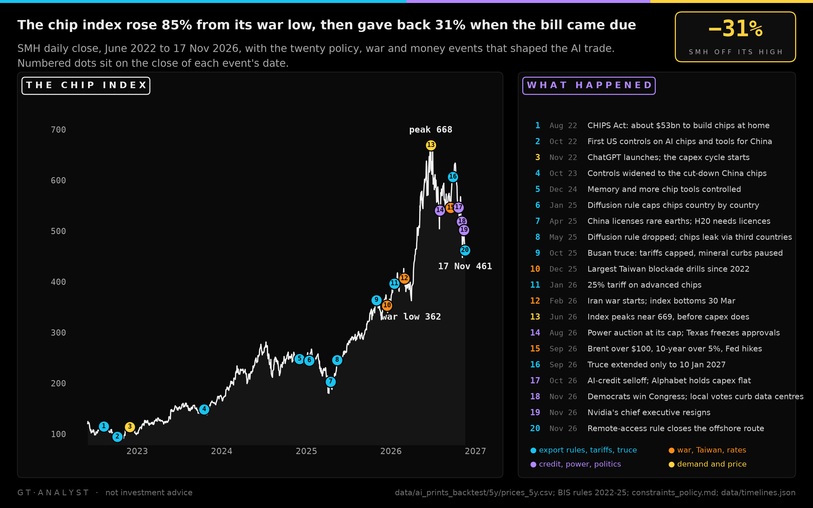
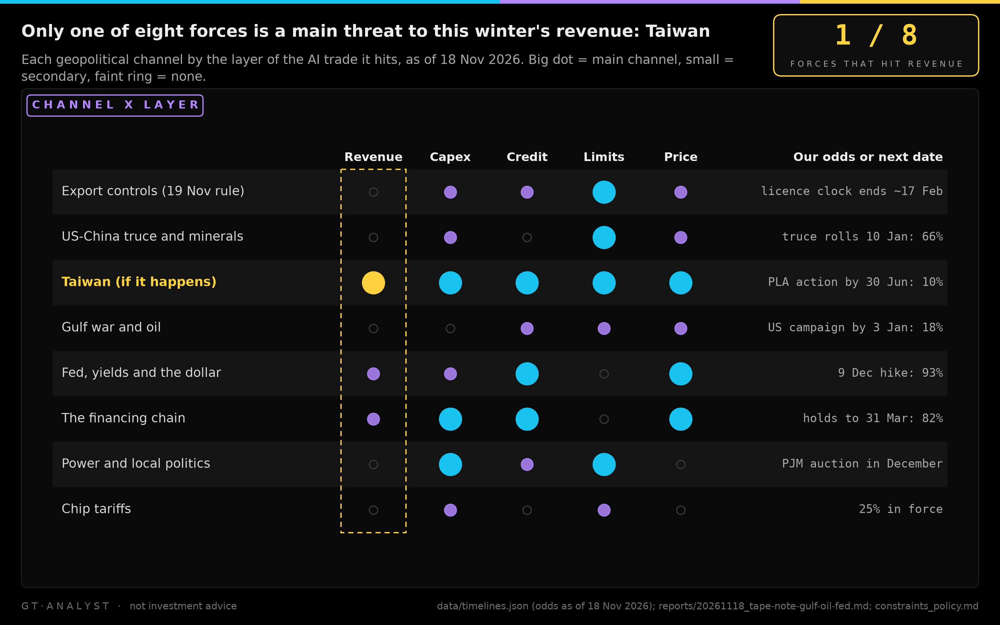
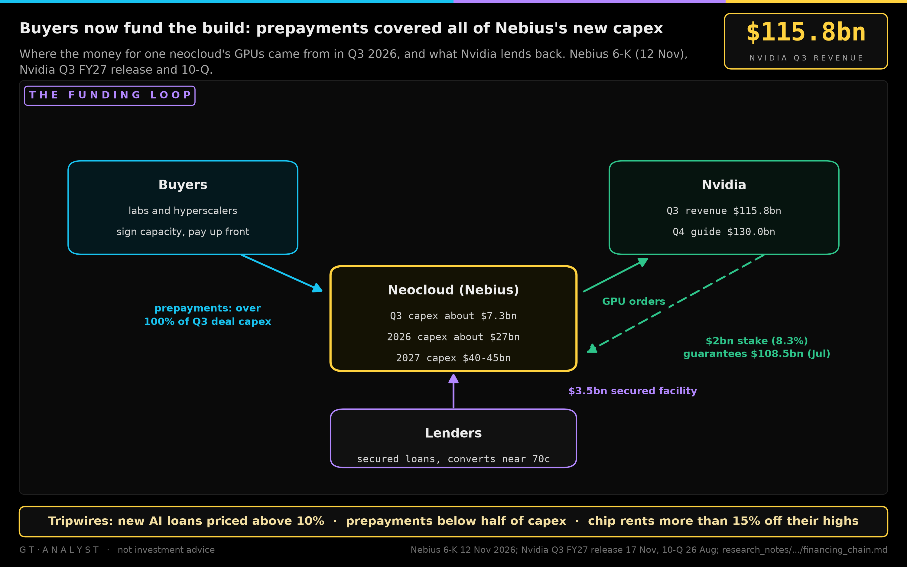
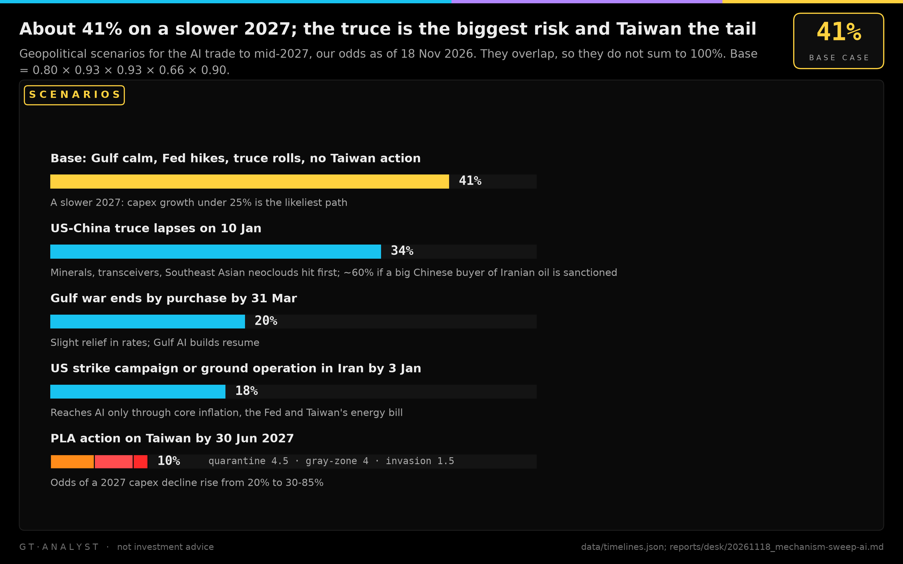
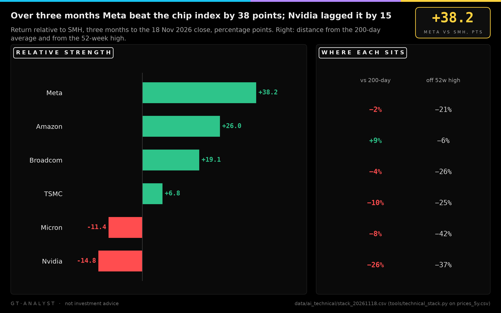
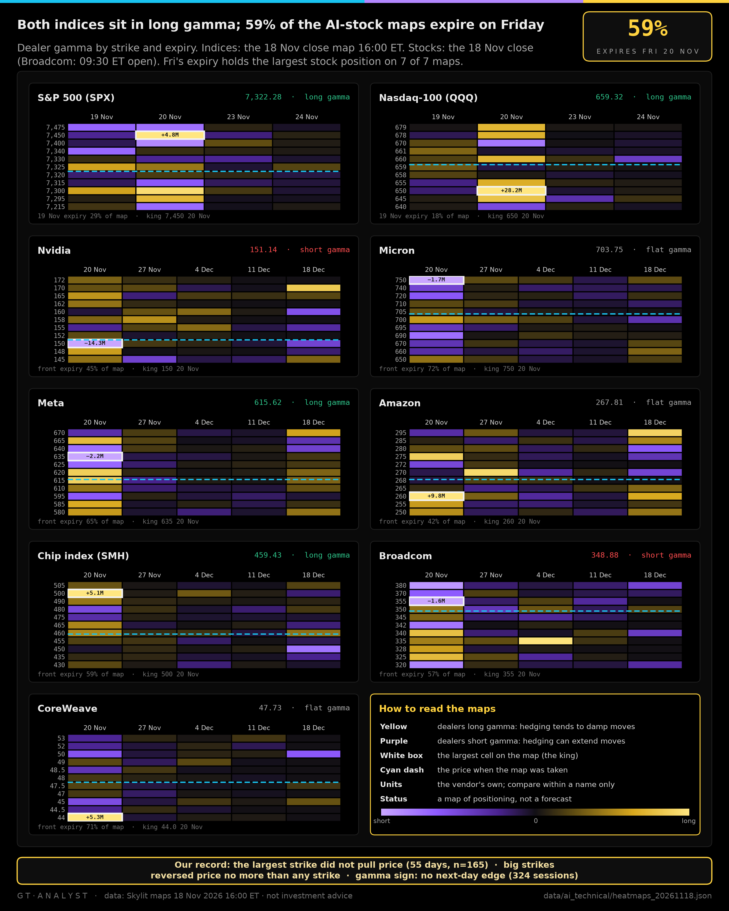
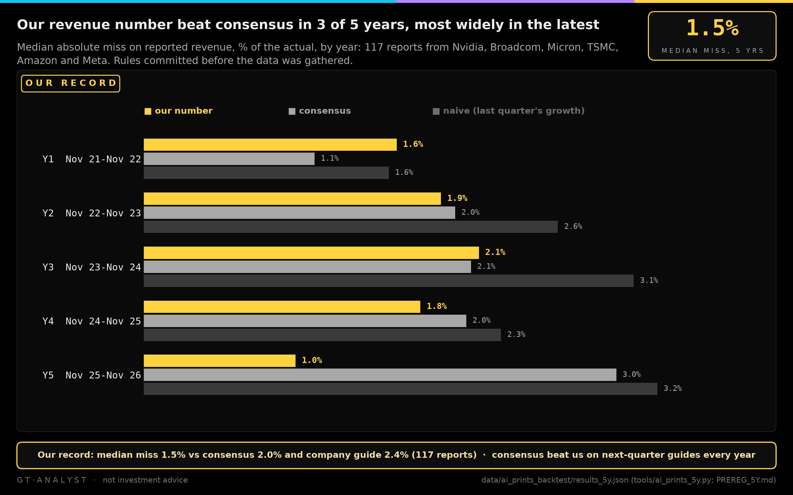
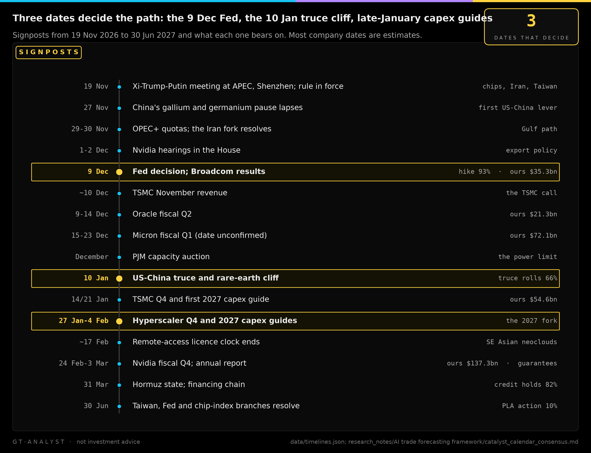

# The Path of the AI Boom

*@alostquant*

**Bottom line:** the AI build isn't running out of buyers. It is running into limits: permits, power, the price of money, and the uneasy peace between Washington and Beijing. Demand at the top is still accelerating, so this winter's revenue reports should mostly land. The danger sits in 2027. It has three ways in: credit for the smaller builders, the US-China truce that expires on 10 January, and a small chance of trouble over Taiwan. Our base case, at about 41%, is a slower 2027, not a broken one.

On 17 November two things happened within hours of each other. Nvidia reported $115.8bn of revenue for a single quarter, nearly twice what it sold in the whole of fiscal 2024. And a new rule from Washington took effect: Chinese firms can no longer rent more than about 750 top-end chips' worth of computing in five Asian countries and Brazil without a licence.

Everyone watched the first story. The second is the kind that now decides the trade.

## Key calls

| Company, quarter | Reports | Company guide | **Our number** | Desk view | Chance it clears its guide |
| --- | --- | --- | --- | --- | --- |
| Broadcom FQ4 2026 | 9 Dec | $34.8bn | **$35.3bn** | about $35.1bn | 94% |
| Oracle FQ2 2027 | 9-14 Dec | $21.2bn | **$21.3bn** | about $21.2bn | 62% |
| Micron FQ1 2027 | 15-23 Dec (unconfirmed) | $61.5bn | **$72.1bn** | about $64.5bn | 88% |
| TSMC Q4 2026 | 14 or 21 Jan | $53.3bn | **$54.6bn** | about $53.5bn | 65% |
| Meta Q4 2026 | about 27 Jan | $74.5bn | **$76.8bn** | $76.8bn | 93% |
| Amazon Q4 2026 | about 4 Feb | $243.5bn | **$248.6bn** | about $248.0bn | 95% |
| Nvidia FQ4 2027 | 24 Feb-3 Mar | $130.0bn | **$137.3bn** | $137.3bn | 90% |

Our number is the company's guidance plus its average beat over its last four reports, fixed on 18 November and scored as it stands. The desk view is where the full analysis lands. These are revenue calls, not share-price calls; the scenario odds later in the report are context. A † marks a figure that rests on secondary sources.

## How we got here: denial, then deals, then the bill

The AI trade has been shaped as much by governments as by engineers. Its history comes in three acts.

**Denial, 2022 to 2024.** Washington cut China off from the best chips in three rounds. First went the chips, then the cut-down versions built to slip under the first rule, then the memory and machines China needed to make its own. At home, the CHIPS Act paid about $53bn to bring chipmaking back. None of this limited demand. It decided who could buy and where the chips went.

**Deals, 2025.** The rules became bargaining chips. A plan to ration chips country by country lasted four months. Gulf states bought their way into the build.† China put its rare earths under licence, and the Busan truce of 30 October traded lower tariffs for a pause in China's mineral curbs. Every gate leaked: one broker alone routed about $12bn of restricted Nvidia chips to Chinese firms by mid-2025.

**The bill, 2026.** The Iran war began on 28 February and the chip index bottomed a month later. It then climbed about 85% to a June peak while spending was still rising. Shares peaked first and spending later, the order of every past boom. In September the war's second round pushed oil above $100 and the 10-year Treasury yield above 5%, and the Fed raised rates. Spending kept climbing anyway. What finally bit was the cost of money:

**war → oil → inflation → Fed hikes → 5% bonds → dearer debt for the builders who borrow**

The October selloff in AI credit, Alphabet holding its spending flat, and the absence of any junk-bond data-centre deal since September are that chain arriving. November then turned politics against the build. Democrats won Congress, voters backed 46 of 47 local measures limiting data centres, and the 16 November rule closed the offshore route to China.

## Where we are: short of permits and credit, not buyers

The striking thing about November is how little of the geopolitics touches this winter's revenue, and how much of it touches 2027. Every force below works through one of three levers: what a data centre costs, when it switches on, and who pays for it. Only one, Taiwan, threatens this winter's revenue directly.

- **Credit looks worse in the headlines than in the contracts.** Insuring CoreWeave's debt costs about 11% a year, but its new secured loans price at 7-7.5%, and Nebius's customers prepaid its new spending in full.
- **The export rule taxes the middlemen.** Any data centre in Indonesia, Malaysia, Singapore, Thailand or Brazil that gives Chinese firms more than about 750 top chips' worth of computing now needs a licence; existing sites have until mid-February. Nvidia's guidance already excludes China, so the cost lands on Southeast Asian chip renters.
- **China's levers sit below the chip.** Its pause on curbs to gallium, germanium and antimony lapses on 27 November, and the rest of the truce runs to 10 January. China also makes about two-thirds of the world's optical transceivers, the parts that link data-centre racks.
- **The truce and Iran are one game.** China buys most of Iran's exported oil. We put a lapse of the truce at 34%, rising to about 60% if Washington first sanctions a big Chinese refiner or bank.
- **Permits are the real supply shock.** The largest US grid auction cleared 6.8 GW short of its target, Texas froze 474 GW of connection requests, and New York has a moratorium. A year's delay costs a builder more than ten points of return; power that costs 50% more costs less than one.
- **The Gulf reaches AI only through the Fed.** The tanker war is frozen and Brent is about $93, but strikes on 2 and 15 November make the weeks to 3 January the riskiest left. We expect the Fed to raise rates on 9 December (93%).
- **Taiwan is the single point of failure.** No shots, but the largest exercise since December 2025. Most of our 10% chance of action by mid-2027 is a quarantine or limited gray-zone fire, not an invasion.

## The money: both companies beat, and only the borrower was punished

Of the three ways into 2027, credit opens first. Two earnings reports, five days apart, show why.

Nebius rents out Nvidia's chips to AI labs. On 12 November it beat forecasts, with revenue up almost sevenfold on a year earlier. It also said it would spend $40-45bn on data centres next year, more than three times the revenue it expects. By the next morning its shares had lost about a fifth.†

Nvidia reported on the 17th. Revenue doubled to $115.8bn, 7% above its own forecast. The shares barely moved.

The difference was not demand. Both companies are selling everything they can deliver. The difference is who pays for the building. Nvidia's customers are among the richest companies on earth. Nebius has to borrow, or persuade its customers to pay up front.

So far the customers are paying. Prepayments covered more than all of Nebius's new spending on its third-quarter deals, which is the most reassuring number in either report. It is also why we watch three tripwires more closely than any earnings beat.

## Nvidia without Huang: a smaller lender, not a smaller order book

Jensen Huang resigned as Nvidia's chief executive on 12 November. Colette Kress, the finance chief, is running the company in the meantime, and the board says it will not bring him back. Nvidia has given no reason; press reports tie the exit to a counter-intelligence inquiry, which we cannot verify.

The exit changes less than the share price suggests. Customers are not buying less. Vera Rubin, the next chip, is shipping, the current-quarter guide is $130bn, and next year's growth outlook went up to about 75%. Our $137.3bn number stands.

What changes is how much of its balance sheet Nvidia will lend. Under Huang it had guaranteed about $108.5bn of customer commitments by July, close to a full quarter of revenue. A successor, least of all an interim chief who is also the finance chief, is unlikely to add to that. The cost falls on the chip renters, which lose their cheapest backstop.

| What changes | What would show it | When |
| --- | --- | --- |
| Lending to customers | Guarantee lines stop growing (35%) | Annual report, late Feb to early Mar |
| Funding for chip renters | More prepayments and secured loans; wider bond spreads | December to March |
| Washington and Beijing | Compliance first; congressional hearings 1-3 Dec | December; new Congress in January |
| Who leads | A permanent chief from the search; GTC on 15-18 Mar is the first without him | By March |

The shares already price a large change: they sit 35% below the October record, at about 11 times forward earnings. If the annual report shows the guarantees still growing, the board has kept Huang's lending policy and the risk to the chip renters falls. If a successor cuts existing commitments, which no one has suggested, the risk moves from Nvidia's revenue to its customers', and our 2027 base case weakens.

## What we see ahead: about 41% on a slower 2027, 10% on the tail that breaks it

In the next twelve months geopolitics is more likely to slow the AI build than to break it.

Our base case, at about 41%, needs four things to hold. The Gulf stays calm. The Fed raises rates on 9 December and does not cut in the first half. The truce rolls past 10 January. And nothing happens over Taiwan.

In that world the likeliest 2027 is slower growth, with capex up less than 25%, at about one in two. Another year above 30% is about one in three; an outright decline, under one in five. The financing chain, meaning no CoreWeave default and Oracle still investment grade, holds through March at about 82%.

**5% bonds and frozen grid queues → dearer, later sites → slower spending growth, not less demand**

**The biggest risk is the truce, and it is tied to Iran.** A lapse on 10 January (34%) would bring China's mineral levers back just as the new export licences bite in mid-February. Both would land on the smaller builders exactly when they most need fresh credit.

**The Gulf matters only through the Fed.** We put a multi-day US strike campaign or a ground operation in Iran before 3 January at 18%. That is high enough to watch and too low to build on, and it has no route into AI revenue except through inflation and rates.

**Taiwan is the tail.** Even limited gray-zone fire would lift the odds of a 2027 capex decline from 20% to about 30%. A quarantine would lift them to about 65%, an invasion to about 85%. TSMC's advanced packaging is the one point that every revenue number in this report passes through.

| Scenario | Odds | It breaks if | First signpost |
| --- | --- | --- | --- |
| Base: a slower 2027 | about 41% | New AI loans price above 10%, or prepayments fall below half of capex | 9 Dec Fed; late-January capex guides |
| Truce lapses 10 Jan | 34% | Rises to about 60% if a big Chinese buyer of Iranian oil is sanctioned | 27 Nov gallium; 10 Jan |
| Gulf war ends by purchase | 20% by 31 Mar | Talks stall past the 3 Jan window | The Qatar track |
| Gulf flare-up | 18% to 3 Jan | Core inflation re-accelerates with oil | Carrier moves; 9 Dec Fed |
| Taiwan action | 10% to 30 Jun 2027 | Drills turn into boarding or turning back ships | December drills |

**The strongest case against us.** Rents for top chips are up about 58% in a year, a large memory maker says it is sold out through 2029, and the leading foundry sees no slowdown. On that evidence 2027 could be another 30%+ year, and our slowdown would be the miss. That is why it is a one-in-two path inside the base case, not a call.

## What the market is pricing: Meta 39 points ahead, Nvidia 35% off its high

Prices move before revenue does, and they have already started to split the trade. At the 17 November close the chip index sat 31% below its June high. Nvidia was the weakest of the group, 35% off its own. Amazon was the only name above its 50-day and 200-day averages. Over three months the market paid for the companies that use AI and for the custom-chip and foundry suppliers, and marked down Nvidia and Micron.

### The positioning map: most of the cushion expires on Friday

Options dealers, the banks on the other side of most options trades, hedge as prices move. When they are long gamma near the price, their hedging leans against moves: they sell into rallies and buy into dips. When they are short gamma, their hedging goes with the move. The next page maps that for the two main US indices and six AI names on the evening of 17 November.

Five things stand out.

**The indices are better cushioned than the stocks.** Dealers are long gamma near the price on both the S&P 500 and the Nasdaq-100. Half of the S&P's map, including its largest position at 7,310, sat in the 18 November expiry, which lapsed at that day's close; the nearest short strike, at 7,350, is just above the price. On the Nasdaq-100 the largest position is long, at 650 on the QQQ in Friday's expiry. It sits 1.5% below the price, with a short strike the same distance above.

**Most of the AI stocks' cushion expires on Friday.** Between 52% and 64% of each stock map sits in the 20 November monthly expiry, and on all six maps the single largest position is there. After Friday the maps thin out, so whatever damping dealers supply today will be much weaker going into the December reports.

**Amazon is the most cushioned, CoreWeave the least.** Amazon's largest position, at $260 just above the price, is long gamma, and the strikes within 5% of the price net to about half the map, all on the long side. CoreWeave is the mirror image: dealers are short gamma right at $50, where it closed. The company most exposed to AI credit is also the one where hedging is most likely to add to a move rather than damp it, in either direction.

**Meta and Micron have short pockets just above the price.** Meta is cushioned just below its price, but its largest position, 2.6% higher at $635, is short gamma. Micron is roughly neutral at its price, with a short pocket at $750, 5% above. Those are the strikes where dealer hedging would switch from leaning against a move to going with it.

**Broadcom's biggest pocket sits just outside what its options price.** Dealers are long gamma at $335-340, around the price, going into the 9 December report, and the options market prices a move of about 8.9% on the day. The largest position on the map, a short strike at $300, is 10.7% below, just beyond that range. The chip index looks similar: cushioned at its price of about $460, with a short pocket just below and its largest long strike 8% above.

A caution that our own testing demands. Over 55 days of intraday index maps, the largest strike did not pull prices toward it. Big strikes reversed price no more often than any other strike. And across 324 sessions, whether dealers were long or short told us nothing about the next day's direction. Single names over weeks have never been tested. Read the maps as a picture of where hedging sits, not as targets; price direction stays a no-call.

Nvidia is left off because its map predates its report, and Oracle and TSMC have no maps in our data. Oracle's options price a move of about 12.6% on its December report.

## The revenue numbers: a 1.5% median miss over five years

We publish revenue calls because revenue is the part of this trade that can be forecast. Across five years and 117 reports from six companies, our number missed by a median 1.5%, against 2.4% for the companies' own guidance and 2.0% for analysts' consensus.

The method has a weak spot: when companies guide down, they clear their own midpoint 74% of the time, against 97% in up-cycles.

Two names lean below this quarter. Micron's beats have shrunk as memory price gains slowed, from about 80% to 40% to an expected 20%, and it was the one company where our rule did worse than the guide. TSMC's October sales came to 34.6% of its quarterly guide, against about 37% in the past two years, so that call is under review until November sales arrive around 10 December.

We keep the misses too. The war-driven price calls we used to make went 1 for 6, which is why we no longer make them, and consensus has beaten us on next-quarter guidance every year.

## Dated signposts to 30 June 2027

- **9 December.** The Fed decides on the day Broadcom reports. We expect a hike (93%); a pause would ease funding for the builders who borrow.
- **10 January.** The truce expires. A lapse brings back China's mineral curbs a month before the export licences bite.
- **Late January.** The big buyers give their first 2027 spending plans. Any of the four guiding below 2026 would raise our odds of a decline.

## Conclusion

The AI build is not short of buyers. It is short of permits, power, cheap money and peace between the two countries that make and mine what it runs on. That is why the next year is more likely to bring a slower build than a broken one. Each of those limits delays sites rather than cancelling demand, and the parts in shortest supply are sold out years ahead.

Two things would change the picture. A truce lapse tied to Iran sanctions would raise the cost of everything below the chip just as the smaller builders need new money. And Taiwan, a 10% tail, is the one event that would break every revenue number at once.

For this winter, expect six of the seven companies to clear their own guidance and two or three to reach our numbers. Micron and TSMC lean below.

This report states direction and mechanism only. It is analysis, not investment advice.

## Sources

Every chart names its data file. Repo data: `data/ai_prints_backtest/`, `data/ai_technical/`, `data/timelines.json`, `research_notes/AI trade forecasting framework/`; charts by `tools/ai_report_charts.py`. The long-form research with every citation is `reports/AI trade forecasting framework.md`.

- Company filings: [Nvidia Q3 FY27 release](https://nvidianews.nvidia.com/news/nvidia-announces-financial-results-for-third-quarter-fiscal-2027); [Nvidia 10-Q, quarter to 26 Jul 2026](https://www.sec.gov/Archives/edgar/data/0001045810/000104581026000075/nvda-20260726.htm); [Nvidia 8-K on the chief executive](https://www.sec.gov/Archives/edgar/data/0001045810/000104581026000082/nvidiaannouncesceotransiti.htm); [Nebius Q3 2026 shareholder letter (6-K)](https://www.sec.gov/Archives/edgar/data/0001513845/000110465926126008/tm2629571d1_ex99-2.htm); [TSMC Q4 2026 guide (6-K)](https://www.sec.gov/Archives/edgar/data/0001046179/000104617926000726/a3q26e_withguidancexfinal.htm); [TSMC October 2026 revenue (6-K)](https://www.sec.gov/Archives/edgar/data/0001046179/000104617926000796/tsm-revenue20261110.htm); [Micron fiscal Q4 prepared remarks](https://s25.q4cdn.com/621799436/files/doc_financials/2026/q4/Q4-FY26-Prepared-Remarks.pdf); [Broadcom Q4 date](https://investors.broadcom.com/news-releases/news-release-details/broadcom-inc-announce-fourth-quarter-and-fiscal-year-2026)
- Wire and trade press: [CNBC, Nvidia results, 17 Nov](https://www.cnbc.com/2026/11/17/nvidia-nvda-earnings-report-q3-2027.html); [CNBC, Nvidia board and export probe, 17 Nov](https://www.cnbc.com/2026/11/17/nvidia-stock-earnings-jensen-huang-resignation.html); [CNBC, AI credit stress, 6 Nov](https://www.cnbc.com/2026/11/06/coreweave-bond-yield-tops-16percent-as-ai-credit-stress-rises.html); [CNBC, AI debt, 17 Nov](https://www.cnbc.com/2026/11/17/apollo-ceo-marc-rowan-on-ai-debt.html); [IFR on AI ratings](https://www.ifre.com/topic-codes/2509450/cds-market-flashes-warning-on-ai-ratings-downgrades); [TrendForce on DRAM](https://www.trendforce.com/news/2026/10/20/news-dram-prices-seen-rising-20-qoq-in-4q26-despite-slower-gains-ai-demand); [TrendForce on the export rule](https://www.trendforce.com/news/2026/11/17/news-u-s-targets-chinas-ai-compute-loophole-tightens-chip-exports-to-malaysia-singapore-and-three-others/)
- Official and academic: [IMF GFSR, Oct 2026, ch. 1](https://www.imf.org/-/media/files/publications/gfsr/2026/october/english/ch1.pdf); [Doms, FRBSF, on telecom capex](https://www.frbsf.org/wp-content/uploads/er19-34bk.pdf); [Greenwood, Shleifer and You, NBER w23191](https://www.nber.org/system/files/working_papers/w23191/w23191.pdf)
- Secondary († in the text): [YieldTheory capex tracker](https://www.yieldtheory.app/research/hyperscaler-capex-2027-forecast); [Blockspace on Nebius](https://blockspace.media/insight/nebius-cuts-2026-revenue-outlook/); [Serrari Group on AI junk bonds](https://serrarigroup.com/ai-data-center-junk-bonds-hit-37bn-as-credit-risks-rise/)
- Geopolitics: US Commerce Department (BIS) export rules of 7 Oct 2022, 17 Oct 2023, 2 Dec 2024 and 13 Jan 2025, and the CHIPS and Science Act (9 Aug 2022), public record; the 2025-2026 record from `research_notes/AI trade forecasting framework/constraints_policy.md` and `research_notes/Stock market geopolitical game/us_china_tech_taiwan.md`.
- Positioning: our own Skylit dealer-gamma maps, 17 Nov 2026 (stocks at the 16:00 ET close, Broadcom at the 09:30 ET open, indices from the 17:30 ET overnight map), via `data/ai_technical/heatmaps_20261117.json` and `data/ai_technical/heatmap_reads_20261117.json`.

---

# APPENDIX: DESK RECORDS (repo copy only)
- 10-page edition (17 Nov PT, user: "all that meat in max 10 pages"; "only predict revenue"; "use the whole game theory engine"). The earlier long version is in git history (commit a1ac697).
- Engine pass with players, game structure, formal checklist, conviction tables and red-team gates per company: reports/desk/20261118_engine-read-revenue.md. Desk views are views; the registered numbers (data/ai_prints_backtest/forward_20261118.json) are unchanged.
- Revenue ledger rows: #136-#142 (range calls) and #124, #127, #132 (thresholds). Guide, capex, credit and SMH rows (#123, #125, #126, #128-#131, #133-#135, #143-#154) are no longer published but stay open and are scored honestly.
- 5-year backtest: reports/backtests/20261118_ai-prints-5y-backtest.md.

- **Revision, 17 Nov PT (user: "a full breakdown of where we are, how we got here geopolitically and what the engine sees for the future of the AI trade"; "only like 2 pages of it should be this revenue stuff").** Added three sections (how we got here, where we are now, what we see ahead) with four new charts; the revenue material is now the key-calls table and one section with the backtest chart (about 2 of 13 pages). Scenario odds are timeline-map conditionals, not ledger calls: base 0.85 x 0.93 x 0.93 x 0.66 x 0.90 = 0.44 (across lanes assumed independent); truce lapse 1 - 0.66; Gulf flare-up 0.10 by 30 Nov, 0.45 x 0.28 = 0.126 by 31 Dec; strait reopening 1 - 0.78; Taiwan `taiwan-h1-2027` 0.10. Map change: `taiwan-watch` and `taiwan-h1-2027` had no shift edges into the AI lane (a wiring gap under the time-lane rule); added edges to `ai-winter` 0.55, `ai-h1-second-leg` 0.70 and `nvda-dc-band` 0.30. No node probability changed. Research brief: shared notes `ai_geopolitics_brief.md`. Repo gap: the 2022-2024 export rounds and the Jan 2025 diffusion rule were not in the repo; dated from the public BIS record. Exports: 13 pages, 7 pictures.

- **Revision 2, 17 Nov PT (user: build a full engine from the Substack archive, then rewrite the report as clearly as those posts; the writers are for learning only).** Engine: `.claude/skills/mechanism-library/SKILL.md` (35 rules, 23 ADOPT, 12 SHADOW; provenance in `PROVENANCE.md`) and `.claude/skills/report-writing/SKILL.md` (14 techniques). Sweep: `reports/desk/20261118_mechanism-sweep-ai.md`. The report now uses the sweep's reads, all PROPOSED for the map and not yet applied: base 0.80 x 0.93 x 0.93 x 0.66 x 0.90 = 0.41 (Gulf frozen 0.85 -> 0.80, P7); truce lapse 60%/31% with/without a Chinese-buyer designation, total 34% (P5); Gulf flare-up to 3 Jan 18%, ends by purchase 20% (P7); Taiwan 10% split 4.5/4/1.5 with capex-decline impacts 65/30/85% (P6); financing chain 82% (P1); 2027 slowdown about one in two with the hike edge plus permitting (P3); Nvidia support lines flat or lower 35% (P2). No writer is named, quoted or imitated in the body.

- **Revision 3, 18 Nov PT (user: "get rid of any non important information").** Cut the history-laws section and its chart, the five-test builder table, the Nvidia/Nebius detail paragraph, the price-context and watch-list paragraphs (the signposts chart carries the dates) and two filler lines; the where-we-are list cut to eight short bullets. No numbers changed. 12 pages, 6 visuals. Older wording is in git (commit e1c8cc9).

- **Revision 4, 18 Nov PT (user: add the technical layer, powered by our heatmaps and Skylit data).** New section "Where the stocks sit": relative-strength chart and a positioning table from `data/ai_technical/levels_20261118.csv` (Skylit dealer-gamma maps at the 17 Nov 16:00 ET close; AVGO 09:30 map; no maps for ORCL or TSM; NVDA map predates its report) and `data/ai_technical/stack_20261118.csv` (`tools/technical_stack.py`). No Unusual Whales data. Walls are approximations (largest positive dealer-gamma strike below/above spot). Measured record stated in the body: largest-strike pin null (55 days), big-strike reversal 70-73% vs 72-76% any strike, lockbox 0/9, gamma sign no next-day separation (324 sessions), vanna 12/42 vs 12.6 chance; single names over weeks untested. Micron's report date now 15-23 Dec (unconfirmed; a screener shows 23 Dec). Skill: `.claude/skills/technical-stack/`.

- **Revision 5, 18 Nov PT (user: I want to see the heatmaps).** Added three dealer-gamma heatmap widgets (MU+META, AMZN+SMH, CRWV+AVGO; NVDA held out as event-stale) from `data/ai_technical/heatmaps_20261117.json` (`tools/heatmap_extract.py`, Skylit 17 Nov maps only). Earlier: section "Where the stocks sit": relative-strength chart and a positioning table from `data/ai_technical/levels_20261118.csv` (Skylit dealer-gamma maps at the 17 Nov 16:00 ET close; AVGO 09:30 map; no maps for ORCL or TSM; NVDA map predates its report) and `data/ai_technical/stack_20261118.csv` (`tools/technical_stack.py`). No Unusual Whales data. Walls are approximations (largest positive dealer-gamma strike below/above spot). Measured record stated in the body: largest-strike pin null (55 days), big-strike reversal 70-73% vs 72-76% any strike, lockbox 0/9, gamma sign no next-day separation (324 sessions), vanna 12/42 vs 12.6 chance; single names over weeks untested. Micron's report date now 15-23 Dec (unconfirmed; a screener shows 23 Dec). Skill: `.claude/skills/technical-stack/`.

- **Revision 6, 18 Nov PT (user: rebuild the charts in the dark house style with our own flair; more depth on the heatmaps; condense; heatmaps all on one page, major indices included; the prose must read like a professional long-form writer).** All ten Claude widgets replaced by eight house-style PNGs from `tools/ai_report_charts.py` (signal stripe, headline badge, mono numerals added to `tools/market_update/chartstyle.py`). The three heatmap widgets became one page: S&P 500 (SPXW) and Nasdaq-100 (QQQ) from the 17 Nov 17:30 ET overnight map plus MU, META, AMZN, SMH, AVGO, CRWV from the 17 Nov close (AVGO 09:30); per-name reads in `data/ai_technical/heatmap_reads_20261117.json` (front-expiry share, net gamma within 2% and 5%, largest cell, largest long rows above/below, largest short row). Cut the Nvidia-Nebius table, the Huang table to four rows, and the positioning table (the RS chart and the board carry it). Corrections: the chip-index rise from the war low is 85% on closes (was 87%); the revenue chart title now says consensus was beaten in 3 of 5 years (the old widget said 'the last 4'; Y3 was 2.12% vs 2.07%); channel odds updated to the applied map (Gulf frozen 80%, financing 82%). No probability changed. Writing: `.claude/skills/report-writing/SKILL.md` gains Part B (prose craft) and a self-edit pass. Exports: 15 pages, 8 pictures; the board sits alone on page 9.
- **Revision 7, 18 Nov PT (user: reorganize for flow; header shows only the title and @alostquant).** New order: key calls, how we got here, where we are, the money (was 'Start here', now opens 'Of the three ways into 2027, credit opens first'), Nvidia without Huang, what we see ahead, what the market is pricing (with the positioning map), the revenue record, signposts, conclusion. Title 'The Path of the AI Boom' (tab renamed; the doc's own title in the claude.ai gallery can only be renamed by hand on the web), byline @alostquant, date chip and name removed. No numbers changed. 15 pages, 8 pictures; the board alone on page 11.
