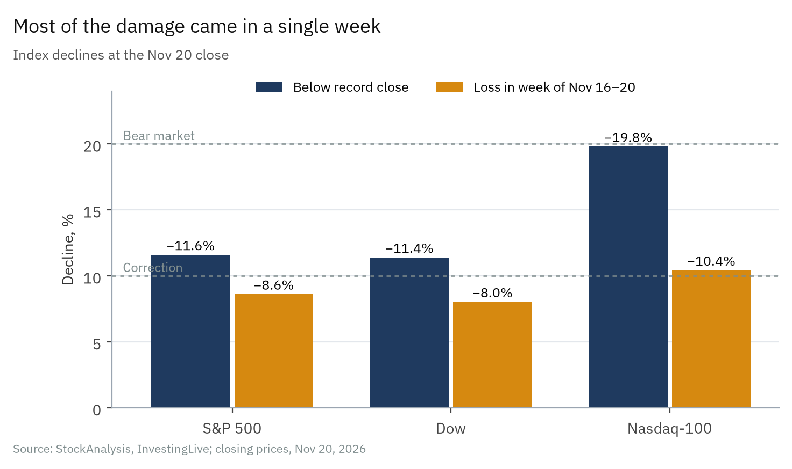
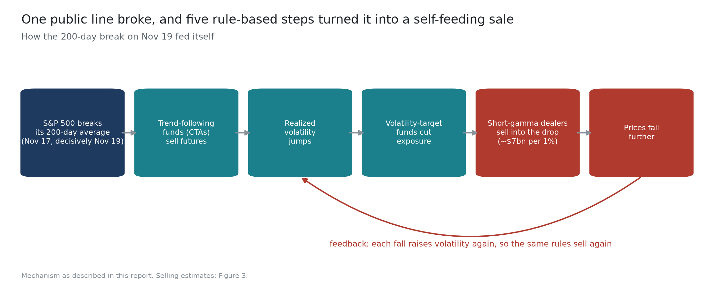
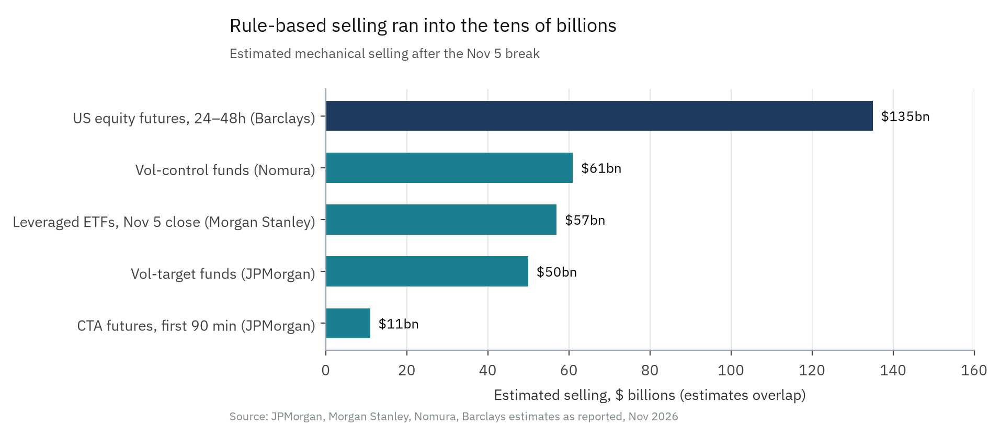
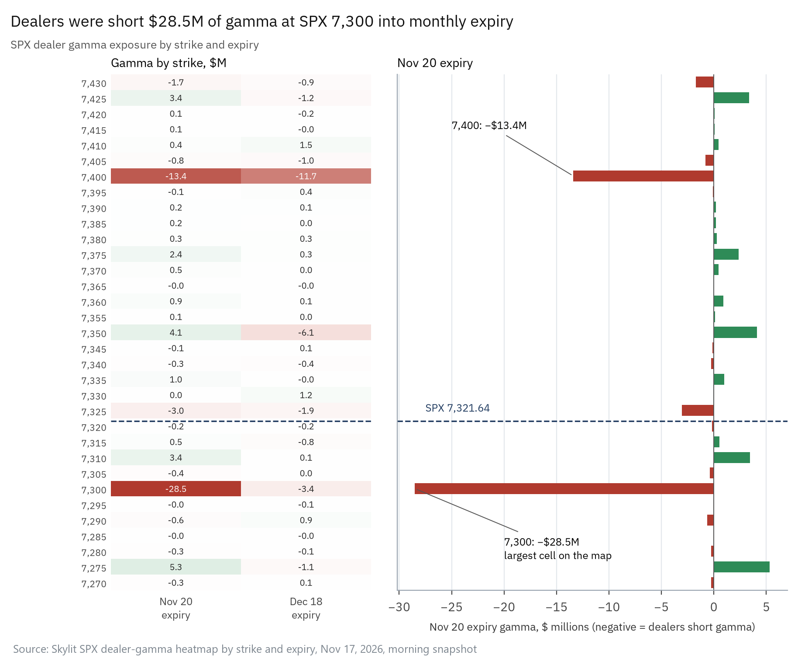
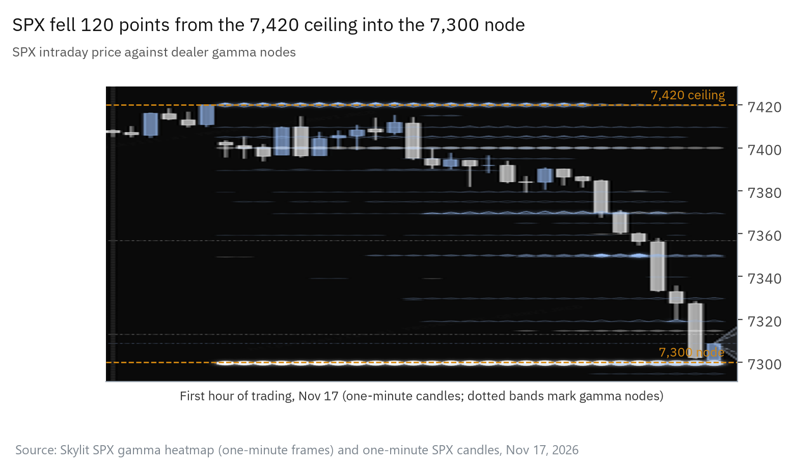
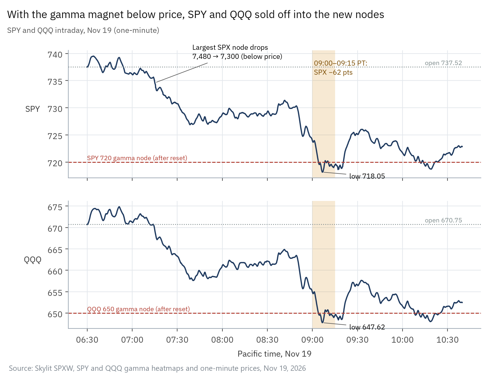
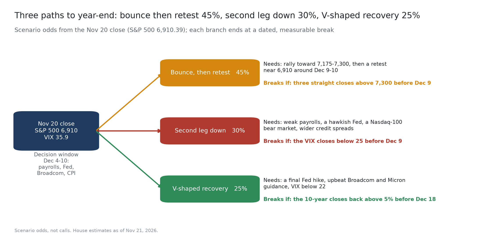
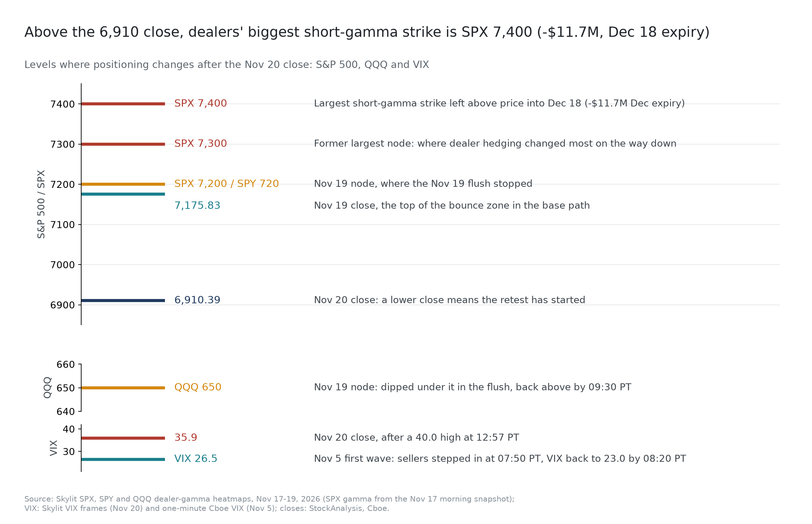
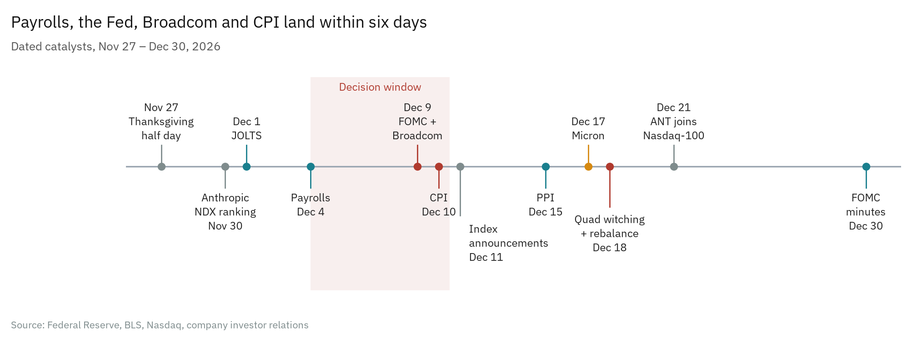

# The S&P 500 Lost 8.6% in Five Sessions. The Fuel Took All Year.

*Headlines picked the day. Leverage, rule-based selling and dealer hedging decided the depth.*

Published Nov 21, 2026 · US equities, rates and volatility · Market analysis, not investment advice.

We expect the Fed to raise rates on Dec 9, and put the odds at 85%. On the index itself we make no call. The likeliest path is a relief bounce and then a retest of Friday's 6,910 close, at 45%. It all turns in one six-day window, Dec 4-10, when payrolls, the Fed, Broadcom and CPI land.

## Key calls

| Call | Odds | Resolves | What flips it |
|---|---|---|---|
| The Fed raises rates on Dec 9 | 85% | Dec 9 | November payrolls below 50,000 on Dec 4 |

Index and volatility paths below are scenario odds, not calls. We don't forecast price direction.

| Market path | Odds | By | What changes it |
|---|---|---|---|
| S&P 500 closes below 6,910.39 | 60% | Dec 31 | Three straight closes above 7,300 before Dec 9 |
| S&P 500 closes above 7,300 on any day | 30% | Dec 18 | A Dec 9 signal that this is the Fed's last hike |
| Nasdaq-100 closes 20% or more below its record | 50% | Dec 31 | Broadcom raises guidance on Dec 9 |
| VIX closes below 25 | 40% | Dec 18 | The 10-year yield closing back above 5% |

## No company reported on Nov 5, yet $3.7trn of stock value vanished

On Nov 5 not one company in the selloff reported results. By the close, $3.7trn of US stock value was gone. The Nasdaq-100 alone lost a record $2.3trn in the session. The news hadn't changed what these firms earn. It changed who had to sell.

Two weeks later the selling finished the job. Friday's 3.7% drop left the S&P 500 at 6,910.39, down seven sessions in a row, its worst week since April 2025.

The Nasdaq-100 took the bigger hit, its largest weekly loss since March 2020, and it briefly crossed the bear-market line on Friday.

Chips did most of the damage. The Philadelphia semiconductor index fell 10.7% on Friday. Nvidia dropped 14% on a reported SEC review of its accounting, and Micron, AMD and Broadcom each lost more than 12%.

The VIX, the market's gauge of expected volatility, touched 40 late on Friday and settled at 35.9. Treasuries caught the safety bid, and the 10-year yield fell to 4.94% from 5.05%.

*Figure 1.*

So the question isn't what the news was. It's why the market was built to fall this far on it.

## Four shocks in 18 days set the timing

Each shock landed on a date the market could see coming, or close to it.

- **The midterms, Nov 3.** Democrats won both chambers, raising the risk of slower approvals for new data centers. Two days later the S&P 500 fell 4.4%.
- **Nvidia's leadership crisis.** A personal scandal, a board probe into possible espionage and Jensen Huang's resignation erased about $1.4trn of market value.
- **Hot inflation.** October CPI rose 0.4%, above forecast. Fed Governor Waller then said a 50 basis-point hike should be considered in December.
- **The Anthropic IPO, Nov 19.** The largest listing ever priced at $83, traded above $115, then reversed and dragged the AI trade lower. We read it only as a gauge of appetite for AI risk. We make no call on the stock, since this analysis is built with Anthropic's own model.

The headlines decided when the market broke. Its structure decided how far it fell.

## Six preconditions turned a dip into an 11.6% fall

### 1. A narrow index hid a bear market underneath

On election day the S&P 500 sat within about 3% of its record. Underneath, Goldman Sachs trading data show 60% of its members were already in bear markets.

The Magnificent Seven had shed $4trn since mid-October while defensive sectors held the index up. When the leaders broke, there was nothing left to rotate into. Index funds made it worse, because they trade by weight, not by value.

### 2. Leverage peaked at $1.44trn and started to unwind

Margin debt was $1.44trn in October, $54bn below June's record, so deleveraging had already begun. Leveraged ETFs have to rebalance into every close. They buy after up days and sell after down days.

On Nov 5 alone those funds sold about $57bn of US stock, the most in records back to 2007. Long/short hedge funds had already cut gross exposure by 7.8% in October, the sharpest cut since 2016.

### 3. Rule-based sellers shared the same public triggers

The S&P 500 slipped under its 200-day moving average on Nov 17 and broke it decisively on Nov 19. That flipped trend-following funds (CTAs) from buyers to sellers.

Volatility-target funds hold less stock when prices swing more, so they cut exposure as realized volatility jumped. Every link in that chain follows a rule, not a judgment. So the selling feeds itself.

*Figure 2.*

Published estimates of that selling overlap, so they shouldn't be added up.

*Figure 3.*

### 4. Dealers were short gamma right where the market traded

Options dealers, the banks on the other side of most options trades, hedge as prices move. When they're short gamma, they have to sell into declines and buy into rallies, which makes both moves bigger.

Positioning showed heavy short gamma at SPX 7,400 and 7,300, mostly in contracts expiring Nov 20. Nomura estimates dealer selling near $7bn for every 1% drop. VIX call buying had also reached summer-2024 levels by mid-October, which primed volatility to overshoot.

### 5. The Fed was tightening into the decline

The Fed hiked in September, paused in October and then got a hot inflation print. Prediction markets price a quarter-point hike on Dec 9 at 90%. The 10-year yield reached 5.15% in the week of Nov 13.

In most past drawdowns, buyers stepped in expecting rate cuts. This time the central bank was hiking.

### 6. The AI bill came due before the payoff

The four largest cloud spenders generated just $26bn of free cash flow as capital spending outran revenue. Amazon's long-term debt rose from $66bn to $173bn in nine months, about 2.6 times.

CoreWeave trades 71% below its high, and Anthropic's revenue growth slowed to 47% from 144%. High-yield credit flashed early. The spread on B and CCC bonds reached 8%, a level seen fewer than five times since 1996.

Any one of these could have been absorbed. Together, every seller met another seller.

## The case against us: tech trades at 16.9 times earnings, about half last year's level

This could be a washout rather than a lasting top. Tech trades at 16.9 times forward earnings, down from about 31 a year ago. Hedge-fund net leverage sits in the bottom tenth of its 16-year range, so forced sellers may be mostly done.

The forced selling may also be fading. JPMorgan estimates leveraged-ETF short gamma has eased to about $6.5bn per 1% move since the first wave.

If the Fed hikes on Dec 9 but signals it's done, a sharp rally is plausible. That's why we give a close above 7,300 a real 30% chance, and why we don't call the index's direction.

## Dealers were short $28.5M of gamma at SPX 7,300 into Friday's expiry

The map shows where dealer hedging changes, from our Skylit options data. On ordinary days the largest node alone hasn't pulled price toward it: price closed nearer to it than to a mirror level only 46.7% of the time, across 165 sessions of 0DTE SPXW. Trend days are different, and Nov 19 and 20 show how.

On the morning of Nov 17, dealers were most short gamma at the 7,300 strike, all of it in contracts expiring Nov 20. The 7,400 strike came next, split between November and December.

*Figure 4.*

In the first hour on Nov 17, price walked down the map from the top node into that 7,300 strike. Later that morning SPY found temporary support near 727. The day before, SPY had held its 738 node, and QQQ 660 was the level the rest of the tape pivoted on.

*Figure 5.*

On Nov 19 the largest SPX node moved below price by 07:15 PT, and the morning sold off toward it. After the 09:00 PT flush the largest nodes reset to SPY 720 and QQQ 650. QQQ dipped under 650 and was back above it by 09:30 PT.

*Figure 6.*

The S&P 500 closed Nov 19 at 7,175.83, on the positive nodes that had built at 7,190 and 7,200 that afternoon.

### On both trend days, SPXW nodes lit up below price before each leg down

Each time, a node appeared below price while negative nodes sat above it. The index then traded down to the new node later the same session. It happened six times in two days, the last one into the final minutes.

| Lit up (PT) | Node lit below price (SPXW 0DTE) | SPX then | Where price went |
|---|---|---|---|
| Nov 19, 07:30 | +7,250 (+$4.8M, +$12.6M by 09:00) | 7,323 | 7,254 by 09:00 |
| Nov 19, 09:00 | +7,190 and +7,200 (+$5M, +$40M by 12:45) | 7,254 | Closed 7,175.83 |
| Nov 20, 07:30 | +7,060 (+$4.2M) | 7,120 | 7,042 by 08:45 |
| Nov 20, 09:30 | +6,975 and +6,950 (+$10.8M, +$8.7M) | 7,021 | 6,961 by 11:30 |
| Nov 20, 11:45 | +6,925 (+$15.1M, +$52.8M at the close) | 6,977 | 6,914 on the map at the close |
| Nov 20, 11:51 | -6,885 (-$3.0M, -$99.8M by 12:58) | 6,970 | Tagged: low 6,886.14 at 12:56 |

*Data: Skylit SPXW 0DTE gamma-heatmap frames, Nov 19-20, 2026, sampled every 15 minutes; node size in $M of dealer gamma.*

The last one was the sharpest. A negative node at 6,885 lit up at 11:51 PT and grew to -$99.8M. SPX tagged it at 12:56 PT, then closed at 6,910.39, between it and the +$52.8M node at 6,925.

The first wave showed up in the flow too. On Nov 5, whales bought puts all the way down. Within the hour put sellers arrived and short covering began, a classic intraday capitulation.

Skylit's flow tide shows the same day in totals. Net options premium on SPXW slid all session, from -$27M at 07:00 PT to -$958M at the close, and QQQ ended at -$527M. The VIX told the same story: it jumped to 26.5 by 07:50 PT, sellers knocked it back to 23.0 within half an hour, and it set the day's 28.4 high at 13:06 PT.

Leveraged ETFs rebalance into the close, so down days end with concentrated forced selling. That fits the late VIX spike to 40 on Nov 20.

On trend days like these, the map showed where each leg was heading before price got there. That's the read to watch on the next one.

## A run with visible exits: levered holders need 75% confidence to stay

Leveraged holders, rule-based funds, dealers and the Fed all shaped this, but holders drove the run. Their choice is a stag hunt. Everyone does best if all hold, and a lone holder takes the worst loss.

A two-player version of that choice has two stable outcomes: all hold or all sell. A holder stays only when confident that enough of the others will stay too.

| Lone holder's position | Confidence needed to keep holding |
|---|---|
| Unlevered | 50% |
| Levered, with margin-call risk | 75% |

Leverage raises the bar to 75%, because a margin call turns a bad outcome into a forced one. Public signals then coordinate the exit: a 200-day break, a visible options strike, a known expiry date. Each tells every player that others will sell, which is why the decline clustered at named levels and dates.

The Fed has tied its credibility to delivering hikes, so it can't also promise a rescue. Had inflation cooled, the same shocks would likely have produced a dip, not a correction. Dealers simply follow the sign of their gamma, and that pressure ended when the Nov 20 contracts expired.

That's why the exits to watch next are dated ones.

## What's next: a bounce and then a retest is the likeliest path, at 45%

Monthly expiry cleared the 7,300 node, and a VIX near 36 sets up short covering. But payrolls, the Fed, Broadcom and CPI all land between Dec 4 and Dec 10. With leverage still unwinding, the odds favor a lower close before year-end, at 60%.

*Figure 7.*

### What a recovery needs

- **Rates stop rising.** The 10-year holds under 5% and the Fed frames Dec 9 as its last hike.
- **AI leaders stop making new lows.** Broadcom's guidance on Dec 9 is the first real test for the chip complex.
- **Index demand absorbs new supply.** Passive buying around Anthropic's expected Dec 21 Nasdaq-100 entry clears without broad selling.
- **Positioning rebuilds below price.** Positive dealer gamma near SPY 720 and QQQ 650 would mean dealers buy dips there instead of selling them.

### What makes it worse

- A hot November CPI on Dec 10, which would revive talk of a 50 basis-point hike in January.
- Deeper deleveraging in FINRA's November margin data, due in December.
- Credit stress, most likely first in heavily indebted data-center borrowers and the B-CCC spread.
- Policy shocks: state data-center pauses, new chip export rules or geopolitical escalation.

Every one of these lands inside the dated window below.

## Above the 6,910 close, short gamma sits at SPX 7,300 and 7,400

*Figure 8.*

## Dated catalysts: four of them land within six days

*Figure 9.*

- **Nov 26-27: Thanksgiving closure and half day.** Thin liquidity can exaggerate moves either way.
- **Nov 30: Anthropic's ranking day for fast Nasdaq-100 entry.** Inclusion confirms the passive buying due around Dec 21.
- **Dec 1 and Dec 4: JOLTS, then November payrolls.** Payrolls below 50,000 would flip our Fed call and lift the V-shaped path.
- **Dec 8-9: FOMC with new projections.** We expect a hike (85%). A signal that it's the last one would raise the odds of a close above 7,300.
- **Dec 9, after the close: Broadcom earnings.** Raised guidance would cut the odds of a Nasdaq-100 bear-market close.
- **Dec 10: November CPI.** A hot print would revive talk of a 50 basis-point January hike and lift the second-leg path.
- **Dec 11 and Dec 15: index announcements on Anthropic, then November PPI.**
- **Dec 17: Micron earnings.** A direct read on AI memory demand. Upbeat guidance supports the V-shaped path.
- **Dec 18: quarterly expiry and index rebalance.** The 7,400 strike's December gamma rolls off.
- **Dec 21 and Dec 30: Anthropic's expected Nasdaq-100 debut, then the December FOMC minutes.** The debut tests whether index demand absorbs new supply.

## The fuel isn't spent until the Dec 4-10 window clears

The headlines have done their work. The fuel hasn't burned off. Leverage is still unwinding, the Fed is still hiking, and the next dated exits sit inside one week in December.

We expect a Dec 9 hike. On the index we make no call, and by Dec 10 we'll know which path we're on.

## Notes and sources

- Index levels and closing data: AP, CNBC, StockAnalysis and InvestingLive, Nov 20-21, 2026.
- Volatility: Cboe, Nov 20, 2026.
- Nvidia SEC review: Reuters, as reported by CNBC and AP, Nov 20, 2026.
- Breadth, quant flows and AI spending: Briefs, Oct 18, Nov 3 and Nov 6, 2026; iShares, Nov 2026.
- Margin debt: FINRA data, Nov 2026.
- Flow estimates: JPMorgan, Morgan Stanley, Nomura, Barclays and Bank of America, as reported Oct-Nov 2026.
- Fed outlook: CNBC, Nov 10, 2026; Kalshi, Nov 21, 2026.
- Calendar: Federal Reserve FOMC calendar; BLS release schedule; Broadcom and Micron investor relations; StockAnalysis on Nasdaq-100 inclusion.
- Dealer gamma and intraday positioning: Skylit options-positioning heatmaps (SPX, SPXW, SPY, QQQ), Nov 17-20, 2026. Options flow: Skylit flow tide (SPY, QQQ, SPXW) and whale flow, Nov 5, 2026. VIX: Skylit VIX frames (Nov 20) and one-minute Cboe VIX (Nov 5). Largest-node record: our 0DTE SPXW records, 165 sessions.
