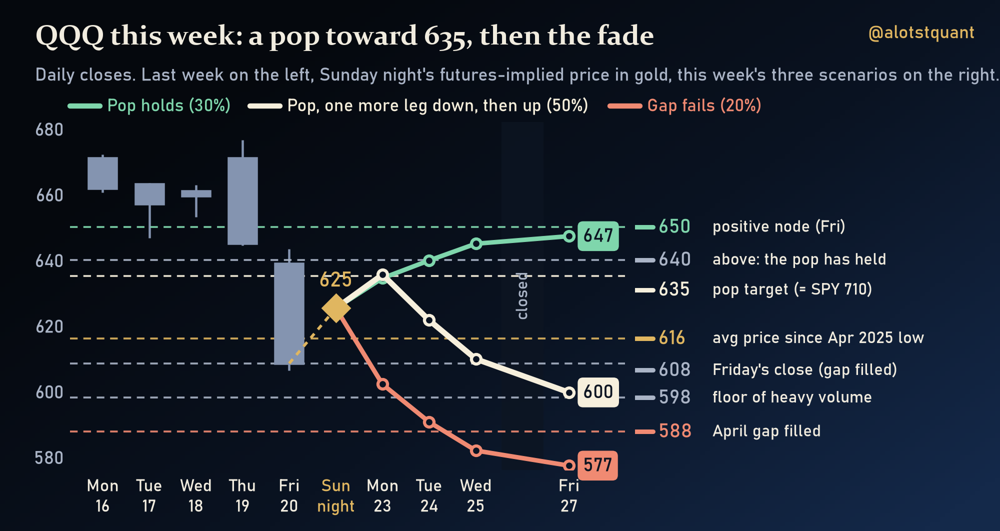
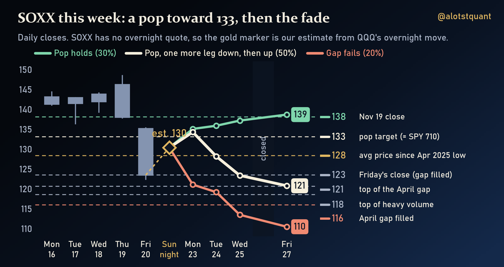
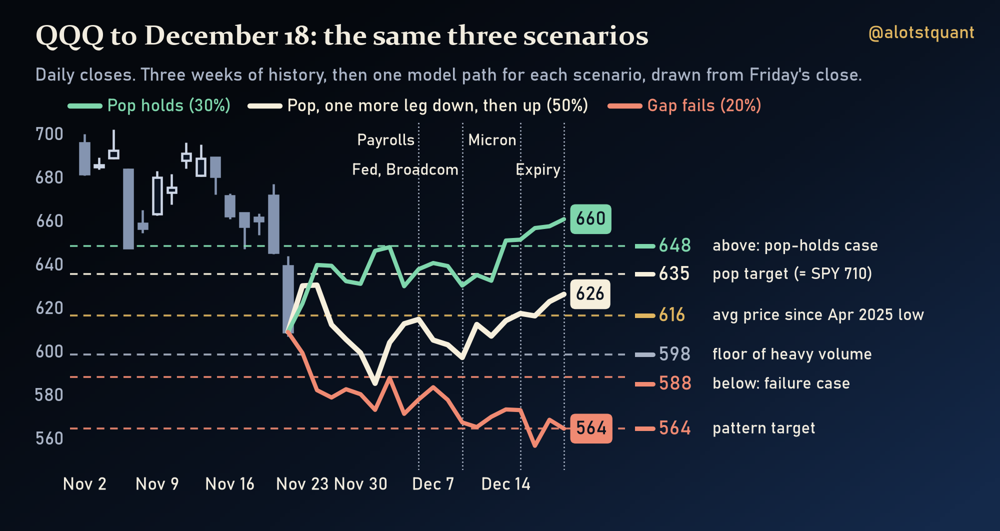
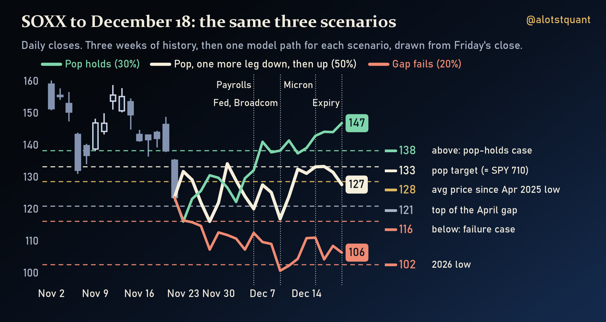

# So the Market Crashed. What's Next

*QQQ and SOXX for the week of November 23-27, with the view into the December 18 expiry*

@alostquant  ·  November 22, 2026, 3:40 PM PT. Market analysis, not investment advice.

Futures are higher tonight. QQQ is indicated near 625 against Friday's 608.45 close, about 2.8% up, and SPY near 700. We think the gap fades before it holds. After drops the size of Friday's, a gap up has filled the same day 72% of the time. Our base case is a pop that carries to SPY 710, which lines up with QQQ 635 and SOXX 133, then one more leg down that takes QQQ back under Friday's close to about 600 by the end of the week, and a turn back up the week of November 30. We put that at about 50%, with 30% on the pop holding and 20% on the gap failing outright. The same odds apply to all three.

| Scenario | Odds | QQQ this week | SOXX this week |
|---|---|---|---|
| Pop to SPY 710, one more leg down, then up | 50% | Opens near 625 and extends to 635 on Monday, which lines up with SPY 710. Rolls over, back under 616, and closes Friday near 600. Confirmed by a rejection at 635 and a close back under 616; wrong on a close above 640 or below 587.7. | Opens near 130 and extends to 133. Rolls over, back under 128.3, and closes Friday near 121. Confirmed by a rejection at 133-135 and a close back under 128.3; wrong on a close above 135 or below 115.9. |
| Pop holds | 30% | Reaches 635 and keeps it, then 640, 645 and about 647 by Friday. Confirmed by a close above 640; wrong on a close back under 616. | Reaches 133 and keeps it, then about 139. Confirmed by a close above 135; wrong on a close back under 128.3. |
| Gap fails | 20% | Closes under 605 on Monday, trades 590-594, then goes through the April gap at 587.7. Confirmed by a close below 587.7; wrong on a close back above 616. | Back under 120.6, then through its April gap at 115.9. Confirmed by a close below 115.9; wrong on a close back above 128.3. |

## Overnight

At 3:40 PM PT, S&P futures were 7,019.5 and Nasdaq futures 25,678.5, which works out to roughly SPY 699.8 and QQQ 625.2. The dealer maps we are working from are Friday's close. Nothing new prints overnight, so the first maps on Monday can change what follows.

A 625 open puts QQQ back above its volume-weighted average price from the April 2025 low, 616.1, which Friday closed under. It also puts it at the top of the range where most of the volume since that low has traded, 598 to 626, with 608 the busiest price. Above 630 very little has traded until 690.

Monday's two large nodes are the King node at 605 (-$10.7M) and 590 (-$5.7M). Both are negative and both would sit below the open, with no large Monday node above until the positive vanna nodes at 635 and 650. Negative nodes add to whatever move runs through them, so a fade that reaches 605 is likely to speed up there. While price stays above it, the map offers little resistance.

We expect the pop to run further than the open. SPY's largest positive node on Monday is 710, which is also Monday's vanna King, and a negative node sits right above it at 711. SPY 710 is 2.9% above Friday's close, about SPX 7,113. At QQQ's recent beta to SPY of 1.5 that is QQQ 635, which is Monday's positive vanna node and about NDX 26,120. For SOXX it works out to 133, next to a pattern target at 132.9. In past cases like this the two-day high ran a median 4.6% above the prior close for SPY and 5.0% for QQQ, so 710 and 635 are inside the usual reach.

## QQQ this week

Exposure sits lower early in the week and higher late. The exposure-weighted centre of each day's expiry is 613 on Monday, 607 on Tuesday, 620 on Wednesday and 634 on Friday. Friday's King node is 665, negative, with a positive node at 650 beneath it, and we treat that pair as the ceiling for the week.

| Day | Centre | Largest nodes | Closes: base / pop holds / gap fails |
|---|---|---|---|
| Mon 23 | 613 | King 605 (-$10.7M), 590 (-$5.7M). HPE reports after the close. | 636 / 634 / 602 |
| Tue 24 | 607 | King 570 (+$3.1M), 600 (+), 610 (-), 648 (+). Dell reports after the close. | 622 / 640 / 591 |
| Wed 25 | 620 | King 565 (-$1.4M), small positive nodes at 620, 640 and 645. | 610 / 645 / 582 |
| Fri 27 | 634 | King 665 (-$3.1M), 650 (+$2.5M), 595 (+). Half day, closing at 10:00 AM PT. | 600 / 647 / 577 |

*Figure 1. QQQ, week of November 23. Grey candles are last week. The gold marker is where futures put QQQ on Sunday night. Each line is one scenario's daily closes, and the dashed lines are the levels named in the text.*

*Skylit QQQ and NDXP dealer gamma maps, Friday November 20 close; our futures feed, 3:40 PM PT November 22; Yahoo Finance.*

## SOXX this week

*Figure 2. SOXX, week of November 23, read the same way. The hollow gold marker is our estimate of the open.*

*Yahoo Finance; Skylit SMH vanna map, November 22, converted at SOXX / SMH = 0.3085.*

SOXX does not trade overnight, so its level is our estimate. QQQ's move times SOXX's 60-day beta of 2.0 gives about 130, up 5.6% on Friday's 123.40. It fell 10.5% on Friday and is 43% below its June record. An open near 130 would sit just above its own average price from the April 2025 low, 128.3, and inside a range, 121 to 135, where almost nothing has traded. Moves through that range tend to be fast in both directions. The first heavy volume below is 107 to 118.5. We have no dealer map for SOXX itself, and the 111 level on the chart is the SMH 360 positive node converted to SOXX.

| Day | Levels in play | Closes: base / pop holds / gap fails |
|---|---|---|
| Mon 23 | 128.3 above, Friday's close 123.4 below | 134.2 / 135.0 / 121.0 |
| Tue 24 | April gap top 120.6, shelf top 118.5 | 128.1 / 135.8 / 119.1 |
| Wed 25 | 128.3, then the pattern target at 132.9 | 123.3 / 137.1 / 113.4 |
| Fri 27 | 138 (the November 19 close) above, 115.9 (April gap fill) below | 120.7 / 138.6 / 110.4 |

## Why we expect the gap to fade

The gap statistics are the main reason. QQQ has had 129 days down 4% or more. The next open gapped up 47% of the time, and when it did the gap filled the same day 72% of the time, against 59% on an ordinary day. The fill rate is 78% for SPY and 66% for SOXX. When the first day instead extended the gap, as our base case assumes, price still traded back to the prior close within five sessions 84% of the time for QQQ and SPY and 93% for SOXX. It went on to close below it a little under half the time for QQQ and SPY.

We still expect a bounce after the fill, because of how much fear is priced. The VIX closed at 35.9, which is 9.4 points above the S&P's realized volatility over the last 20 sessions and in the 91st percentile since 1990. After readings like that, QQQ was higher a week later in 61% to 80% of 21 to 33 past cases, depending on how the reading is defined. Over the following month the same history puts less weight on further losses than our price model does, which is why the failure case is 20% and not higher.

The week is also short. HPE reports on Monday and Dell on Tuesday, both after the close. The market is shut on Thursday and closes at 10:00 AM PT on Friday.

## Catalysts

The fade case needs no news. The other two need something to happen, and the table lists what we are watching and which way each outcome would push. These are the events we expect to matter. We have not tested them as signals.

| Date | Event | Would support the pop holding | Would support the gap failing |
|---|---|---|---|
| Mon Nov 23 | First maps of the day, the VIX | A positive King node at or under price. VIX closing under 30. | The King node stays negative and follows price down. VIX back above 40, Friday's high. |
| Mon Nov 23, after the close | HPE results | AI systems backlog well above the last $5.9bn, firm 2027 outlook. | Backlog flat, or orders pushed into 2027. |
| Tue Nov 24, after the close | Dell results | AI backlog above $95bn and the $74bn AI server guide raised. Revenue guide is $48.5-49.5bn. | AI backlog below $95bn, or the $74bn guide cut. |
| By Nov 26, Dec 1-3 | Nvidia's CEO before Congress (requested, not confirmed) | Testimony agreed and no new limits. | A subpoena or new export limits. The remote-access chip rule published Nov 19 already starts a 90-day licensing clock. |
| Any day | Data-center credit | A junk-rated data-center bond prices. None has since late September. | CoreWeave's default-swap spread above 1,289bp, its Nov 5 peak, or a pulled refinancing. |
| Tue Dec 1 | Job openings, Marvell results | Marvell guides custom AI chip revenue higher. | Marvell guides lower. It is the first chip print after the selloff. |
| Fri Dec 4 | November payrolls | A middling number that leaves Dec 9 as the last hike. | A hot number that adds hikes, or the 10-year yield back above 5%. |
| Tue Dec 8 | SpaceX lock-up ends | The 797.6M freed shares are absorbed quietly. | Heavy selling that pulls demand from other growth stocks. |
| Wed Dec 9 | Fed decision, Broadcom results | The Fed hikes and signals it is done. Broadcom above $35.6bn, the top of consensus. Our number is $35.3bn. | The Fed signals more hikes. Broadcom at or below its $34.8bn guide. |
| Dec 9-14 | Oracle results | Backlog above the prior $664bn, capex inside $90-95bn. | Backlog down, or capex raised with free cash flow still negative. |
| Thu Dec 10 | CPI, Texas grid report | Inflation cools. The report clears projects in the 66 GW base queue. | Inflation picks up. The freeze stays on the 474 GW queue. |
| Tue Dec 15 | Micron results | Revenue above the $63.8bn consensus. Our number is $72.1bn with a wide range. | Revenue under the $61.5bn guide, or weaker memory pricing. |
| Thu Dec 17 | Texas utility commission | Approvals restart for base-load projects. | The new governor extends the freeze. |

Only the first four fall this week, along with any news on the Congressional dates. With so little scheduled, the gap and the 605 King node will decide most of it.

## Risks to the view

We would move to the pop-holds case on a close above 640 in QQQ, 712 in SPY or 135 in SOXX, and to the failure case on a close below 587.7 in QQQ or 115.9 in SOXX, which are the April gap fills. A VIX that stays above 30 on an up day would tell us the fear premium is not coming out.

One piece of history argues against us. In the ten past cases where QQQ lagged SPY by this much while SPY was itself down 8% or more in a month, all of them in 2002, 2008 and 2022, QQQ was higher 19 sessions later only three times.

## Into December 18

We carry the same three scenarios and the same odds to the December 18 expiry. For QQQ the failure case is a close below 580 and the pop-holds case a close above 648. For SOXX the lines are 111 and 138, and for SPY 665 and 720. QQQ's 648 is the 61.8% retracement and a positive vanna node. SOXX's 111 is the SMH 360 positive node and 138 is the November 19 close.

*Figure 3. QQQ to December 18. One model path for each scenario, drawn from Friday's close, with the dated events marked.*

*Skylit QQQ and NDXP dealer gamma and vanna maps, Friday November 20 close; Yahoo Finance.*

*Figure 4. SOXX to December 18, read the same way.*

*Yahoo Finance; Skylit SMH vanna map, November 22, converted to SOXX.*

*Notes. Scenario paths and ranges come from our price model, which redraws past sessions scaled to current implied volatility and, for this week, starts from the overnight price. It has no record of calling direction, so the odds are rough. Levels are closing levels. Data: Skylit dealer gamma and vanna maps, our futures feed and 1-minute bars, Yahoo Finance, company releases and wire reports.*
