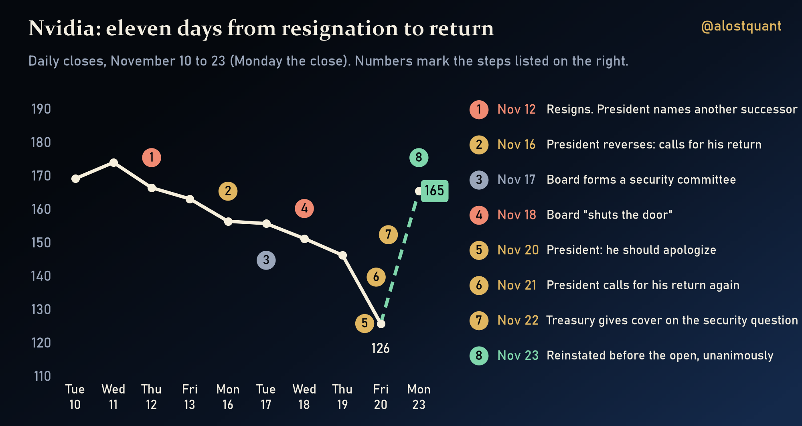
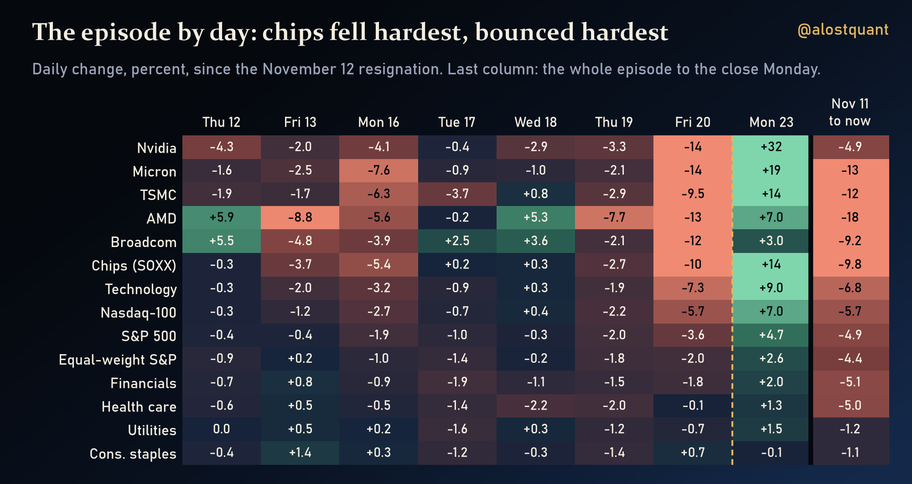
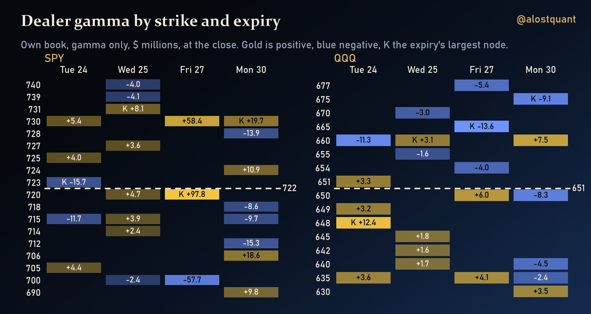

# Eleven Days: Who Held the Lever at Nvidia

*How the chief executive came back, what it did to the market, and what is still open*

@alostquant  ·  November 23, 2026, after the close. Market analysis, not investment advice.

Nvidia's board reinstated Jensen Huang before Monday's open, eleven days after he resigned and five days after it ruled out his return. The stock opened 33% higher and closed at 165, about where it closed the day he left. The S&P 500 closed up 4.7% and the SOXX chip fund 14%. The board had refused on national-security grounds. That finding belonged to Washington, and Washington had been asking for his return since November 16.

We missed it. Sunday's week-ahead note had no scenario in which the shock reversed before the open, although every step in Figure 1 was public when we wrote it. This note sets out the steps, why they pointed one way, and what the reversal leaves open.

*Figure 1. Nvidia's daily closes from November 10, with the eight public steps between the resignation and the return.*

*Yahoo Finance closing prices to November 23. Events: Reuters, CNBC, Al Jazeera, Tom's Hardware and the President's public posts, dated by when each was reported.*

## The reason was Washington's to remove

A board's refusal is only as firm as the reason behind it. Nvidia's reason was security exposure: the former chief's relationship, and the export-control case around a Singapore reseller. The executive branch decides what counts as a security risk, issues the export licences and runs the criminal investigation. So the question was never only what the board wanted. It was what the administration would say about the risk.

It answered in steps. On November 12 the President accepted the resignation and named another company's chief as successor. Four days later he reversed and called for reinstatement. The board set up a security and export control committee on the 17th and still ruled out a return on the 18th, while a faction of directors was reported to be working for one. On the 20th the President said the former chief should apologize, which named a condition. He repeated the call on the 21st. On the 22nd the Treasury Secretary was reported as saying that export-control violations must be kept separate from the former chief's private life. That was the cover the board needed, and its statement on Monday cited no national security risk. The President told CNBC afterwards that he had spoken to the board directly.

| Lever | What Washington held | State by November 22 |
|---|---|---|
| Permission | Export licences, and the remote-access chip rule with its 90-day licensing clock | Not used in public |
| Punishment | The criminal probe of the reseller and the reported SEC review | Running. It raised the cost of a return |
| Cover | An official statement on the security question | Given on November 22 |
| Access | Direct contact with directors | Confirmed by the President on November 23 |
| Audience | Public calls for his return into a falling stock | Made on November 16, 21 and 23 |

The stake was large enough to keep the pressure on. The S&P 500 had just lost 8.6% in a week with the Fed still raising rates. CNBC reported on November 17 that accounts linked to the President had traded up to $97.5M of Nvidia shares. We record that as a reported interest and not as a motive. Who objected mattered less than who could stop it: lawmakers and California's attorney general criticized the decision, and none of them held a veto.

## What it did to the market

*Figure 2. Daily change by name and sector from the resignation to Monday. Green is up, coral is down.*

*Yahoo Finance daily closes to November 23.*

Nvidia lost 28% between November 11 and Friday's close and ended Monday 5% below where it started. Both the damage and the recovery sat in chips. Micron rose 19% on Monday, TSMC 14% and the SOXX fund 14%, while staples ended flat. The recovery is partial. The S&P 500 is still 4.9% below its November 11 close and AMD 18% below. One day undid Friday. It did not undo the week before.

## Where dealers sit now

*Figure 3. Dealer gamma by strike and expiry for SPY and QQQ. The dashed line is the closing price.*

*Skylit SPY and QQQ dealer gamma maps at the close, November 23.*

SPY's largest node for Friday is 720, positive, at $98M, with a negative node at 700 and a positive one at 730. Hedging at positive nodes works against a move, so for Friday's half day SPY sits between two of them. Tuesday's largest SPY node is negative, at 723, just above the 722 close. QQQ is more two-sided. Its largest node for Tuesday moved during the day to 648, positive, under the 651 close, with a negative node at 660 above it. Its largest nodes for Friday and November 30, at 665 and 675, are negative, and negative nodes add to a move that reaches them. The map gives levels. It has no record of giving direction.

## What is still open

| Who | What they hold | Can they stop it | First sign |
|---|---|---|---|
| The board's investigation | Its own findings on the reseller case | Yes | A conclusion date, or a director resigning |
| Congress | Hearings already agreed in both chambers; an opposition probe opened November 20 | Not now. Subpoena power from January, when both chambers change hands | A hearing date, then a subpoena |
| California's attorney general | State enforcement | Not so far | A filing |
| The SEC | The reported review of Nvidia's accounting | In principle | A formal order, or a closing letter |
| Justice Department | The criminal probe of the reseller | Only if charges reach him | An indictment that names individuals |

We put the chance that he is still chief executive at year-end at 85%. The players with a real veto are the board itself and agencies of the administration that asked for him back, and Congress cannot compel anything before January. That number is a judgment: we have no scored record on calls of this kind. For the market, the reversal removes one of the four shocks behind the decline. The Fed, the election result and the supply of new AI stock are unchanged.

*Notes. Prices are Yahoo Finance closes. Events are dated by when they were reported and are attributed in the text. Dealer nodes are each fund's own book, gamma only. Documented actions are stated as reported; we draw no conclusion about intent.*
