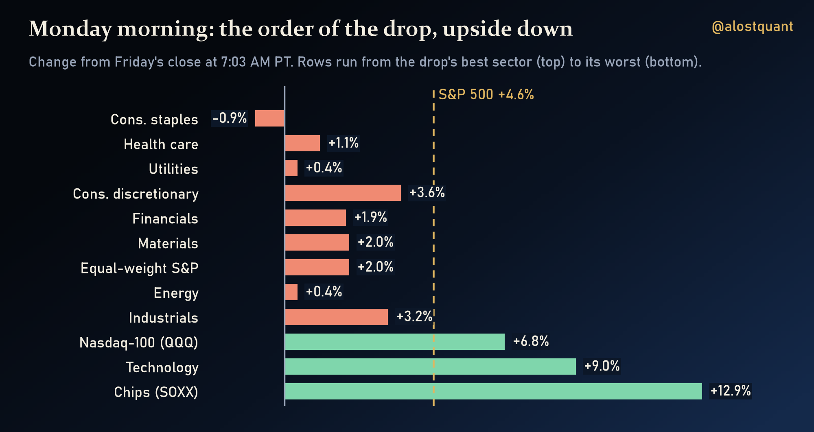
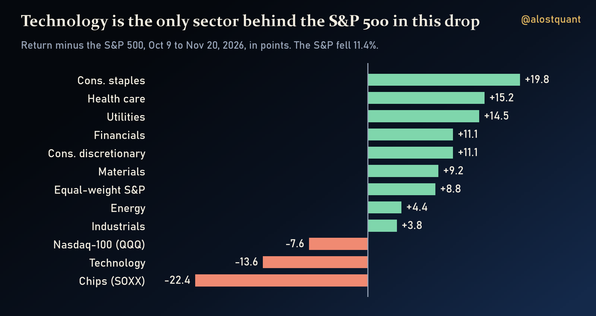
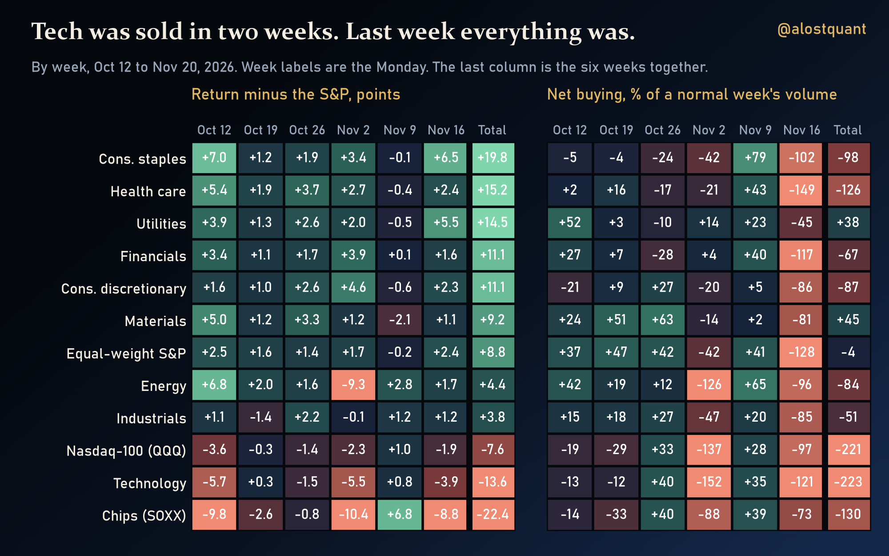
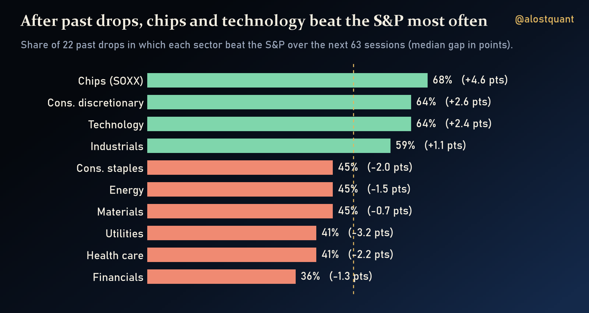
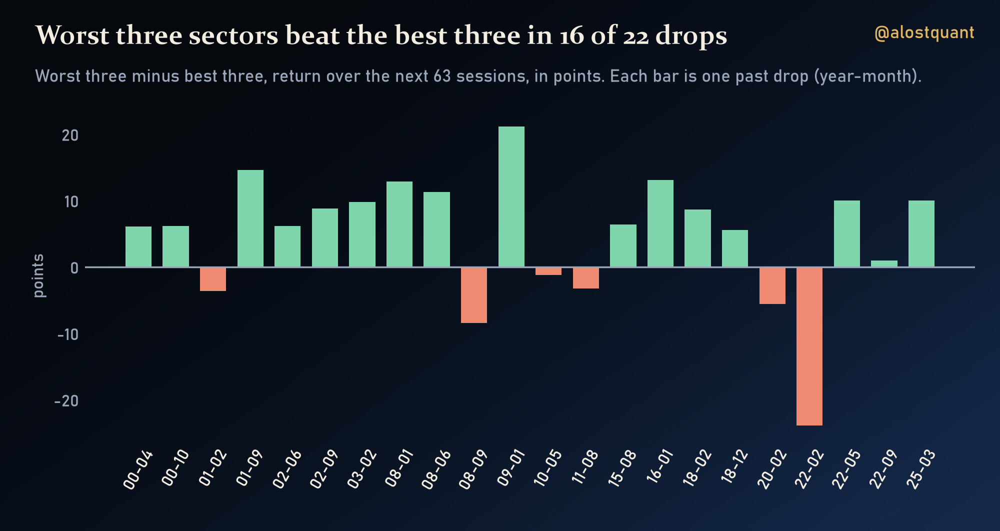

# Sector Rotation After the Drop

*Monday update: the laggards led by more in one morning than they usually do in a week. What 22 past drops say about the rest*

@alostquant  ·  Updated November 23, 2026, 7:03 AM PT. First published November 22. Market analysis, not investment advice.

Nvidia's board reinstated its chief executive before Monday's open and the order of the drop turned over. At 7:03 AM PT technology is up 9.0% on the day and chips 12.9%, against 4.6% for the S&P, +1.1% for health care and -0.9% for staples. The three sectors that fell most in the drop are 4.0 points ahead of the three that held up best. Only 1 of the 22 past drops had a bigger first day, and the median was +0.4. That is the rotation this article expected, arriving in a morning and not over a quarter. History says to treat a first day like this with care: in the past cases the strongest first days were followed by the weakest quarters. We keep the odds measured from Friday's close and add what the record says about buying after the jump.

The S&P 500 closed Friday 11.4% below its October high. Since 2000 it has first closed 10% or more under a 30-session high 22 times before this one. In those cases the three sectors that fell most went on to beat the three that held up best over the following quarter 73% of the time. Over the first month there was no pattern at all. This drop was one-sided: on Friday technology was 13.6 points behind the index and every other sector was ahead of it. After this morning it is 10.9 behind.

| Scenario | Odds | By late February | Confirms / wrong |
|---|---|---|---|
| Laggards lead | 65% | Technology, industrials and energy beat staples, health care and utilities by 3 points or more. That happened after 15 of 22 past drops. | Measured from Friday's close, so this morning's 4.0 points count toward it. Confirmed by technology beating the index on up days after December 9. A further drop in the index does not rule it out. |
| No clear rotation | 10% | The two groups finish within 3 points of each other. 2 of 22. | The index chops and neither group pulls away. |
| Defensives keep leading | 25% | Staples, health care and utilities stay ahead by 3 points or more. 5 of 22: 2001, 2008, 2011, 2020 and early 2022. | In all five the index fell at least another 7% within the quarter. A lower low alone does not confirm it: that also happened in 10 of the 17 cases where the laggards led. |

## Monday morning

*Figure 1. Monday morning by sector. Green bars are ahead of the S&P 500 on the day, coral bars behind. Rows are in the order of the drop, best at the top.*

*Yahoo Finance, Friday November 20 close to 7:03 AM PT November 23, 2026.*

Figure 1 lists the sectors in the order they finished the drop, best at the top, and shows what each has done today. The ranking has flipped. Chips are up 12.9%, technology 9.0% and the Nasdaq-100 6.8%. Staples are -0.9%, utilities +0.4% and health care +1.1%. The equal-weight S&P is up 2.0% against 4.6% for the ordinary index, so the gain sits in the largest technology names, the same place the damage sat.

It has not closed much of the gap. Technology was 13.6 points behind the S&P since October 9 and is now 10.9 behind. Chips were 22.4 behind and are now 17.9. Staples were 19.8 ahead and are still 14.8 ahead. Energy, one of the three worst sectors of the drop, is +0.4% today, which says this is a move in technology on Nvidia's news and not yet a broad return to the sectors that were sold.

In the 22 past drops the three worst sectors beat the three best on the first day after the low 64% of the time, by a median +0.4 points, and after five sessions 59% of the time, by +0.8. The largest first day was +5.5 points, in January 2009. Today's 4.0 would rank second.

A strong first day has not been a good sign. In the 8 cases with the strongest first days, +1.5 points or more, the laggards added to their lead over the rest of the quarter only 50% of the time, with a median further gain of about zero. In the 8 cases where the first day went against them, they led over the rest of the quarter 88% of the time, by a median +7.7. Three of the five failures of the pattern, autumn 2008, February 2020 and February 2022, began with a strong first day. Eight cases is a small sample and the link is weak, but it points one way: the first day tends to borrow from the quarter. A strong first week carried no such penalty.

So the call has two parts now. Measured from Friday's close, the laggards have a head start and we keep 65% on their leading by late February. For money put to work after this morning, the record after a strong first day is a coin flip for the rest of the quarter. In past cases nothing separated the sectors over the first month, so there has been no cost to waiting.

## Where the sectors stood on Friday

*Figure 2. Each sector's return minus the S&P 500 since the October 9 high. Green is ahead of the index, coral behind.*

*Yahoo Finance sector ETFs, through November 20, 2026.*

Staples are 19.8 points ahead of the S&P since October 9, health care 15.2 and utilities 14.5. Financials and consumer discretionary are each 11.1 ahead. Technology is 13.6 behind and chips 22.4 behind. The equal-weight S&P is 8.8 points ahead of the ordinary index, which says the damage sits in the largest technology names and not across the market.

That split is normal in direction and unusual in size. Staples beat the index during every one of the 22 past drops and utilities in all but one. Technology lagged in 82% of them and chips in 89%, but by a median of only 2.5 and 5.0 points.

## Where the money went

Figure 3 splits the drop into its six weeks. The left panel is each group's return minus the S&P for the week. The right panel is an estimate of net buying. Each day's dollar volume counts as buying when the fund closed near its high and as selling when it closed near its low, and the week's sum is shown as a percentage of a normal week's volume. It is built from price and volume, not from fund creation and redemption data.

*Figure 3. Six weeks of the drop. Left: return minus the S&P, in points. Right: estimated net buying as a percentage of a normal week's volume. Green is ahead of the index or bought, coral is behind or sold.*

*Yahoo Finance daily prices and volume, October 12 to November 20, 2026. A normal week is the 60 sessions to October 9.*

Technology was not sold steadily. It was bought the week of October 26 (+40) and again in the bounce the week of November 9 (+35). The selling came in two weeks, November 2 (-152) and November 16 (-121), and those two are more than the whole six-week figure of -223, a little over two normal weeks of volume sold on balance.

The sectors that led on price were not bought heavily. Staples are up 8.4% since October 9 on 2.0 times their normal volume, yet their net buying is -98 and health care's is -126. Before last week staples were flat on this measure. Only utilities (+38) and materials (+45) show net buying over the six weeks, and the equal-weight S&P is about flat (-4). Money left technology faster than it left everything else. It did not pile into the defensives.

Last week nothing was bought. Every row is negative for the week of November 16, including health care (-149) and staples (-102), with utilities the least sold (-45). The S&P fell 8.6% that week. Selling everything at once is forced selling, not rotation. The week before was the reverse, with every row positive and staples the most bought (+79).

For the rotation call this cuts both ways. The laggards-lead pattern needs buyers to come back to technology, and they did come back in two of the six weeks. But a market that is still selling its leaders has not finished liquidating. The first sign we would look for is a week when the index falls and technology's row is green. Monday is the opposite test, an up day, and technology passed it. The down-week test is still to come.

## What followed past drops

The index itself was a coin flip after a month, higher in 50% of cases with a median change of +0.1%. After a quarter it was higher in 73%, by a median 4.7%. The sector picture follows the same clock. Nothing separates the sectors after a month. After a quarter the ones that were hit hardest have usually led.

*Figure 4. How often each sector beat the S&P over the 63 sessions after a drop, with the median gap in points. The dashed line is 50%.*

*Yahoo Finance sector ETFs, 22 drops, 2000 to 2025.*

| Sector | Lagged in the drop | Beat the S&P, next month | Beat the S&P, next quarter (median gap) |
|---|---|---|---|
| Chips (SOXX) | 89% | 58% | 68% (+4.6 pts) |
| Technology | 82% | 55% | 64% (+2.4 pts) |
| Consumer discretionary | 55% | 50% | 64% (+2.6 pts) |
| Industrials | 41% | 45% | 59% (+1.1 pts) |
| Materials | 41% | 45% | 45% (-0.7 pts) |
| Energy | 41% | 55% | 45% (-1.5 pts) |
| Consumer staples | 0% | 59% | 45% (-2.0 pts) |
| Health care | 14% | 59% | 41% (-2.2 pts) |
| Utilities | 5% | 45% | 41% (-3.2 pts) |
| Financials | 55% | 50% | 36% (-1.3 pts) |

Chips beat the index over the next quarter in 68% of cases and technology and consumer discretionary in 64%. Financials did so in only 36%, and utilities and health care in 41%. The sectors people hide in during a drop have tended to give that lead back.

## The laggards lead, but it takes a quarter

Taking the three worst sectors of each drop as a group, they beat the S&P over the next quarter 86% of the time. The three best beat it 32% of the time. The median gap between the two groups was 6.3 points. After one month the same comparison is 50% and 0.1 points, which is nothing. Loosening the test to drops of 8% gives 33 cases and a weaker but similar result: the laggards led in 61%, by a median 3.6 points.

Technology was among the three worst sectors in 16 of the 22 drops, as it is now. In those it beat the index over the next quarter 69% of the time, by a median 4.2 points, and the S&P itself was higher in 69%. In the first week after a drop chips beat the index in 79% of cases and the Nasdaq-100 in 68%.

*Figure 5. For each past drop, the next-quarter return of its three worst sectors minus its three best. Green bars are drops where the laggards went on to lead.*

*Yahoo Finance sector ETFs. Worst and best are measured from the 30-session high to the day of the drop.*

## Catalysts

| Date | Event | Would help the laggards | Would help the defensives |
|---|---|---|---|
| Fri Dec 4 | November payrolls | A middling number that leaves December 9 as the last hike. | A hot number that adds hikes. |
| Wed Dec 9 | Fed decision, Broadcom results | The Fed hikes and signals it is done. Broadcom above $35.6bn. | The Fed signals more hikes. Broadcom at or below its $34.8bn guide. |
| Dec 9-14 | Oracle results | Backlog above the prior $664bn. | Backlog down, or capex raised with free cash flow still negative. |
| Thu Dec 10 | CPI | Inflation cools. | Inflation picks up. |
| Tue Dec 15 | Micron results | Revenue above the $63.8bn consensus. | Revenue under the $61.5bn guide. |
| Any day | Data-center credit | A junk-rated data-center bond prices. None has since late September. | CoreWeave's default-swap spread above 1,289bp, its November 5 peak. |

## Risks to the view

The new risk is that the rotation is already spent. One morning has delivered 4.0 points, against a median lead of 6.3 built over a whole quarter in past drops, and it came on news about one company. If the index gives back the gap, the sectors that jumped most have the most to give back. The board's investigation at Nvidia continues, and the Fed is still expected to raise rates on December 9.

The pattern failed five times: 2001, the autumn of 2008, 2011, February 2020 and February 2022. In all five the index fell at least another 7% within the quarter. A further drop does not break the pattern by itself: the index also fell another 5% or more in 10 of the 17 cases where the laggards went on to lead. The deepest ones did break it, with 2008 and 2020 each losing more than 20%. The closest of the five to today is February 2022, when the Fed was raising rates into inflation above target and the three worst sectors went on to lag the three best by 23.9 points over the next quarter. The Fed is expected to raise rates again on December 9.

The sample is also small and clustered. Seven of the 22 drops fall between 2000 and 2003, and technology's gap to the index this time is about five times its median in the past cases, so history may understate how long it takes to close.

*Notes. A drop is the first day the S&P 500 (SPY) closes 10% or more below its highest close of the prior 30 sessions, counted once per 60 sessions: 22 past cases, April 2000 to March 2025. Sectors are the nine original SPDR sector funds, with SOXX for chips (19 cases). A quarter is 63 sessions, a month 21. Odds are rounded from those counts. Monday's figures are Yahoo Finance 1-minute prices at 7:03 AM PT and will differ from the close. The first-day comparison uses the same 22 drops and the same three worst and three best sectors of each. Nvidia's announcement: Yahoo Finance and CNBC, November 23, 2026. Data: Yahoo Finance.*
