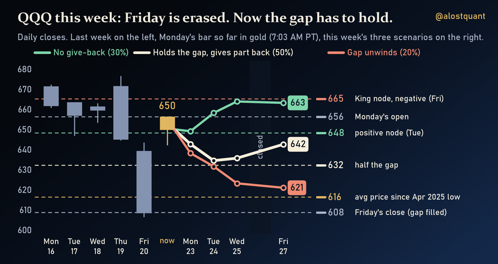
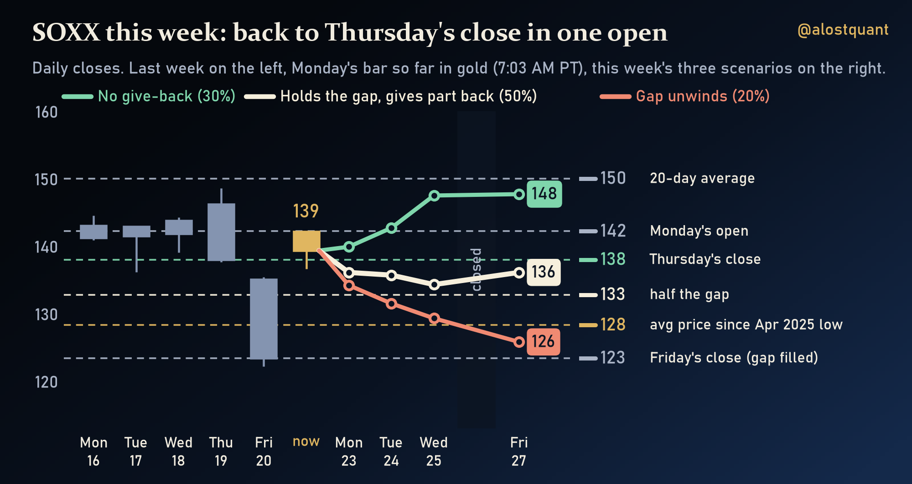
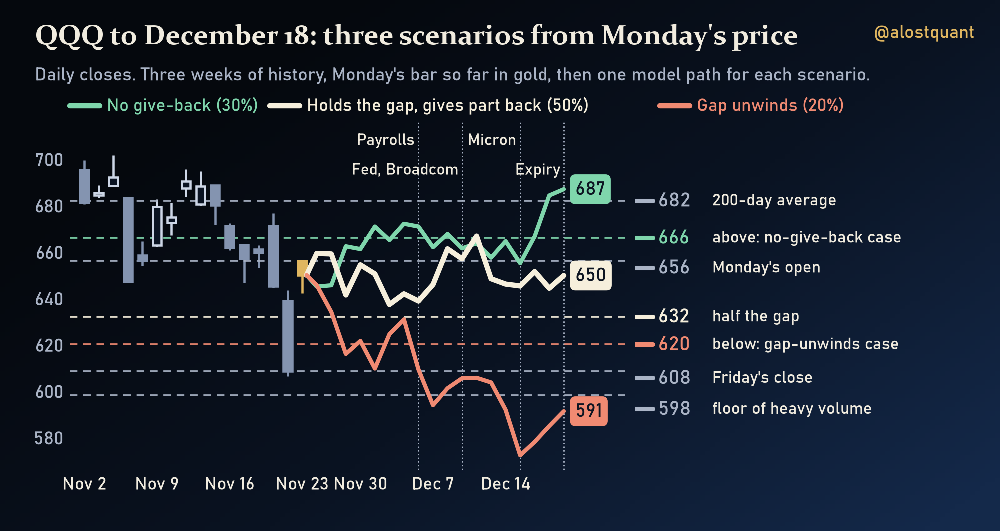
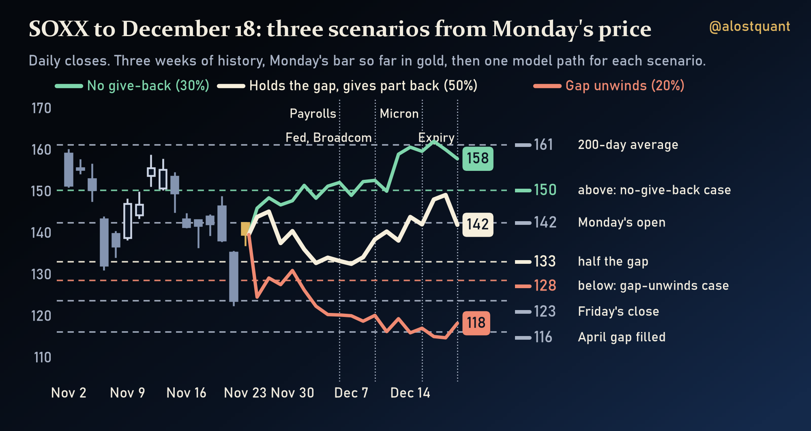

# So the Market Crashed. What's Next

*Monday update: Nvidia's chief executive is back and the open erased Friday. QQQ and SOXX for November 23-27 and into December 18*

@alostquant  ·  Updated November 23, 2026, 7:03 AM PT. First published November 22. Market analysis, not investment advice.

Sunday's base case did not survive the open. Nvidia's board reinstated Jensen Huang as chief executive before the bell, the stock opened 33% higher, and QQQ opened at 655.98, 7.8% above Friday's close. That is the largest opening gap in our QQQ record, which starts in 1999. We expected a gap up, and we expected it to run to QQQ 635, SPY 710 and SOXX 133 before fading under Friday's close. We said a close above 640 would prove that wrong. QQQ opened 16 points above that line and has not traded below 642 since.

The open took back all of Friday's loss, and the first pullback held at last Thursday's close. At 7:03 AM PT QQQ is 649.85, SPY 721.24 and SOXX 139.34. Our new base case, at 50%, is that the gap holds but gives part of itself back: QQQ tests 632 to 636, which is half of the gap, and finishes the week near 642. We put 30% on no give-back and 20% on the gap unwinding. The same odds apply to SOXX.

| Scenario | Odds | QQQ this week | SOXX this week |
|---|---|---|---|
| Holds the gap, gives part back | 50% | Trades between 632 and the 656 open. Tests 632 to 636, half the gap, and closes Friday near 642. Confirmed by a low that holds 632 on a close; wrong on a close above 656 or below 632. | Trades between 133 and the 142 open. Tests 133, half the gap, and closes Friday near 136. Wrong on a close above 142 or below 132.8. |
| No give-back | 30% | Holds this morning's 642 low, closes back above the 656 open, then 660 and 665, the week's two negative King nodes. Closes Friday near 663. Confirmed by a close above 656; wrong on a close under 642. | Closes back above 142, then 148.6, the November 19 high. Closes Friday near 148. Confirmed by a close above 142; wrong on a close under 132.8. |
| Gap unwinds | 20% | Closes under 632, then 620 to 624, and Friday near 621, on its average price since the April 2025 low. Confirmed by a close below 632; wrong on a close back above 648. | Closes under 132.8, then 128.3, and Friday near 126. Confirmed by a close below 132.8; wrong on a close back above 138. |

## What happened

Nvidia said its board had reinstated Huang as president and chief executive, effective immediately. He resigned on November 12. The board's independent investigation continues, and the company has set up a national security and export control committee. President Trump had called for his return on Sunday. Nvidia closed Friday at 125.53, traded as high as 169 before the bell, opened at 167.04 and has ranged 157 to 170 since.

The index gaps are records or close to it. QQQ's 7.8% beats the 6.9% of December 2000. SOXX opened 15.2% higher, against a prior record of 9.1% in 2002. SPY's 5.0% is its fifth largest since 1993, behind two days in the autumn of 2008 and two in March 2020.

Each of the three opened at the level it held early last week and then fell back to Thursday's close. QQQ opened at 656, just under its closes of 657 to 662 from last Monday to Wednesday, and faded to 642, just under Thursday's 645.04 close. SOXX opened at 142, on its closes of 141 to 142 from the same three days, and faded to 136.6 against Thursday's 137.95. SPY opened at 724, short of its 200-day average at 730, and fell to 714 against Thursday's 715.87. One day of the decline has been undone. The other six sessions of it have not.

The VIX is 28.9, down from 35.9. On Friday it stood 9.4 points above the S&P's realized volatility, and that gap was our reason to expect a bounce. Once today's move enters the realized figure the gap is close to zero. The bounce it pointed to has happened, and it no longer leans either way.

## Gaps this large

Nothing in our record matches this open, so the nearest evidence is the set of the largest gaps. The table takes the gaps of 4% or more in QQQ, 3% or more in SPY and 5% or more in SOXX. Four sessions means the gap day and the next three, which is this week. Nineteen sessions ends on December 18. The any-day figure is the same statistic for every day in the record.

| After a large gap up | QQQ, 4% or more (19) | SPY, 3% or more (18) | SOXX, 5% or more (24) |
|---|---|---|---|
| Closed above its open that day (any day) | 68% (52%) | 61% (52%) | 54% (50%) |
| Traded back to half the gap within 4 sessions | 58% | 78% | 58% |
| Filled the gap within 4 sessions | 42% | 50% | 50% |
| Close after 4 sessions above the open (any day) | 58% (56%) | 61% (58%) | 54% (54%) |
| Filled the gap within 19 sessions | 74% | 67% | 71% |
| Close after 19 sessions above the open (any day) | 47% (63%) | 61% (65%) | 58% (59%) |

Two things stand out. A large gap has usually been tested: price came back to the middle of it within the week in 58% to 78% of cases and filled it within 19 sessions in 67% to 74%. And the gap day's open has been no floor. The close four sessions later was above it about as often as on any ordinary day, and for QQQ the close 19 sessions later was above it less often than usual, 47% against 63%.

Those cases come mostly from 2000 to 2002, 2008 and March 2020, when daily ranges were much wider than now, so they overstate how far price is likely to travel. Our price model, scaled to today's implied volatility, puts a QQQ close at or below 632 this week at 33% and by December 18 at 61%. It puts a close at or below Friday's 608.45 by December 18 at 31%. Both the record and the model put a test of half the gap above even by December 18. For this week they disagree, with the record at 58% and the model at 33%. That is why the base case gives part of the gap back, and why the full unwind gets 20% and not less.

## QQQ this week

The dealer map moved up with price. On Sunday the exposure-weighted centre of each day's expiry sat between 607 and 634. This morning it is 650 for Tuesday, 652 for Wednesday and 657 for Friday. Positive nodes sit at and just under price, at 640, 645, 648 and 650, and hedging at positive nodes works against the move. The largest nodes above are negative: 660 on Tuesday and 665 on Friday. Negative nodes add to a move that runs through them, so a push through 660 would be likely to reach 665 quickly, and a rejection there would be likely to travel. We treat 632 to 665 as the week's range.

| Day | Centre | Largest nodes | Closes: base / no give-back / unwinds |
|---|---|---|---|
| Mon 23 | n/a | Today's expiry is not in this morning's pull. HPE reports after the close. | 642 / 649 / 638 |
| Tue 24 | 650 | King 660 (-$9.3M), 648 (+$8.1M). Dell reports after the close. | 634 / 658 / 631 |
| Wed 25 | 652 | King 660 (+$2.6M), 645 (+$1.6M), 640 (+$1.5M). PCE inflation. | 636 / 664 / 623 |
| Fri 27 | 657 | King 665 (-$12.1M), 650 (+$6.0M), 677 (-$4.9M). Half day, closing at 10:00 AM PT. | 642 / 663 / 621 |

*Figure 1. QQQ, week of November 23. Grey candles are last week. The gold candle is Monday so far. Each line is one scenario's daily closes, and the dashed lines are the levels named in the text.*

*Skylit QQQ and NDXP dealer gamma maps, 6:45 AM PT November 23; Yahoo Finance 1-minute bars to 7:03 AM PT.*

SPY's map says the same thing more firmly. Its largest node for Friday is 720, positive, at $87.1M, with a negative node at 700 below it and a positive one at 730 above. SPY is trading within a few points of 720 now. A large positive node at price argues for a week that stays near it, which fits the base case better than either of the others.

## SOXX this week

*Figure 2. SOXX, week of November 23, read the same way.*

*Yahoo Finance daily bars and 1-minute bars to 7:03 AM PT.*

SOXX is up 12.9% on the day and still 37% below its June record. The open put it back above the range between 121 and 135 where almost nothing has traded, and above its average price since the April 2025 low, 128.3. Half of the gap is 132.8, next to the 133 we named on Sunday as the pop target. That level is now the first support and the line between the base case and the unwind. We have no dealer map for SOXX itself.

| Day | Levels in play | Closes: base / no give-back / unwinds |
|---|---|---|
| Mon 23 | The 142 open above, Thursday's close at 138, the morning low at 136.6 | 136.1 / 139.9 / 134.2 |
| Tue 24 | 138, then 132.8, half the gap | 135.7 / 142.7 / 131.5 |
| Wed 25 | 132.8 below, the 142 open above | 134.3 / 147.5 / 129.3 |
| Fri 27 | 148.6 (the November 19 high) and the 20-day average near 150 above, 128.3 below | 136.1 / 147.7 / 125.8 |

## What the open does not change

One of the four shocks behind the decline has reversed. The other three have not: the Fed is still expected to raise rates on December 9, the midterm result still stands, and the Anthropic listing still has to be absorbed. Leverage was still coming out of the market last week, and one morning does not put it back.

The size of the gap is itself a sign of how the market is built. A change of chief executive at one company moved the Nasdaq-100 by 7.8% at the open. Dealers who are short gamma have to buy into rallies as well as sell into declines, and leveraged funds have to buy into the close after an up day just as they sold into it after down days. The same mechanics that made the decline larger made the open larger, and they will work in whichever direction the next move starts.

## Catalysts

| Date | Event | Would support holding the gap | Would support the gap unwinding |
|---|---|---|---|
| Mon Nov 23 | Today's close, the VIX | QQQ closes above 648. VIX closes under 27. | QQQ closes under the 642 morning low. VIX back above 32. |
| Mon Nov 23, after the close | HPE results | AI systems backlog well above the last $5.9bn, firm 2027 outlook. | Backlog flat, or orders pushed into 2027. |
| Tue Nov 24, after the close | Dell results | AI backlog above $95bn and the $74bn AI server guide raised. Revenue guide is $48.5-49.5bn. | AI backlog below $95bn, or the $74bn guide cut. |
| Wed Nov 25 | PCE inflation | A soft number ahead of the December 9 Fed meeting. | A hot number that revives talk of a larger hike. |
| Any day | Nvidia's board investigation | It concludes with Huang in place. | New findings, or a regulator acting on them. The reported SEC review of Nvidia's accounting has not been withdrawn that we can find. |
| Any day | Data-center credit | A junk-rated data-center bond prices. None has since late September. | CoreWeave's default-swap spread above 1,289bp, its Nov 5 peak, or a pulled refinancing. |
| Tue Dec 1 | Job openings, Marvell results | Marvell guides custom AI chip revenue higher. | Marvell guides lower. It is the first chip print after the selloff. |
| Fri Dec 4 | November payrolls | A middling number that leaves Dec 9 as the last hike. | A hot number that adds hikes, or the 10-year yield back above 5%. |
| Tue Dec 8 | SpaceX lock-up ends | The 797.6M freed shares are absorbed quietly. | Heavy selling that pulls demand from other growth stocks. |
| Wed Dec 9 | Fed decision, Broadcom results | The Fed hikes and signals it is done. Broadcom above $35.6bn, the top of consensus. Our number is $35.3bn. | The Fed signals more hikes. Broadcom at or below its $34.8bn guide. |
| Thu Dec 10 | CPI, Texas grid report | Inflation cools. The report clears projects in the 66 GW base queue. | Inflation picks up. The freeze stays on the 474 GW queue. |
| Tue Dec 15 | Micron results | Revenue above the $63.8bn consensus. Our number is $72.1bn with a wide range. | Revenue under the $61.5bn guide, or weaker memory pricing. |

## Risks to the view

We would move to the no-give-back case on a close above 656 in QQQ, 730 in SPY or 142 in SOXX, and to the unwind on a close below 632 in QQQ, 707 in SPY or 132.8 in SOXX. A VIX that stops falling while price holds would tell us the buying is short covering and not new demand.

Our own record this week argues for humility about the middle case. On Sunday we gave the pop-holds case 30% and it was exceeded before the first trade. The model has no way to see news of this kind, and neither do we. One piece of history still argues against the bulls: in the ten past cases where QQQ lagged SPY by as much as it had by Friday while SPY was down 8% or more in a month, all of them in 2002, 2008 and 2022, QQQ was higher 19 sessions later only three times.

## Into December 18

We carry the same three scenarios and odds to the December 18 expiry, measured on the close that day. For QQQ the unwind is a close below 620 and the no-give-back case a close above 666, which is the 38.2% retracement of the decline and next to Friday's 665 node. For SOXX the lines are 128.3 and 150, and for SPY 700 and 730. The model, which has no view on direction, splits QQQ 38% between the lines, 38% above and 24% below, with a middle 80% range of 594 to 708. Our odds lean further toward the middle than that because of the positive nodes at price.

*Figure 3. QQQ to December 18. One model path for each scenario, drawn from Monday morning's price, with the dated events marked.*

*Skylit QQQ and NDXP dealer gamma maps, November 23; Yahoo Finance to 7:03 AM PT.*

*Figure 4. SOXX to December 18, read the same way.*

*Yahoo Finance to 7:03 AM PT.*

*Notes. Scenario paths and ranges come from our price model, which redraws past sessions with no drift. For this update the same paths were restarted from Monday morning's price and scaled to today's implied volatility (VIX 28.9 against 35.9 on Friday). It has no record of calling direction, so the odds are rough. Levels are closing levels. Gap statistics use Yahoo Finance daily bars: QQQ from 1999, SPY from 1993, SOXX from 2001. Data: Skylit dealer gamma maps, Yahoo Finance, company releases and wire reports. Nvidia's announcement and the President's comments: Yahoo Finance, CNBC and Investing.com, November 23, 2026.*
