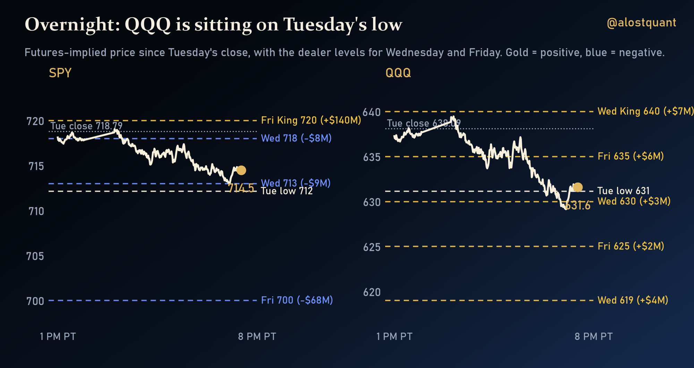
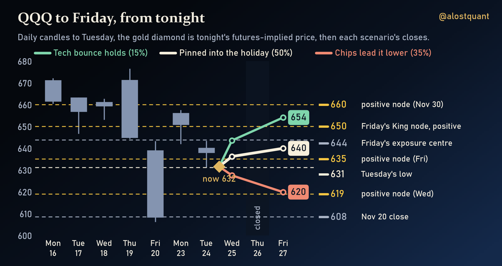
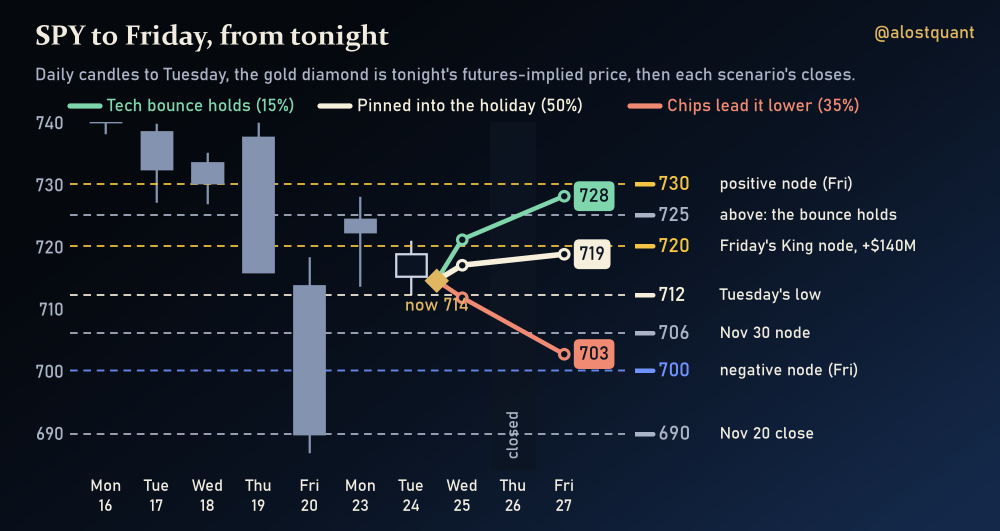
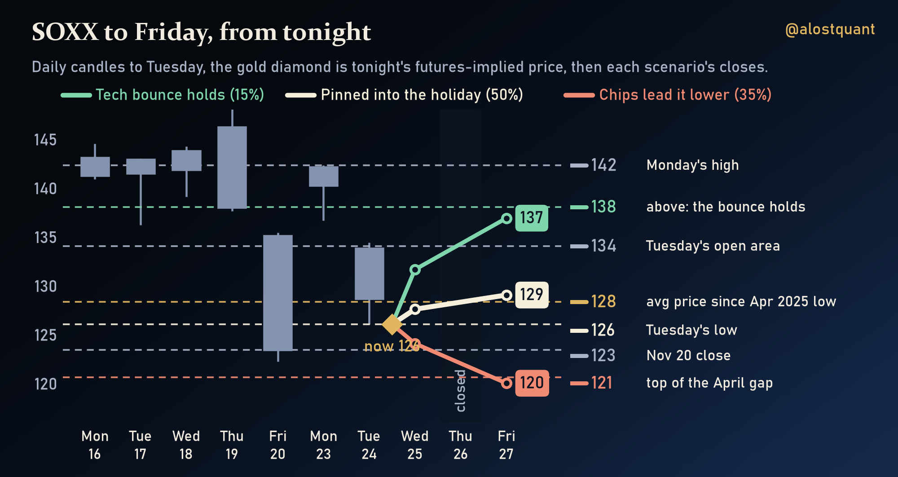
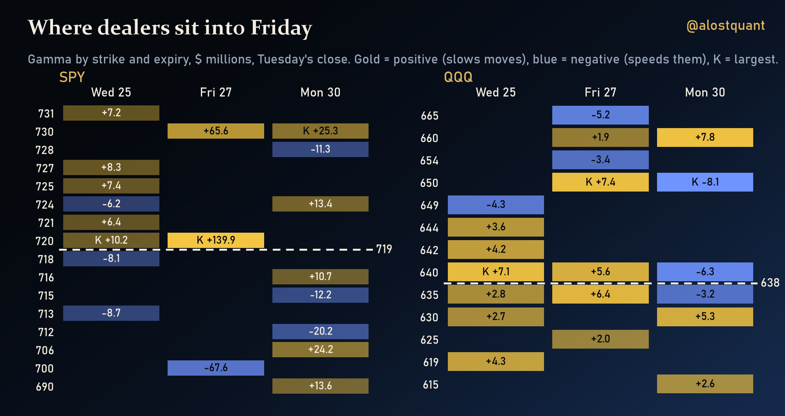

# The Rest of the Week, Simply

*Where we are on the maps after tonight's drop, Wednesday's inflation and growth data, prices to Friday's half day, and the world*

@alostquant  ·  November 24, 2026, 7:30 PM PT, with futures trading overnight. Market analysis, not investment advice.

## Where we are now

*Figure 1. Futures-implied SPY and QQQ since Tuesday's close, against the dealer levels for Wednesday and Friday.*

*Our futures feed and Skylit dealer maps at Tuesday's close, 7:30 PM PT.*

- **The drop:** Nasdaq futures are down 1.0% since the close and S&P futures 0.6%. That puts QQQ near 631.6 (low 629.1), SPY near 714.5 (low 712.9) and SOXX, which does not trade overnight, near 126 on our estimate.
- **QQQ is sitting on Tuesday's low, 631.** That is the line between our base case and the down case. Small positive levels sit just below at 630 (Wednesday) and 625 (Friday), which should slow a further drop. 635 and 640 are the first levels above.
- **SPY is between two negative levels,** 718 and 713 on Wednesday's book, where moves tend to speed up. It is about 6 points under Friday's 720 level, the biggest on the map. Below Tuesday's 712 low the next large level is 700, also negative.
- **Why:** a source said Nvidia's chief executive admitted breaking the company's code of conduct, the Houthis threatened Saudi Red Sea ports after a strike that injured 11 at a Riyadh tower, and a US jury convicted Huawei. The AI rebound is wobbling.
- **Keep it in proportion:** overnight trading is thin, the open is 14 hours away, and core PCE lands an hour before it at 8:30 AM ET.

What it changes: from tonight's price, the Friday odds move against the bounce. QQQ finishing Friday above 650 drops to 13% and below 631 rises to 37%. We now put the scenarios at 50% pinned, 15% tech bounce and 35% chips lower, from 50, 30 and 20 on Tuesday afternoon.

## The short version

- **Two sessions left.** Wednesday is a full day, Thursday is closed, Friday closes at 1:00 PM ET.
- **Tuesday:** chips gave back half of Monday (SOXX -8.3%, Nvidia -5.8%). SPY closed at 718.79, QQQ at 638.09. Futures fell further tonight.
- **Wednesday 8:30 AM ET:** core PCE, most likely 0.3% (68%), and revised third-quarter growth, most likely 3.5% to 3.7%.
- **Base case (50%):** a pinned holiday week. SPY works back toward 720, QQQ holds 631 to 650. Chips lower is 35%, a tech bounce 15%.
- **The map:** SPY's 720 level ($140M) is the magnet above. QQQ has small supports at 630 and 625 under tonight's price.
- **The world:** no Iran deal this week (95%). The Houthis are widening the war into Saudi Arabia.

## Wednesday's data

Core PCE is the Fed's preferred inflation gauge. October's consumer and producer price reports already gave most of it away, so six forecasts average 0.28% for the month. The only question is the rounding: 0.2%, 0.3% or 0.4%. We allow a typical miss of about 0.05 points either way. The chances below are measured from tonight's prices.

| Core PCE prints | Chance | SPY above Tuesday's close Friday | QQQ above 650 | QQQ below 631 | Friday middle SPY / QQQ |
|---|---|---|---|---|---|
| 0.2% (softer) | 24% | 61% | 27% | 21% | 722 / 642 |
| 0.3% (as expected) | 68% | 38% | 9% | 39% | 716 / 634 |
| 0.4% (hotter) | 8% | 14% | 2% | 68% | 709 / 625 |
| All outcomes |  | 42% | 13% | 37% | 717 / 635 |

A 0.2% print is now the way back: it puts the middle of Friday's range back near SPY 722 and QQQ 642. An in-line 0.3% leaves both near tonight's level. Growth barely matters. Forecasts sit between 3.5% and 3.7%, and across every likely print Friday's middle moves by about two points in SPY. Faster growth is slightly worse for stocks because the Fed is raising rates.

## Prices to Friday

| Scenario | Chance | QQQ | SPY | SOXX |
|---|---|---|---|---|
| Pinned into the holiday | 50% | Holds 631-650. Friday about 640 | Holds 712-725. Friday about 719 | Holds 124-134. Friday about 129 |
| Tech bounce holds | 15% | Above 650. Friday about 654 | Above 725. Friday about 728 | Above 134. Friday about 137 |
| Chips lead it lower | 35% | Below 631. Friday about 620 | Below 712. Friday about 703 | Below 124. Friday about 120 |

Two things still lean up: since 1993 SPY has closed the Friday after Thanksgiving above the Tuesday before it in 76% of years, and the 720 level pulls SPY back toward it. Against that, tonight's drop starts the week 0.6% lower. From here the model, with the data and the season added, gives SPY a 42% chance of finishing above Tuesday's close. The holiday record would say more, so we call it close to even.

*Figure 2. QQQ to Friday from tonight's price.*

*Skylit QQQ dealer maps, Tuesday's close; our futures feed; Yahoo Finance.*

*Figure 3. SPY to Friday from tonight's price.*

*Skylit SPY dealer maps, Tuesday's close; our futures feed; Yahoo Finance.*

*Figure 4. SOXX to Friday. Its overnight price is our estimate from QQQ's move; we have no dealer map for SOXX.*

*Yahoo Finance; our futures feed.*

## Reading the dealer map

*Figure 5. Dealer gamma by strike and expiry, SPY and QQQ. The dashed line is Tuesday's close.*

*Skylit SPY and QQQ dealer gamma maps, own books, Tuesday's close.*

Dealers who sold options hedge as price moves. At a gold (positive) level their hedging works against the move, so price tends to slow and stick. At a blue (negative) level their hedging adds to the move, so price tends to speed through. The map gives levels. It has no record of predicting direction.

- **SPY:** Friday's 720 is the largest level on either chart at $140 million, about 6 points above tonight. 730 is positive too ($66 million). Wednesday's 718 and 713 are negative, so the open could move fast in either direction. Below 712 the next big level is 700, negative ($68 million).
- **QQQ:** tonight's price is on the 630-635 shelf of small positive levels. 640 is Wednesday's largest. 649 is negative just under Friday's 650. Read: 625-630 should slow a drop; a close back above 640 opens the 649-650 test.
- **After Friday:** the November 30 books turn negative at QQQ 650 and 640, so next week's moves could be larger.

## The world, to Sunday

| Call | Chance |
|---|---|
| No US-Iran deal or ceasefire | 95% |
| US and Iran hold talks both sides confirm | 15% |
| Another ship hit in or near Hormuz | 90% |
| US strikes Iranian soil, or disables a blockade-running tanker (either) | about 45% |
| Another drone or missile strike on Saudi Arabia (Houthis now threaten Jeddah) | 75% |
| Another Russian drone or jet in a NATO country's airspace | 70% |
| Russian and NATO forces exchange fire | 2% |
| Taiwan's opposition wins more top local posts than the governing party (Saturday) | 70% |
| China announces large military drills around Taiwan | 10% |

Iran is still the one that matters for prices. The US blockade holds, Iran's attacks on shipping are at a wartime high, and Tehran will not talk until seven conditions are met. Oil sits near a three-month low because supply elsewhere is rising, so markets treat it as contained. The Houthis' strike on a Riyadh tower and their threat to Saudi Red Sea ports widen the war, but have not moved oil. Russia and NATO are louder; we expect incidents, not a clash. Taiwan votes on Saturday with markets closed.

## What to watch

| When (ET) | What | Good for the bounce | Bad for it |
|---|---|---|---|
| Overnight | QQQ 631, SPY 712 | Futures back above them by the open | Futures under 629 / 712 at the open |
| Wed 8:30 AM | Core PCE and GDP | Core 0.2% | Core 0.4% |
| Wed close | QQQ 631 and 640 | A close above 640 | A close under 631 |
| Fri 1:00 PM | Half-day close | SPY back at 720 | SPY under 712 |
| Weekend | Iran, Taiwan vote | Quiet | A sunk tanker, a US strike, PLA drills |

*Notes. Chances are our estimates. Overnight prices are SPY and QQQ implied from S&P and Nasdaq futures at 7:30 PM PT; SOXX is estimated at twice QQQ's move. PCE odds use six published forecasts and an assumed typical miss of 0.045 points; growth odds use four forecasts and an assumed miss of 0.25. Reactions to each print are our assumptions. The price model restarts its paths at tonight's price with no drift, scaled to the VIX, with Friday counted as a half day. Holiday-week figures use Yahoo Finance daily closes. News: Reuters, CNBC, Al Jazeera, Gulf News, gCaptain, Lloyd's List, November 22 to 25 (UTC).*
