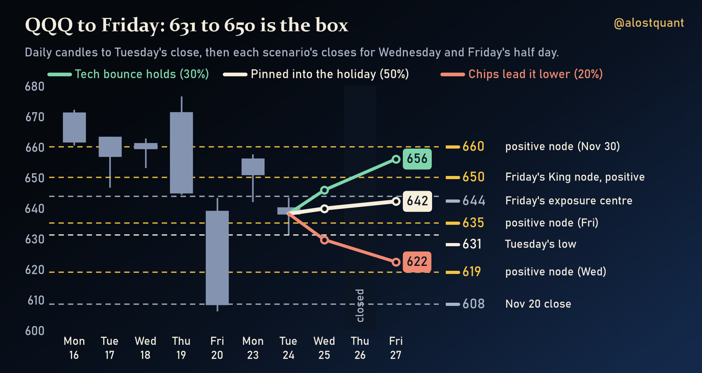
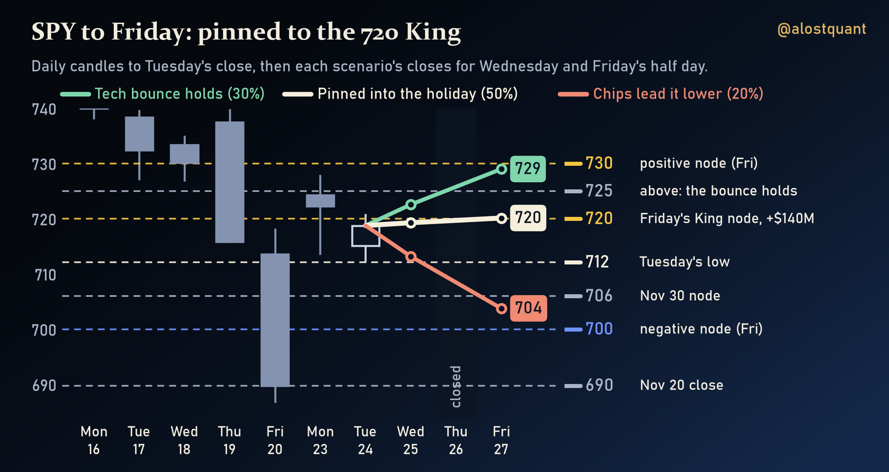
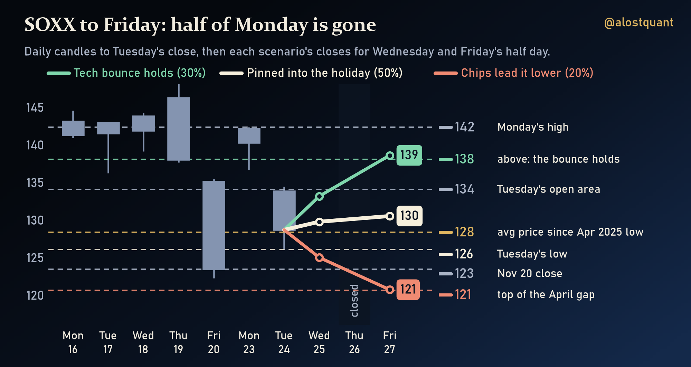

# To Friday: Geopolitics and Prices

*The Iran blockade, Russia and NATO, Taiwan's vote, and three scenarios for QQQ, SPY and SOXX to Friday's half day*

@alostquant  ·  November 24, 2026, after the close. Market analysis, not investment advice.

Two sessions are left this week. Wednesday is a full day with October's PCE inflation report at 8:30 AM ET, Thursday is closed for Thanksgiving, and Friday closes at 1:00 PM ET. Tuesday took back much of Monday in chips: SOXX fell 8.3% and Nvidia 5.8%, while SPY lost only 0.5% because staples rose 1.7%. The VIX closed at 26.2.

The geopolitical risk this week is at sea, not at the table. Iran's attacks on shipping around Hormuz are at their highest since the war began, the US blockade of Iranian ports holds, and Tehran says it will not talk until seven conditions are met. We expect no deal and no return to a US bombing campaign before the weekend. In markets our base case, at 50%, is a pinned holiday week: SPY near 720, QQQ between 631 and 650. We put 30% on the tech bounce resuming and 20% on chips leading the index lower.

## Geopolitics to Sunday, November 29

| Call | Odds | What would change it |
|---|---|---|
| No US-Iran deal or ceasefire confirmed by both sides | 95% | Qatar's mediation produces a joint statement. Iran dropping its seven conditions would be the first sign |
| US and Iran hold talks, direct or mediated, confirmed by both | 15% | A date and venue announced. Qatar's prime minister met the Secretary of State on November 23 |
| At least one more ship reported hit in or near Hormuz | 90% | Reported hits stop for three straight days |
| US forces strike Iranian territory, acknowledged by a US official | 25% | An Iranian strike that kills US personnel in the Gulf. Without one, the stated timeline is after New Year |
| US forces disable or sink a blockade-running tanker, confirmed | 30% | A tanker convoy actually sails. Iranian media walked back the convoy claims on November 24 |
| Another Houthi or Iranian strike on Saudi territory reported | 70% | A lull of three days after the November 24 attack on a Riyadh tower |
| Another Russian drone or aircraft violates a NATO member's airspace | 70% | No reported incident by Saturday. Poland reported one on November 23 |
| Russian and NATO forces exchange fire | 2% | Russia acts on its threat against Estonia |
| Ukraine hits another Russian vessel outside the Black Sea | 30% | Kyiv says it will keep sinking Russian ships; Moscow escorts its ships out of Libya |
| Opposition KMT wins more of the 22 top local posts than the DPP in Taiwan on Saturday | 70% | Pre-vote polls; the opposition won 13 of 22 in 2022 |
| Large PLA drills announced around Taiwan by Sunday | 10% | Beijing reads the result as a vote on independence |

Iran is the call that matters for prices. The blockade has cut Iran's oil income and inflation there is reported near 90%, which pushes Tehran to raise the cost of the blockade at sea instead of conceding at the table. Its attacks are hurting shipping without moving oil: Brent touched a three-month low under $90 on Tuesday, because supply from elsewhere is rising. A US strike on Iranian soil, or a sunk Iranian tanker, is the path from here to a weekend headline that moves Monday's open. We put the chance of at least one of the two by Sunday at about 45%, and more of that weight is on the tanker.

Russia and NATO are louder than last week. Ukraine sank a Russian corvette off Libya and hit cargo ships in the Baltic, Moscow accused Estonia of moving to the verge of open war, and NATO is sending early-warning aircraft to Poland. The President meets NATO's secretary general on Wednesday. We expect more incidents and no clash. China is lowering the temperature: it extended its suspension of the gallium, germanium and antimony export ban to the US on Tuesday. Taiwan votes on Saturday with the market closed, so any reaction lands on Monday's open, and chips carry the most of it.

## Prices to Friday

| Scenario | Odds | QQQ | SPY | SOXX |
|---|---|---|---|---|
| Pinned into the holiday | 50% | Holds 631-650. Wednesday near 640, Friday near 642 | Holds 712-725. Friday near 720, on the King node | Holds 124-134. Friday near 130 |
| Tech bounce holds | 30% | Closes above 650, then 654 to 660. Friday near 656 | Closes above 725 toward the 730 node. Friday near 729 | Back above 134. Friday near 139 |
| Chips lead it lower | 20% | Closes under Tuesday's 631 low, toward 619-625. Friday near 622 | Closes under 712, toward the 700 node. Friday near 704 | Under 124. Friday near 121 |

The dealer maps argue for the base case. SPY's largest node for Friday's expiry is 720, positive, at $140M, up from $98M on Monday, with a second positive node at 730 and a negative one at 700. Hedging at positive nodes leans against a move, and SPY closed at 718.79. QQQ's Friday book is a cluster of positive nodes at 635, 640 and 650, with the exposure-weighted centre at 644. Below 631 the next positive node is 619, on Wednesday's book.

*Figure 1. QQQ to Friday. Daily candles to Tuesday, then each scenario's closes for Wednesday and Friday. Dashed lines are the levels named in the text.*

*Skylit QQQ dealer gamma maps at Tuesday's close; Yahoo Finance.*

History leans the same way. Since 1993, SPY closed the Friday after Thanksgiving above the Tuesday before it in 76% of years, with a median gain of 0.19%. QQQ did so in 81% of years since 1999, by a median 0.49%. Any two-session span closes higher about 56% of the time. The worst Thanksgiving week for QQQ in that record lost 3.0%. Our price model has no view on direction. It puts SPY's Friday close between 706 and 732 eight times in ten, and QQQ's between 622 and 654. We lean up from it because of the season and the positive nodes. That lean is why our odds put 30% above 650 in QQQ against the model's 17%.

*Figure 2. SPY to Friday, read the same way.*

*Skylit SPY dealer gamma maps at Tuesday's close; Yahoo Finance.*

*Figure 3. SOXX to Friday. We have no dealer map for SOXX itself.*

*Yahoo Finance.*

SOXX is the swing factor. It gained 13.6% on Monday and gave back 8.3% on Tuesday, closing at 128.63, just above its average price since the April 2025 low at 128.3. A close under Tuesday's 126 low would put it back in the thin range where it traded before Monday, and the chips scenario starts there. Taiwan's vote and any weekend Iran headline both land after Friday's close.

## Calendar

| When (ET) | Event | Would support the bounce | Would support the drop |
|---|---|---|---|
| Wed 8:30 AM | October PCE inflation | Core in line or softer; the December 9 hike stays the last one priced | A hot core reading that adds 2027 hikes |
| Wed | The President meets NATO's secretary general | A Ukraine air-defence release without new demands on Russia | Talk of an Estonia or Poland incident |
| Wed-Sun | Hormuz and the blockade | Reported hits fall; Qatar announces talks | A US strike on Iranian soil or a sunk tanker |
| Fri 1:00 PM | Half-day close | SPY holds the 720 node into expiry | SPY closes under 712 |
| Sat 28 | Taiwan local elections | A quiet result and no PLA drills | Drills announced; reaction on Monday's open |
| Sun 29 | OPEC+ ministerial meeting | Context only; no oil call | Context only; no oil call |

*Notes. Odds are our judgment for the period to Sunday, November 29, unless stated. Price scenarios use closing levels; the 50 / 30 / 20 split is ours. The model's ranges restart its paths from Tuesday's close with no drift, scaled to the current VIX, with Friday's move scaled for the half day. Thanksgiving-week statistics use Yahoo Finance daily closes. News: Reuters, CNBC, Al Jazeera, Gulf News, gCaptain and Lloyd's List, November 22 to 24, 2026. Dealer nodes are each fund's own gamma book. PCE date: Bureau of Economic Analysis schedule. Taiwan vote date: Central Election Commission.*
