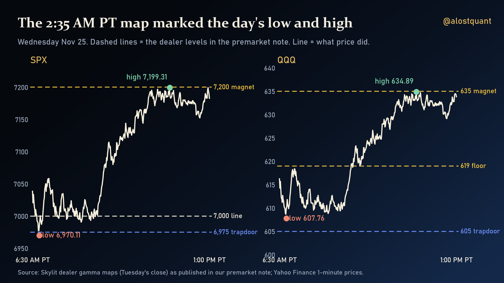
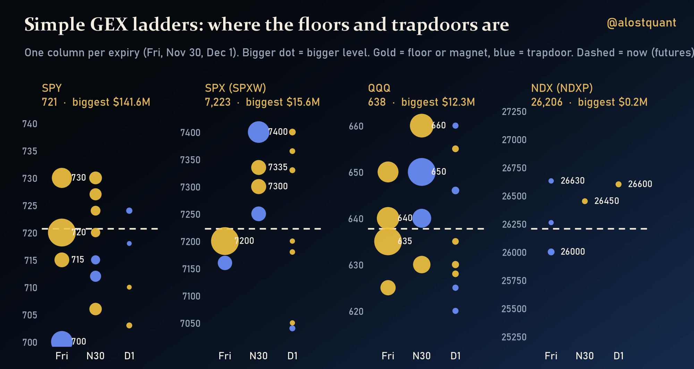
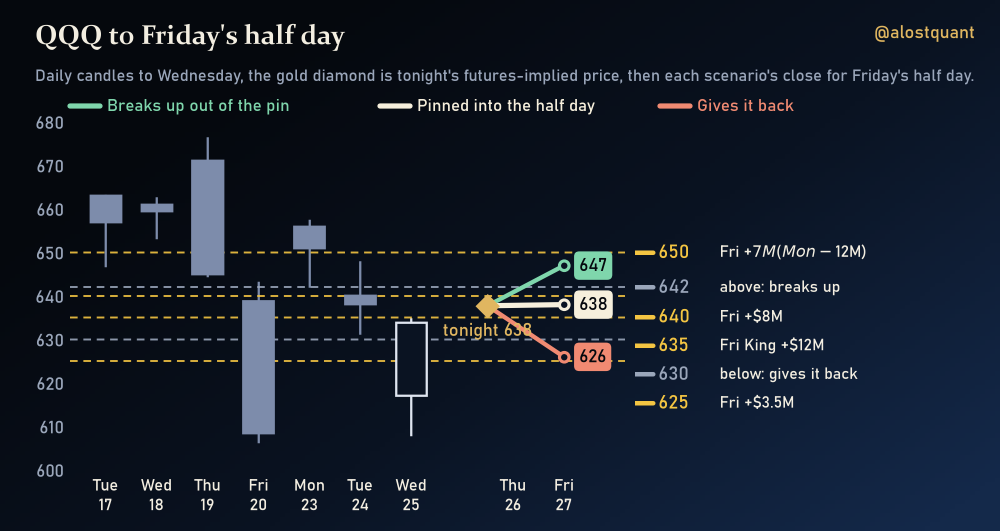
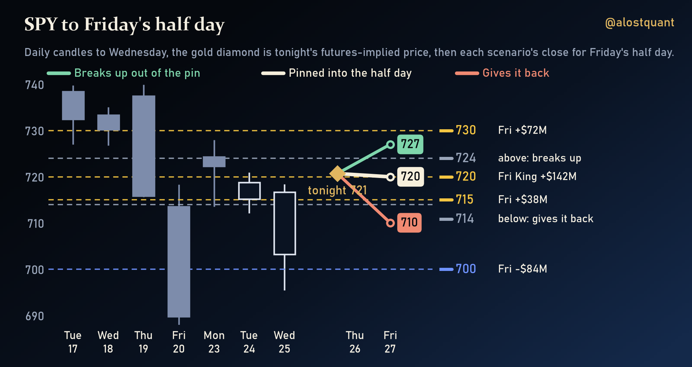
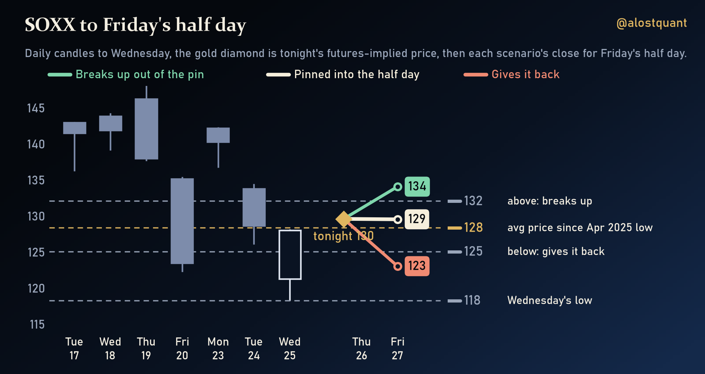

# Friday, Simply

*Where we are after Wednesday's reversal, simple GEX reads, and three scenarios for Friday's half day*

@alostquant  ·  November 25, 2026, 4:45 PM PT, with futures trading. Market analysis, not investment advice.

## Where we are now

- **Wednesday:** a 2.5% overnight drop on the tariff report, a flush at the open, then a full reversal. SPX went from 6,970 to 7,199 and closed at 7,183. QQQ went from 607.76 to 634.89 and closed at 633.81. SOXX closed at 127.96, the VIX at 28.1.
- **Tonight:** S&P futures are up 0.55% and Nasdaq futures 0.62% from Wednesday's close. That puts SPY near 720.7, QQQ near 637.7 and SPX near 7,223. SOXX near 130 on our estimate.
- **What's left:** Thursday is closed. Friday is a half day, closing at 1:00 PM ET (10:00 AM PT). Then a weekend with a Taiwan election and the tariff decision pending.
- **The map:** SPY is sitting right on Friday's biggest level, 720, worth $142 million. QQQ sits between Friday's 635 and 640, both positive.

*Figure 1. Wednesday: SPX and QQQ against the levels in our premarket note. The lows and highs landed on the map's levels.*

*Skylit dealer maps (Tuesday's close) as published in our premarket note; Yahoo Finance 1-minute prices.*

## Simple GEX reads for Friday

Gold levels are floors and magnets: dealers' hedging there slows price and pulls it in. Blue levels are trapdoors: hedging there speeds a move up. Each expiry is read on its own. These are Wednesday's closing maps.

*Figure 2. Gamma by strike for Friday, November 30 and December 1. Dot size shows the size of the level; the dashed line is tonight's futures-implied price.*

*Skylit SPY, SPXW, QQQ and NDXP dealer gamma maps, own books, Wednesday's close.*

| Index | Now | Floor | Trapdoor | Magnet | Simple read |
|---|---|---|---|---|---|
| SPY | 721 | 715 (Fri, +$38M) | 700 (Fri, -$84M) | 720 (Fri, +$142M), 730 (+$72M) | Sitting on the magnet. Pinned 715-725 unless news hits. |
| SPX (SPXW) | 7,223 | 7,200 (Fri, +$16M) | 7,160 (Fri), 7,000 (Fri) | 7,200 | Above 7,200 and leaning on it. Monday's 7,400 is a trapdoor above. |
| QQQ | 638 | 635 (Fri, +$12M) | Monday's 650 (-$12M) | 640, 650 (Fri) | Between two floors. 650 is the Friday ceiling; past it Monday turns fast. |
| NDX (NDXP) | 26,206 | none that matter | none that matter | none | Still almost empty. Use QQQ. |
| VIX | 28.1 | 25 (calm) | 32 (stress) | 34.95 (Wednesday's high) | Fell 7 points from the open. Under 25 would say the fear is gone. |

## Friday's half day

| Scenario | Chance | QQQ | SPY | SOXX |
|---|---|---|---|---|
| Pinned into the half day | 50% | Stays 630-642. Close about 638 | Stays 714-724. Close about 720 | Stays 125-132. Close about 129 |
| Breaks up out of the pin | 30% | Above 642. Close about 647 | Above 724. Close about 727 | Above 132. Close about 134 |
| Gives it back | 20% | Under 630. Close about 626 | Under 714. Close about 710 | Under 125. Close about 123 |

The model, starting from tonight's futures and counting Friday as a half day, gives QQQ 51% to stay between 630 and 642, 33% to close above and 16% below. For SPY it is 53%, 33% and 13%. Our 50 / 30 / 20 rounds those. The chance SPY closes Friday above Wednesday's close is about 77%, mostly because futures already start higher. Since 1993 the Friday after Thanksgiving closed higher 61% of the time, with a median move of only 0.08%.

*Figure 3. QQQ: Wednesday's close, tonight's futures, and Friday's three closes.*

*Skylit QQQ dealer maps, Wednesday's close; Yahoo Finance.*

*Figure 4. SPY, read the same way.*

*Skylit SPY dealer maps, Wednesday's close; Yahoo Finance.*

*Figure 5. SOXX. We have no dealer map for SOXX; its overnight price is our estimate.*

*Yahoo Finance.*

## The weekend

| Call | Chance |
|---|---|
| The administration formally announces the new tariffs on the 16 partners by Sunday | 30% |
| No US-Iran deal or ceasefire by Sunday | 95% |
| US strikes Iranian soil, or disables a blockade-running tanker (either), by Sunday | about 45% |
| Taiwan's opposition wins more top local posts than the governing party (Saturday) | 70% |
| China announces large military drills around Taiwan by Sunday | 10% |

Friday is thin and pinned. The risk is what lands after it: a formal tariff announcement, a weekend incident at sea, or a strong reaction to Taiwan's vote would all hit Monday's open, when the November 30 books turn negative at QQQ 650 and SPX 7,400. A quiet weekend leaves the pin in charge into Monday.

## What to watch

| When | What | Good for the bounce | Bad for it |
|---|---|---|---|
| Thursday | Futures (open, early halt) | Holding tonight's gains | Back under Wednesday's close |
| Fri 9:30 AM ET | The open | SPY holds 715, QQQ holds 635 | SPY under 714, QQQ under 630 |
| Fri 1:00 PM ET | Half-day close | QQQ above 642 | QQQ under 630 |
| Weekend | Tariffs, Iran, Taiwan vote | Quiet | An announcement, a strike, PLA drills |

*Notes. Chances are our estimates. Tonight's prices are SPY and QQQ scaled by the S&P and Nasdaq futures move since Wednesday's close (4:37 PM PT); SOXX at twice QQQ's move. Dealer levels are from Wednesday's close, gamma only, each expiry on its own. The price model restarts its paths at tonight's price with no drift, scaled to the VIX, with Friday counted as a half day. Holiday figures use Yahoo Finance daily closes since 1993.*
