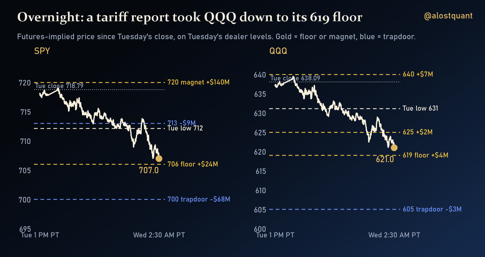
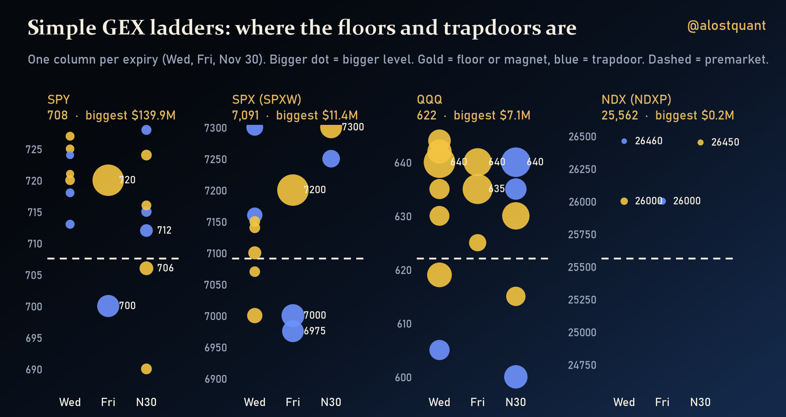
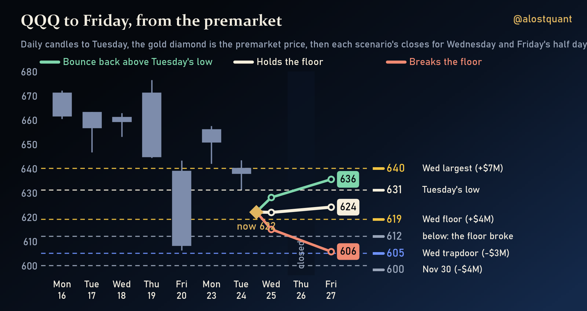
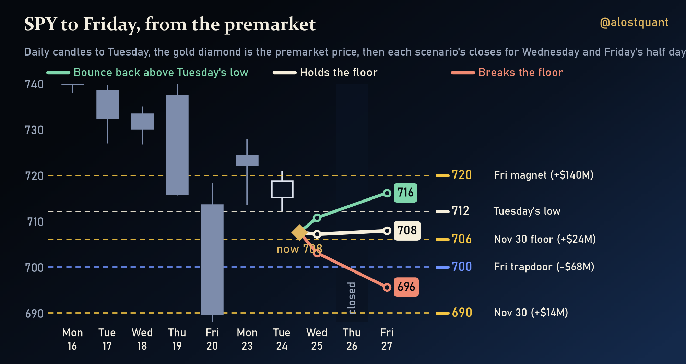
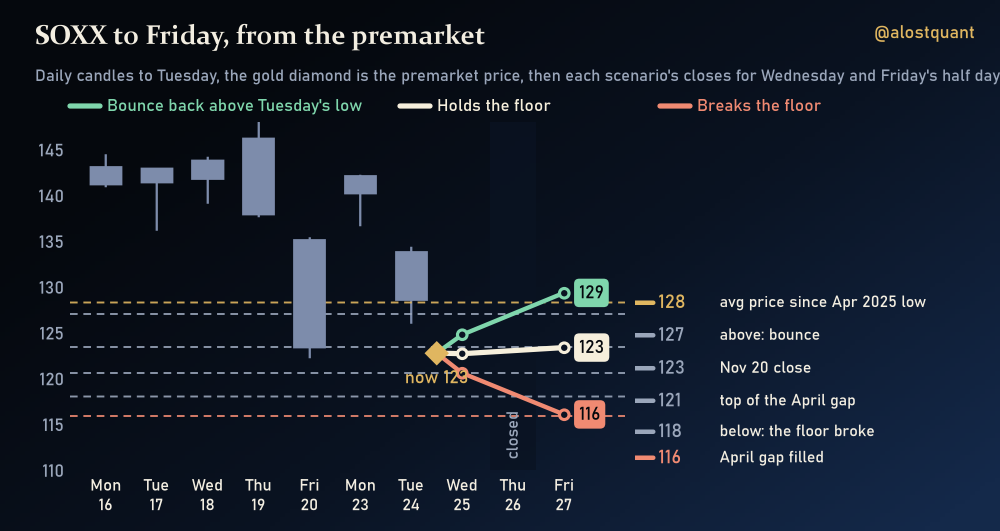

# The Rest of the Week, Simply

*Wednesday premarket: a tariff report knocked futures down overnight. Where we are on the maps, simple GEX reads, today's data and Friday*

@alostquant  ·  November 25, 2026, 2:35 AM PT (5:35 AM ET), before the 8:30 AM ET data. Market analysis, not investment advice.

## Where we are now

*Figure 1. Futures-implied SPY and QQQ since Tuesday's close, against Tuesday's dealer levels.*

*Our futures feed; Skylit dealer maps at Tuesday's close.*

- **The drop:** Nasdaq futures are down about 2.5% from Tuesday's close and S&P futures 1.5%. Premarket, QQQ is 622.06 (-2.5%), SPY 707.56 (-1.6%) and SOXX 122.76 (-4.6%). Nvidia is down about 5%.
- **Why:** Reuters reported that the administration could put tariffs on a broad range of imports from 16 major trading partners after a probe into excess industrial capacity. Nothing has been announced. Chips are leading the drop, on top of worries about debt-funded AI spending.
- **VIX:** 29.2 premarket, up from 26.4 at Tuesday's close.
- **Today:** core PCE and revised third-quarter growth at 8:30 AM ET, the open at 9:30 AM ET. Thursday is closed and Friday closes at 1:00 PM ET.
- **Tuesday's lines are gone.** QQQ is 9 points under Tuesday's 631 low and SPY 5 points under its 712 low, so the scenarios below start from here.

## Simple GEX reads

Gold levels are floors and magnets: dealers' hedging there slows price down and pulls it in. Blue levels are trapdoors: hedging there speeds a move up. Each expiry is read on its own, never added together. The maps are from Tuesday's close and update at the open.

*Figure 2. Gamma by strike for each expiry. Dot size shows the size of the level; the dashed line is the premarket price.*

*Skylit SPY, SPXW, QQQ and NDXP dealer gamma maps, own books, Tuesday's close. SPX and NDX converted from SPY and QQQ.*

| Index | Now | Floor | Trapdoor | Magnet | Simple read |
|---|---|---|---|---|---|
| SPY | 708 | 706 (Nov 30, +$24M) | 700 (Fri, -$68M) | 720 (Fri, +$140M) | Above 706: drift back toward 712-720. Under 700: falls fast. |
| SPX (SPXW) | 7,091 | 7,100 and 7,000 (today, small) | 7,000 and 6,975 (Fri) | 7,200 (Fri, +$11M) | 7,000 is the line for the week. |
| QQQ | 622 | 619 (today, +$4M) | 605 (today), 600 (Nov 30) | 635-640 (Fri, today) | Hold 619: bounce toward 630-640. Lose it: little until 605. |
| NDX (NDXP) | 25,562 | none that matter | none that matter | 26,000 ($0.17M) | Almost empty. No read. Use QQQ. |
| VIX | 29.2 | 25 (calm) | 32 (stress) | 35.9 (Nov 20 high) | Prices about 1.8% daily S&P moves. No live map. |

SPXW in plain words: today's expiry has only small levels, positive at 7,100, 7,150 and 7,000, so the open can move freely. Friday's book is the one that matters: 7,200 is positive and the largest, while 7,000 and 6,975 are negative. Above 7,000 the index is drawn back toward 7,100-7,200; below it, Friday's hedging adds to the fall.

NDXP in plain words: its levels are about forty times smaller than QQQ's, so it gives no read. VIX in plain words: we do not have a live VIX dealer map, so this is a level read only. At 29 the options market expects daily S&P moves of about 1.8%. A move under 25 would say the fear is leaving; above 32, Monday's high, would say it is building toward the November 20 peak of 35.9.

## Today's data, from the premarket price

| Core PCE prints | Chance | QQQ back above 631 by Friday | QQQ under 612 Friday | SPY back above 712 | Friday middle SPY / QQQ |
|---|---|---|---|---|---|
| 0.2% (softer) | 24% | 54% | 6% | 60% | 715 / 632 |
| 0.3% (as expected) | 68% | 33% | 18% | 39% | 709 / 625 |
| 0.4% (hotter) | 8% | 11% | 40% | 16% | 702 / 616 |
| All outcomes |  | 37% | 17% | 42% | 710 / 626 |

Forecasts for core PCE average 0.28% for October, so 0.3% is the likely print. A 0.2% would be the best chance of a bounce; it makes QQQ more likely than not to get back above 631. Growth, forecast at 3.5% to 3.7%, moves Friday's middle by about two points and does not change the call. From the premarket price, the chance SPY finishes the week above Tuesday's close is about 20%.

## Prices to Friday

| Scenario | Chance | QQQ | SPY | SOXX |
|---|---|---|---|---|
| Holds the floor | 45% | Stays 612-631. Friday about 624 | Stays 700-712. Friday about 708 | Stays 118-127. Friday about 123 |
| Bounce back above Tuesday's low | 35% | Above 631. Friday about 636 | Above 712. Friday about 716 | Above 127. Friday about 129 |
| Breaks the floor | 20% | Under 612. Friday about 606 | Under 700. Friday about 696 | Under 118. Friday about 116 |

The model, from the premarket price with the data and the holiday drift included, gives QQQ 46% to stay between 612 and 631, 37% to get back above 631 and 17% to break under 612. For SPY it is 37%, 42% and 21%. Our 45 / 35 / 20 sits between the two. The tariff report is not policy yet; a denial or a delay is the fastest route back above Tuesday's lows.

*Figure 3. QQQ to Friday from the premarket.*

*Skylit QQQ dealer maps, Tuesday's close; our futures feed; Yahoo Finance.*

*Figure 4. SPY to Friday from the premarket.*

*Skylit SPY dealer maps, Tuesday's close; our futures feed; Yahoo Finance.*

*Figure 5. SOXX to Friday from the premarket. We have no dealer map for SOXX.*

*Yahoo Finance premarket.*

## The world, to Sunday

| Call | Chance |
|---|---|
| The administration formally announces the new tariffs on the 16 partners by Sunday | 30% |
| No US-Iran deal or ceasefire | 95% |
| US strikes Iranian soil, or disables a blockade-running tanker (either) | about 45% |
| Another ship hit in or near Hormuz | 90% |
| Another drone or missile strike on Saudi Arabia | 75% |
| Another Russian drone or jet in a NATO country's airspace | 70% |
| Taiwan's opposition wins more top local posts than the governing party (Saturday) | 70% |
| China announces large military drills around Taiwan | 10% |

Tariffs are now the call that matters most for prices. A formal announcement over the holiday would hit Monday's open; we put it at 30% because Reuters described plans, not a decision, and the week is short. Iran is unchanged: the blockade holds, Iran's attacks at sea are at a wartime high, and oil is still near a three-month low.

## What to watch

| When (ET) | What | Good for the bounce | Bad for it |
|---|---|---|---|
| 8:30 AM | Core PCE and GDP | Core 0.2% | Core 0.4% |
| 9:30 AM | The open | QQQ holds 619, SPY holds 706 | QQQ under 619, SPY under 700 |
| All day | Tariff headlines | A denial or a delay | A formal announcement |
| Fri 1:00 PM | Half-day close | QQQ above 631, SPY above 712 | QQQ under 612, SPY under 700 |
| Weekend | Iran, Taiwan vote | Quiet | A sunk tanker, a US strike, PLA drills |

*Notes. Chances are our estimates. Premarket prices are Yahoo Finance at 5:33 AM ET; SPX and NDX are converted from SPY and QQQ. Dealer levels are from Tuesday's close, gamma only, each expiry on its own. VIX has no live dealer map in our records. PCE odds use six published forecasts and an assumed miss of 0.045 points. The price model restarts its paths at the premarket price with no drift, scaled to the VIX, with Friday counted as a half day; reactions to each print are our assumptions. News: Reuters via Investing.com, Al Jazeera, CNBC, November 24 to 25.*
