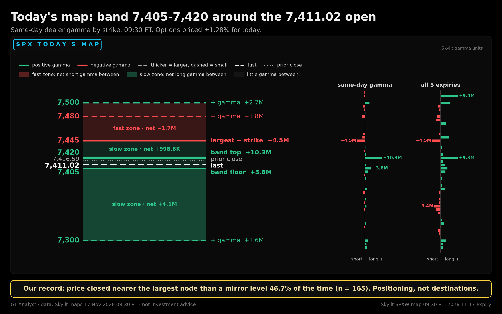
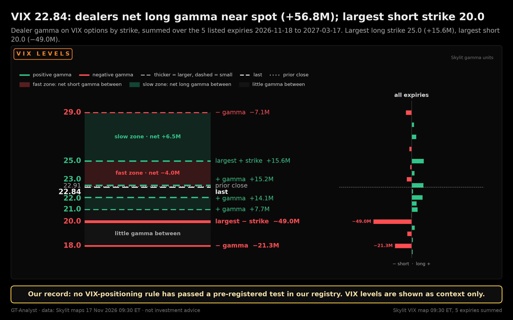
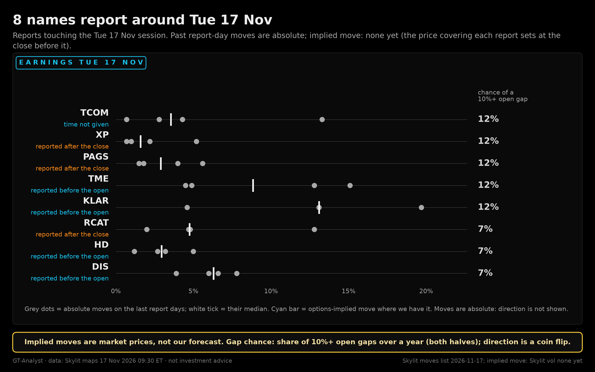
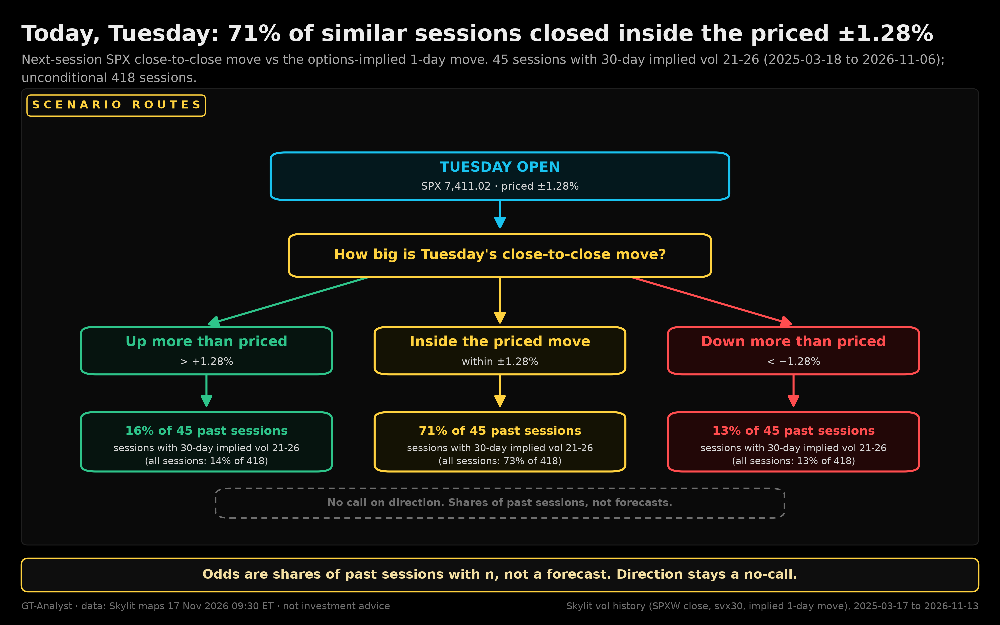

# US market update · Tuesday 17 November 2026 · morning (09:30 ET map)

*SPX opened at 7,411.02 against a prior close of 7,416.59.*

## The day's events

Two Fed policymakers leaned further toward tightening: Governor Waller said a half-point move should be considered if inflation stays hot, and St. Louis Fed president Musalem said up to four more hikes may be needed by spring. Futures put about 95% on a quarter-point hike on 9 December. (speeches as reported on the wires; time not given)

Nvidia reports its fiscal third quarter after the close, five days after its chief executive resigned. (company calendar; time not given)

## Overnight

Overnight futures path: GAP. Our ES/NQ bars cover 06:00-16:14 ET only and lag the live maps.

## Today's map

Base case logged (2026-11-17-SPX-morning-band): SPX closes inside 7,405-7,420, the largest long-gamma same-day strikes either side of the open. Scored at the close.

*Today's same-day map at 09:30 ET.*

## VIX positioning

Across all listed VIX expiries dealers are net long gamma within 10% of the VIX (+56.8M). The largest short-gamma strike is 20.0 and the largest long-gamma strike 25.0. In principle net long VIX gamma near spot damps the VIX's own moves. We hold no tested rule for VIX positioning, so it is context.

*VIX 22.84: dealers net long gamma near spot (+56.8M); largest short strike 20.0.*

## Single names

MU: no Skylit single-name gamma map on 2026-11-16 at or before 23:59 ET.

*8 names report around Tue 17 Nov.*

## Routes for today

*Routes for Tuesday's session. Inside the priced move: 71% of 45 sessions with 30-day implied vol 21-26; beyond it up 16%, down 13%.*

## Dated watch-list

- Wed 18 Nov 14:00 ET: Minutes of the October FOMC meeting
- Thu 19 Nov: Shenzhen talks involving China, Russia and Iran (dates per China's foreign ministry)
- Fri 20 Nov 16:00 ET: Monthly options expiry (index and single names)

## Data and staleness

- Snapshot: 17 Nov 2026 09:30 ET (live), fresh (same day).
- Index maps: Skylit per-minute gamma maps (5 expiries per symbol); spot is a 1-minute sample, so highs and lows are sampled, not exchange OHLC.
- Gamma values are Skylit's per-strike units; compare within one symbol only.
- Charm by strike: GAP (not in our Skylit maps). Index vanna (SPX/SPY/QQQ): GAP. Dealer net contracts: GAP.
- Overnight futures: ES/NQ bars cover 06:00-16:14 ET and end 2026-11-16; the night-turn clock needs years of full overnight bars (GAP).
- Macro calendar consensus and prior values: GAP. DXY, yields, metals panels: GAP.
- Never used: Unusual Whales data or cached option chains of unclear source.

---
GT-Analyst · data: Skylit maps 17 Nov 2026 09:30 ET · not investment advice. Levels describe dealer positioning, not targets; no trade, hedge or size is implied.
