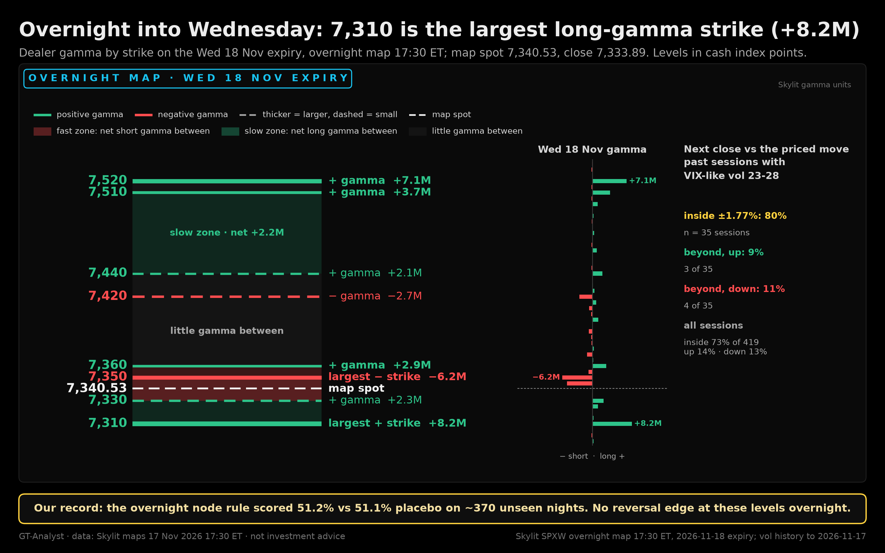
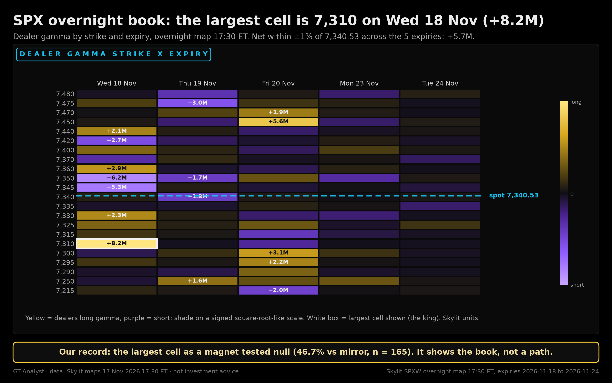
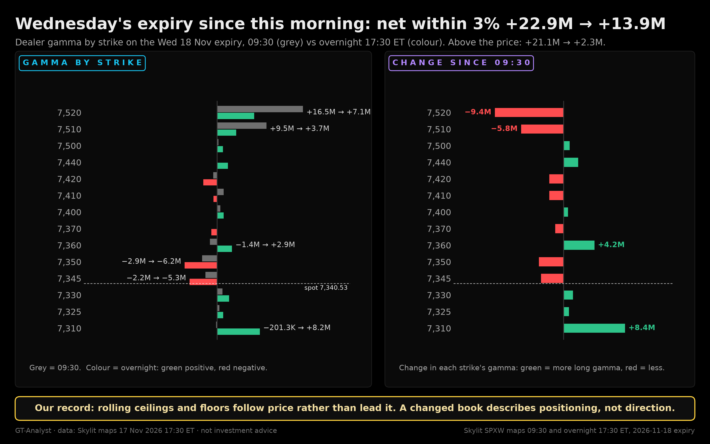
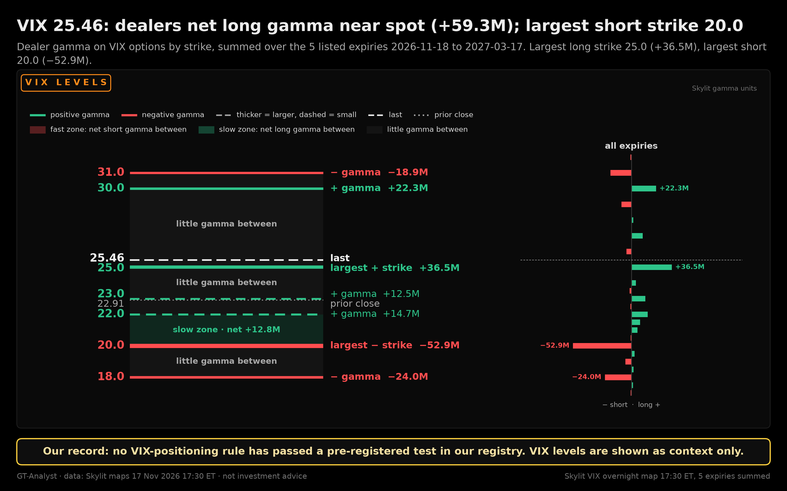
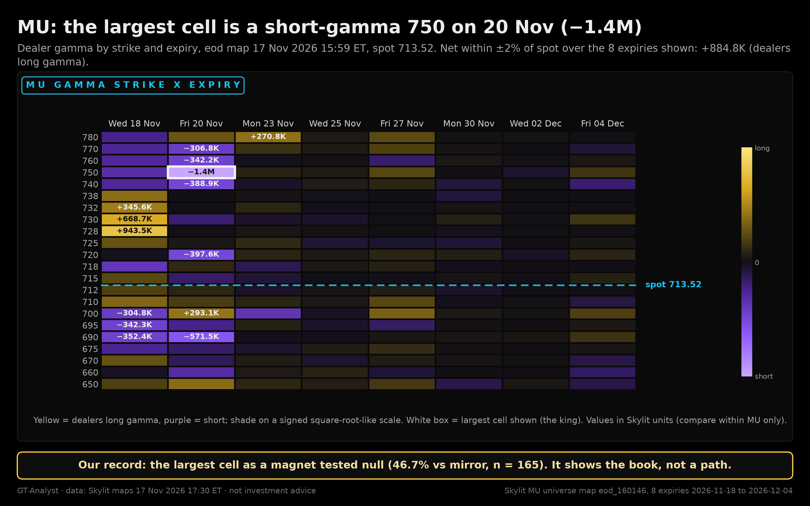
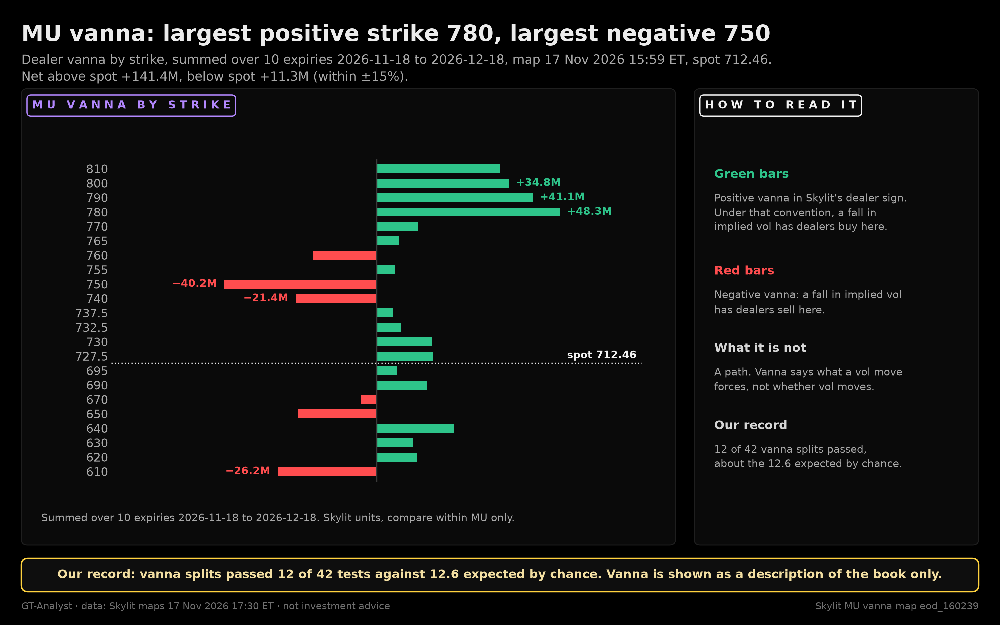
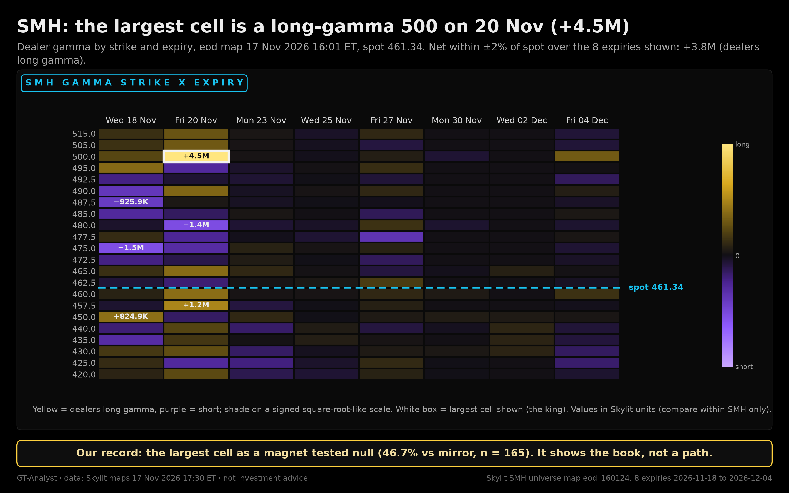
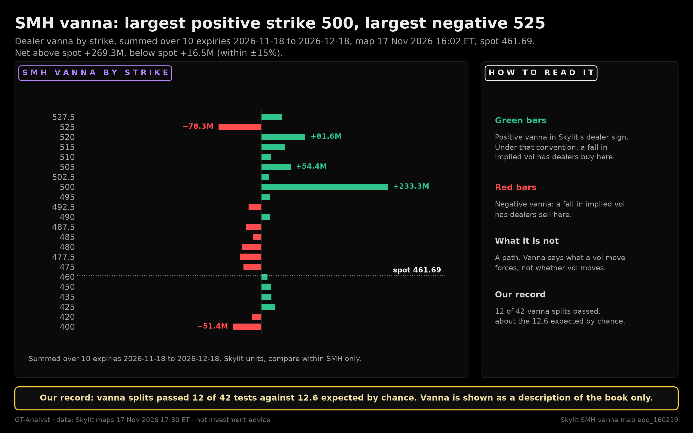
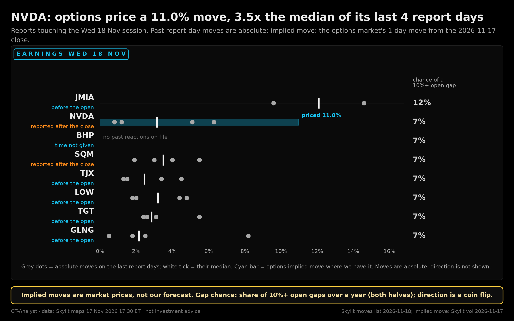
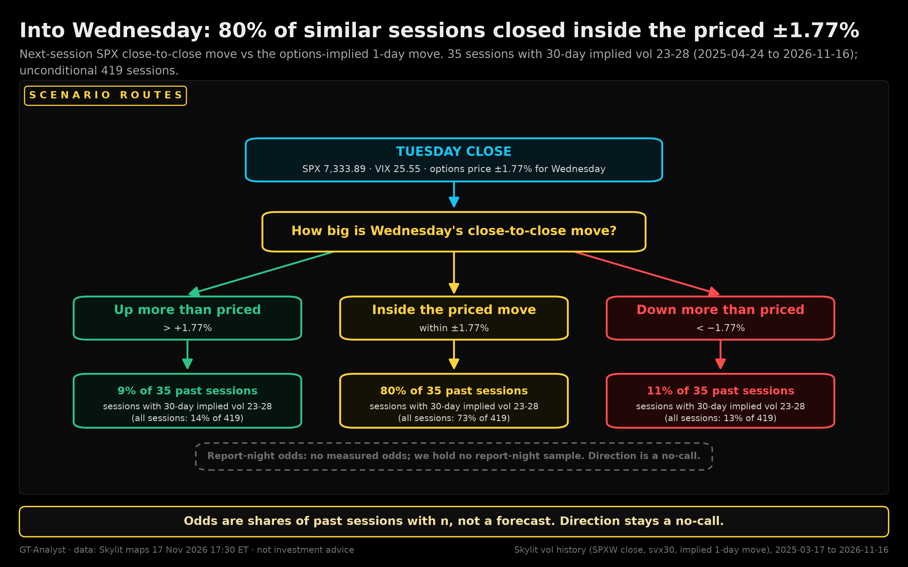

# US market update · overnight into Wednesday 18 November 2026 (map 17:30 ET)

*SPX closed −1.12% at 7,333.89; options price ±1.77% for Wednesday.*

## The day's events

Two Fed policymakers leaned further toward tightening: Governor Waller said a half-point move should be considered if inflation stays hot, and St. Louis Fed president Musalem said up to four more hikes may be needed by spring. Futures put about 95% on a quarter-point hike on 9 December. (speeches as reported on the wires; time not given)

US aircraft struck a Revolutionary Guards missile launch site on Qeshm Island, which a US official called self-defense; Iran reports little damage. It is the third US strike day on Iranian territory this month. (Bloomberg via gCaptain; reported 17 Nov 15:14 ET)

Nvidia reported fiscal third-quarter revenue of $115.8bn against $109.1bn expected and raised next year's growth outlook to 75%. (company release; consensus per LSEG as reported by Reuters and CNBC; time not given)

## Key calls

SPX closed −1.12% at 7,333.89. Options price ±1.77% for Wednesday; in 35 similar past sessions the next close stayed inside the priced move 80% of the time. Direction is a no-call.

| Call | Odds | Resolves | What flips it |
|---|---|---|---|
| Today's base case: SPX closed inside 7,405-7,420 | 52% of 260 past sessions | scored at 16:00 ET | MISS (close 7,340.90) |
| Wednesday's close lands inside the priced ±1.77% | 80% of 35 past sessions | Wed 18 Nov 16:00 ET | a close beyond 7,463 or 7,204 |
| Direction of SPX into Wednesday | No call | n/a | n/a |

## How the day closed, and how this morning's map scored

SPX closed at 7,333.89 (−1.12% on 7,416.59), after a high of 7,413.88 at 09:59 and a low of 7,290.92 at 10:55. The VIX finished at 25.55.

Score: this morning's base case was a close inside the 7,405-7,420 band from the 09:30 map. The 16:00 sample was 7,340.90, below (outside) the band. A miss: the band described where gamma sat at the open, and price left it once the morning's long-gamma strikes were behind it.

## The overnight map

Levels are cash. Futures traded about 29 points above cash at the 16 Nov close (front ES contract; STALE: our bars end T-1). On the Wed 18 Nov expiry the largest long-gamma strike is 7,310 (+8.2M). Below the map spot of 7,340.53 the drawn strikes are 7,330 (+2.3M), 7,310 (+8.2M). Above it: 7,350 (−6.2M), 7,360 (+2.9M), 7,420 (−2.7M), 7,440 (+2.1M). Our overnight node rule did not survive its holdout, so these are positioning, not stopping points.

*Overnight into Wednesday: 7,310 is the largest long-gamma strike (+8.2M).*

## The map across expiries

Across the next 5 expiries the biggest cell is 7,310 on Wed 18 Nov (+8.2M); net gamma within 1% of the price is +5.7M, so dealers are net long gamma around the price into the open.

*SPX dealer gamma by strike and expiry, overnight map 17:30 ET.*

## Wednesday's expiry: this morning vs tonight

Net gamma on the Wed 18 Nov expiry within 3% of the price went from +22.9M this morning to +13.9M tonight; above the price from +21.1M to +2.3M.

*Wednesday's expiry, 09:30 vs overnight.*

## VIX positioning

Across all listed VIX expiries dealers are net long gamma within 10% of the VIX (+59.3M). The largest short-gamma strike is 20.0 and the largest long-gamma strike 25.0. In principle net long VIX gamma near spot damps the VIX's own moves. We hold no tested rule for VIX positioning, so it is context.

*VIX 25.46: dealers net long gamma near spot (+59.3M); largest short strike 20.0.*

## Single names

MU's eod map (17 Nov 2026 15:59 ET, spot 713.52): the largest cell is 750 on Fri 20 Nov (−1.4M), and net gamma within 2% of spot over the 8 expiries shown is +884.8K, so dealers are net long gamma around the price.

*MU dealer gamma across 8 expiries (17 Nov 2026 15:59 ET). Largest cell 750 on 2026-11-20, −1.4M.*

*MU vanna by strike (17 Nov 2026 15:59 ET): largest positive 780, largest negative 750; net above spot +141.4M, below +11.3M.*

SMH's eod map (17 Nov 2026 16:01 ET, spot 461.34): the largest cell is 500 on Fri 20 Nov (+4.5M), and net gamma within 2% of spot over the 8 expiries shown is +3.8M, so dealers are net long gamma around the price.

*SMH dealer gamma across 8 expiries (17 Nov 2026 16:01 ET). Largest cell 500 on 2026-11-20, +4.5M.*

*SMH vanna by strike (17 Nov 2026 16:02 ET): largest positive 500, largest negative 525; net above spot +269.3M, below +16.5M.*

NVDA: EVENT-STALE: map predates the 17 Nov 16:00 ET release (map 17 Nov 2026 15:59 ET); no levels shown.

*NVDA: options price a 11.0% move, 3.5x the median of its last 4 report days.*

NVDA reported after the close; its options had priced a 11.0% move against a median 3.1% on its last 4 report days. We log the realised move against that price after Wednesday's close.

## Routes into Wednesday

*Routes for Wednesday's session. Inside the priced move: 80% of 35 sessions with 30-day implied vol 23-28; beyond it up 9%, down 11%.*

In 35 past sessions with 30-day implied vol 23-28 the next close landed inside the priced ±1.77% 80% of the time; beyond it up 9%, down 11%. Shares of past sessions, not a forecast.

## Dated watch-list

- Wed 18 Nov 09:30 ET: First cash session after Nvidia's report
- Wed 18 Nov 14:00 ET: Minutes of the October FOMC meeting
- Thu 19 Nov: Shenzhen talks involving China, Russia and Iran (dates per China's foreign ministry)
- Fri 20 Nov 16:00 ET: Monthly options expiry (index and single names)

## Our record

> **Morning band held the close on 52% of 260 sessions vs 44% for its mirror (in-sample, Oct 2025 to 17 Nov 2026). Logged editions so far: 0 of 1 morning bands held the close.**

Bootstrap 95% interval for the band-minus-mirror gap: +1.9 to +15.0 points; in-sample, not pre-registered, so a lead only. The overnight node rule was null on ~370 unseen nights.

## Data and staleness

- Snapshot: 17 Nov 2026 17:30 ET (overnight), fresh (same day).
- Index maps: Skylit per-minute gamma maps (5 expiries per symbol); spot is a 1-minute sample, so highs and lows are sampled, not exchange OHLC.
- Gamma values are Skylit's per-strike units; compare within one symbol only.
- Charm by strike: GAP (not in our Skylit maps). Index vanna (SPX/SPY/QQQ): GAP. Dealer net contracts: GAP.
- Overnight futures: ES/NQ bars cover 06:00-16:14 ET and end 2026-11-16; the night-turn clock needs years of full overnight bars (GAP).
- Macro calendar consensus and prior values: GAP. DXY, yields, metals panels: GAP.
- Never used: Unusual Whales data or cached option chains of unclear source.

---
GT-Analyst · data: Skylit maps 17 Nov 2026 17:30 ET · not investment advice. Levels describe dealer positioning, not targets; no trade, hedge or size is implied.
