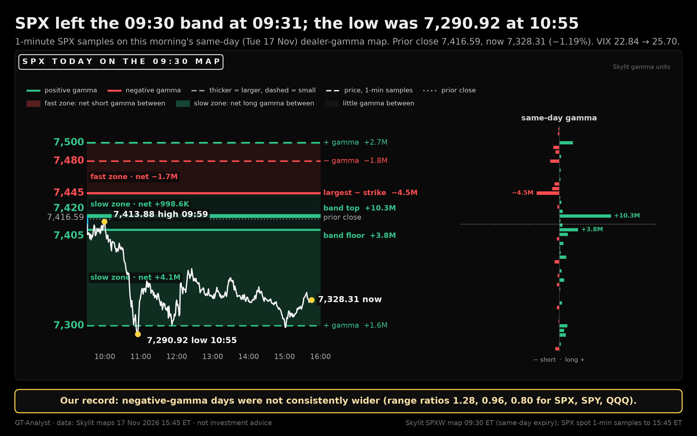
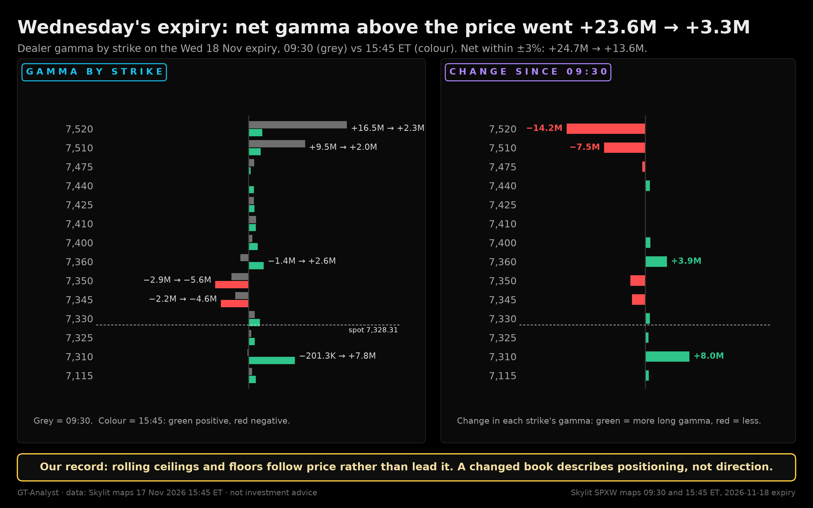
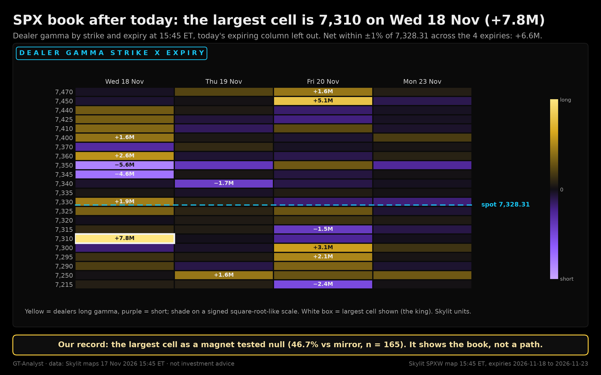
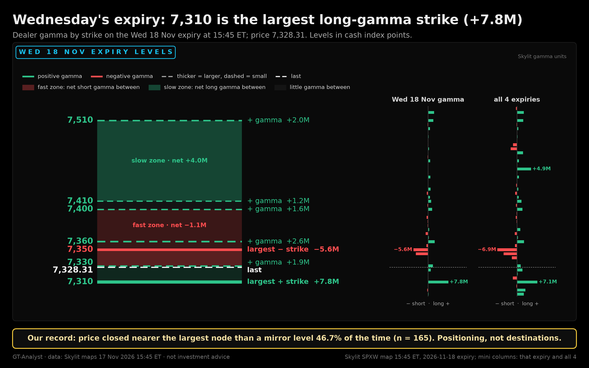
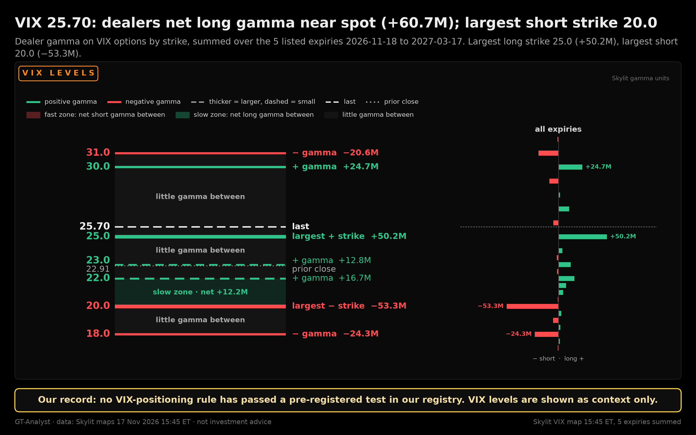
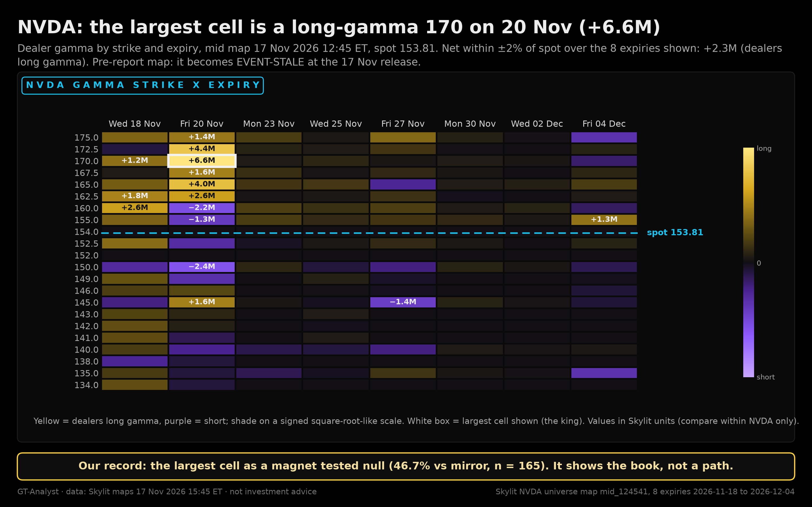
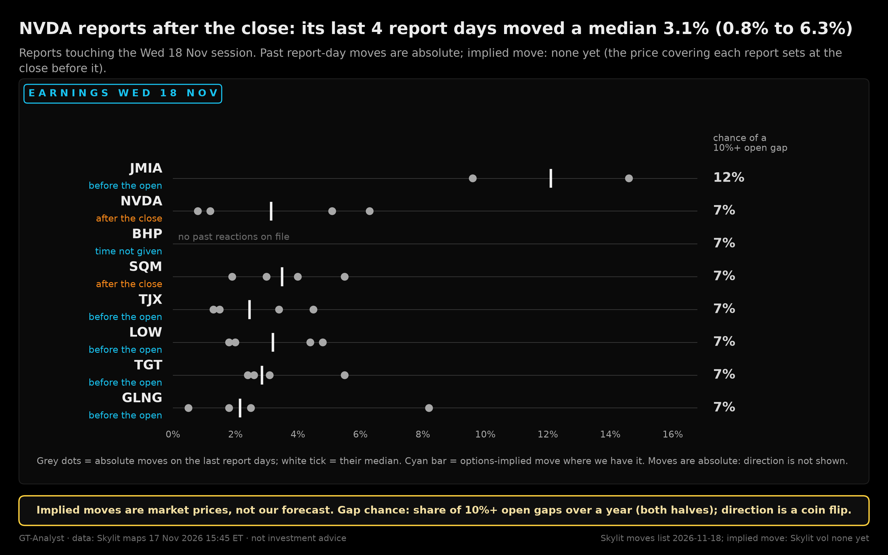
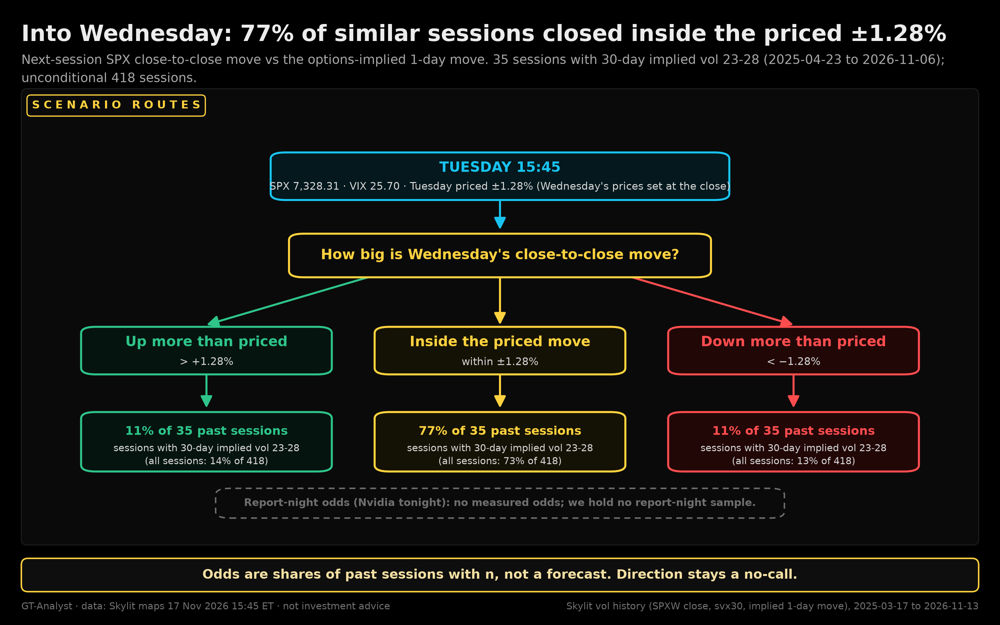

# US market update · Tuesday 17 November 2026 · before the close (15:45 ET)

*SPX down 1.19% at 7,328.31 with the VIX at 25.70; tomorrow's book changed under the price.*

## The day's events

Two Fed policymakers leaned further toward tightening: Governor Waller said a half-point move should be considered if inflation stays hot, and St. Louis Fed president Musalem said up to four more hikes may be needed by spring. Futures put about 95% on a quarter-point hike on 9 December. (speeches as reported on the wires; time not given)

US aircraft struck a Revolutionary Guards missile launch site on Qeshm Island, which a US official called self-defense; Iran reports little damage. It is the third US strike day on Iranian territory this month. (Bloomberg via gCaptain; reported 17 Nov 15:14 ET)

Nvidia reports its fiscal third quarter after the close, five days after its chief executive resigned. (company calendar; time not given)

## Key calls

SPX is −1.19% at 7,328.31. This morning's band broke at 09:31, and Wednesday's book lost most of its long gamma above the price (+23.6M → +3.3M). Odds below are measured base rates with their n; direction is a no-call.

| Call | Odds | Resolves | What flips it |
|---|---|---|---|
| Base case logged at 09:30: SPX closes inside 7,405-7,420 | 53% of 259 past sessions | Tue 17 Nov 16:00 ET | a 16:00 close outside the band (now 7,328.31: outside) |
| Wednesday's close lands inside its priced 1-day move | 77% of 35 past sessions | Wed 18 Nov 16:00 ET | a close-to-close move beyond the priced move (set at today's close) |
| Direction of SPX into Wednesday | No call | n/a | n/a |

## What happened today

SPX opened at 7,411.02, made its high of 7,413.88 at 09:59 and its low of 7,290.92 at 10:55, and stands at 7,328.31 (−1.19% on the prior close of 7,416.59). The VIX went from 22.84 at the open to a 27.71 high at 11:54 and 25.70 now. Options had priced a ±1.28% day from the prior close; the move so far is 1.19%, inside that.

This morning's map put the band between 7,405 and 7,420, the largest long-gamma same-day strikes either side of the 7,411.02 open. Our logged base case was a close inside that band. Price left the band at 09:31 (7,399.80) and is outside it at 15:45.

*SPX today on this morning's map: high 7,413.88 at 09:59, low 7,290.92 at 10:55, now 7,328.31.*

## Wednesday's expiry: this morning vs now

Net dealer gamma on the Wed 18 Nov expiry within 3% of the price went from +24.7M at 09:30 to +13.6M now; above the price it went from +23.6M to +3.3M. The biggest gain was at 7,310 (−201.3K → +7.8M) and the biggest loss at 7,520 (+16.5M → +2.3M). A book that turns net short above the price means fewer brakes in that direction; our tests could not turn that into a forecast.

*Wednesday's expiry, 09:30 vs 15:45: net within 3% +24.7M → +13.6M; above the price +23.6M → +3.3M.*

## The map across expiries

Leaving out today's expiring column, the biggest single cell in the book is 7,310 on the Wed 18 Nov expiry (+7.8M). Net gamma within 1% of the price across the 4 remaining expiries is +6.6M, so dealers are net long gamma around the price going into the night.

*SPX dealer gamma by strike and expiry at 15:45 ET; largest cell 7,310 on Wed 18 Nov (+7.8M).*

## Wednesday's map as it stands

On the Wed 18 Nov expiry the largest long-gamma strike is 7,310 (+7.8M). Above, the long-gamma strikes are 7,330 (+1.9M), 7,360 (+2.6M), 7,400 (+1.6M), 7,410 (+1.2M), 7,510 (+2.0M). These describe positioning at 15:45; the overnight edition re-reads them at 17:30 ET.

*Wednesday's expiry: 7,310 is the largest long-gamma strike (+7.8M).*

## VIX positioning

Across all listed VIX expiries dealers are net long gamma within 10% of the VIX (+60.7M). The largest short-gamma strike is 20.0 and the largest long-gamma strike 25.0. In principle net long VIX gamma near spot damps the VIX's own moves. We hold no tested rule for VIX positioning, so it is context.

*VIX 25.70: dealers net long gamma near spot (+60.7M); largest short strike 20.0.*

## Single names into tonight's reports

NVDA's mid map (17 Nov 2026 12:45 ET, spot 153.81): the largest cell is 170 on Fri 20 Nov (+6.6M), and net gamma within 2% of spot over the 8 expiries shown is +2.3M, so dealers are net long gamma around the price. Pre-report map: it becomes EVENT-STALE at the 17 Nov release.

*NVDA dealer gamma across 8 expiries (17 Nov 2026 12:45 ET). Largest cell 170 on 2026-11-20, +6.6M.*

*NVDA reports after the close: its last 4 report days moved a median 3.1% (0.8% to 6.3%).*

NVDA vanna: no Skylit vanna map at or before 15:45 ET (the vanna batch runs at 16:00 ET only).

## Routes into Wednesday

*Routes for Wednesday's session. Inside the priced move: 77% of 35 sessions with 30-day implied vol 23-28; beyond it up 11%, down 11%.*

In 35 past sessions with 30-day implied vol 23-28, the next close landed inside the priced move 77% of the time, beyond it on the upside 11% and on the downside 11%. These are shares of past sessions with their n, not a forecast, and they do not condition on tonight's report. Direction stays a no-call.

## What would change the picture

- The overnight map (17:30 ET) moves the largest long-gamma strike on the Wed 18 Nov expiry away from 7,310, or its size falls below half of +7.8M.
- Net gamma above the price on the Wed 18 Nov expiry turns back positive (now +3.3M).
- The VIX closes back under 23 (now 25.70): the vol-bracket base rates above would then be read from a different bucket.

## Dated watch-list

- Wed 18 Nov 14:00 ET: Minutes of the October FOMC meeting
- Thu 19 Nov: Shenzhen talks involving China, Russia and Iran (dates per China's foreign ministry)
- Fri 20 Nov 16:00 ET: Monthly options expiry (index and single names)

## Our record

> **Morning band held the close on 53% of 259 sessions vs 44% for its mirror (in-sample, Oct 2025 to 16 Nov 2026). No logged edition has been scored yet.**

Bootstrap 95% interval for the gap between the band and its mirror: +1.9 to +15.1 points. It is in-sample and was not pre-registered, so it stays a lead, not a rule. Our other measured results are null: the largest node as a magnet (46.7% vs mirror, n = 165), the gamma-sign range test (1.28 / 0.96 / 0.80) and vanna splits at chance (12 of 42).

## Data and staleness

- Snapshot: 17 Nov 2026 15:45 ET (live), fresh (same day).
- Index maps: Skylit per-minute gamma maps (5 expiries per symbol); spot is a 1-minute sample, so highs and lows are sampled, not exchange OHLC.
- Gamma values are Skylit's per-strike units; compare within one symbol only.
- Charm by strike: GAP (not in our Skylit maps). Index vanna (SPX/SPY/QQQ): GAP. Dealer net contracts: GAP.
- Overnight futures: ES/NQ bars cover 06:00-16:14 ET and end 2026-11-16; the night-turn clock needs years of full overnight bars (GAP).
- Macro calendar consensus and prior values: GAP. DXY, yields, metals panels: GAP.
- Never used: Unusual Whales data or cached option chains of unclear source.

---
GT-Analyst · data: Skylit maps 17 Nov 2026 15:45 ET · not investment advice. Levels describe dealer positioning, not targets; no trade, hedge or size is implied.
