# US market update · overnight into Friday 20 November 2026 (map 17:30 ET)

*SPX closed −1.98% at 7,178.75; options price ±1.99% for Friday.*

## The day's events

The S&P 500 fell 2.0% to 7,176, its sixth straight loss; the Nasdaq fell 2.25% and the Dow about 1,100 points, under 50,000. The wires tied the late slide to renewed rate-hike talk and to money rotating toward the Anthropic debut. (Yahoo Finance live blog; Motley Fool; 24/7 Wall St.; reported 19 Nov 16:10 ET)

Anthropic began trading at 08:50 PT, opening about 34% above its $83 offer price and closing about 17% above it. Alphabet and CoreWeave fell as holders re-priced stakes and took profits. (Yahoo Finance; Motley Fool; reported 19 Nov 11:50 ET)

AMD fell about 8% after a short seller disclosed a position; Nvidia slid again as investors weighed its chief executive's departure against a quarter that doubled revenue and profit. Chips turned red at 09:24 PT. (CNBC; Yahoo Finance; Motley Fool; reported 19 Nov 11:04 ET)

The Trump-Xi meetings ended with little change on chips, rare earths or tariffs. (Yahoo Finance; reported 19 Nov 08:27 ET)

## Key calls

SPX closed −1.98% at 7,178.75. Options price ±1.99% for Friday; in 389 similar past sessions the next close stayed inside the priced move 74% of the time. Direction is a no-call.

| Call | Odds | Resolves | What flips it |
|---|---|---|---|
| Today's base case: SPX closed inside 7,300-7,400 | 52% of 262 past sessions | scored at 16:00 ET | MISS (close 7,177.56) |
| Friday's close lands inside the priced ±1.99% | 74% of 389 past sessions | Fri 20 Nov 16:00 ET | a close beyond 7,321 or 7,036 |
| Direction of SPX into Friday | No call | n/a | n/a |

## How the day closed, and how this morning's map scored

SPX closed at 7,178.75 (−1.98% on 7,323.63), after a high of 7,389.26 at 09:30 and a low of 7,177.56 at 16:00. The VIX finished at 28.56.

Score: this morning's base case was a close inside the 7,300-7,400 band from the 09:30 map. The 16:00 sample was 7,177.56, below (outside) the band. A miss: the band described where gamma sat at the open, and price left it once the morning's long-gamma strikes were behind it.

## The overnight map

Levels are cash. Futures traded about 9 points above cash at the 19 Nov close (front ES contract; same day). On the Fri 20 Nov expiry the largest long-gamma strike is 7,300 (+4.1M). Below the map spot of 7,175.83 the drawn strikes are 7,165 (+1.8M), 7,155 (+2.6M), 7,140 (−3.3M). Above it: 7,215 (−4.4M), 7,300 (+4.1M), 7,340 (−1.7M). Our overnight node rule did not survive its holdout, so these are positioning, not stopping points.

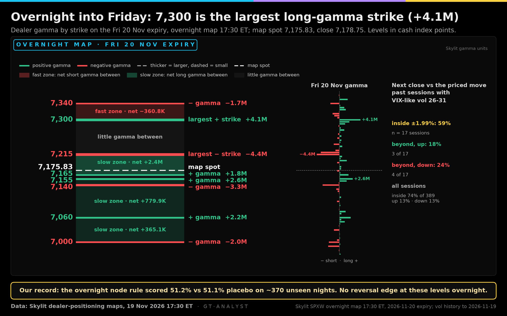

*Overnight into Friday: 7,300 is the largest long-gamma strike (+4.1M).*

## The map across expiries

Across the next 5 expiries the biggest cell is 7,215 on Fri 20 Nov (−4.4M); net gamma within 1% of the price is −12.6M, so dealers are net short gamma around the price into the open.

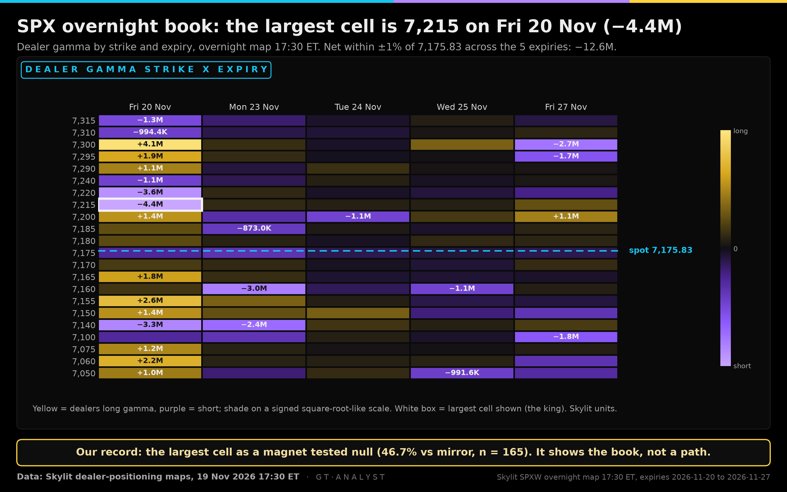

*SPX dealer gamma by strike and expiry, overnight map 17:30 ET.*

## Friday's expiry: this morning vs tonight

Net gamma on the Fri 20 Nov expiry within 3% of the price went from +22.9M this morning to +2.8M tonight; above the price from +24.3M to +2.2M.

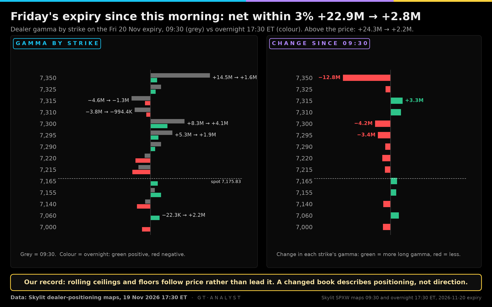

*Friday's expiry, 09:30 vs overnight.*

## VIX positioning

Across all listed VIX expiries dealers are net short gamma within 10% of the VIX (−5.9M). The largest short-gamma strike is 20.0 and the largest long-gamma strike 22.0. In principle net short VIX gamma near spot lets a vol spike feed itself. We hold no tested rule for VIX positioning, so it is context.

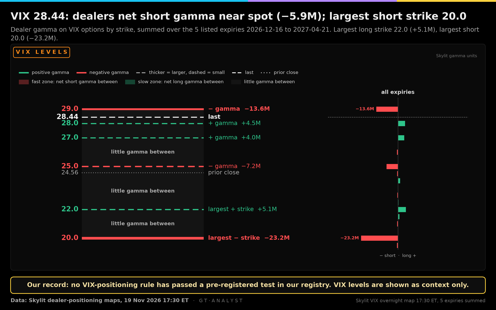

*VIX 28.44: dealers net short gamma near spot (−5.9M); largest short strike 20.0.*

## Single names

SMH's eod map (19 Nov 2026 16:01 ET, spot 446.89): the largest cell is 500 on Fri 20 Nov (+3.1M), and net gamma within 2% of spot over the 8 expiries shown is +3.3M, so dealers are net long gamma around the price.

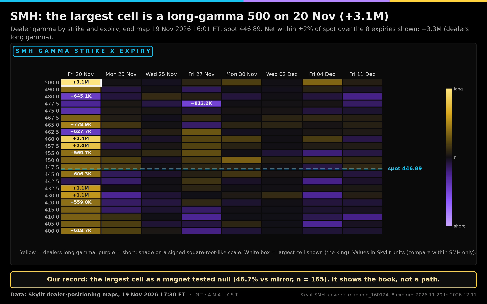

*SMH dealer gamma across 8 expiries (19 Nov 2026 16:01 ET). Largest cell 500 on 2026-11-20, +3.1M.*

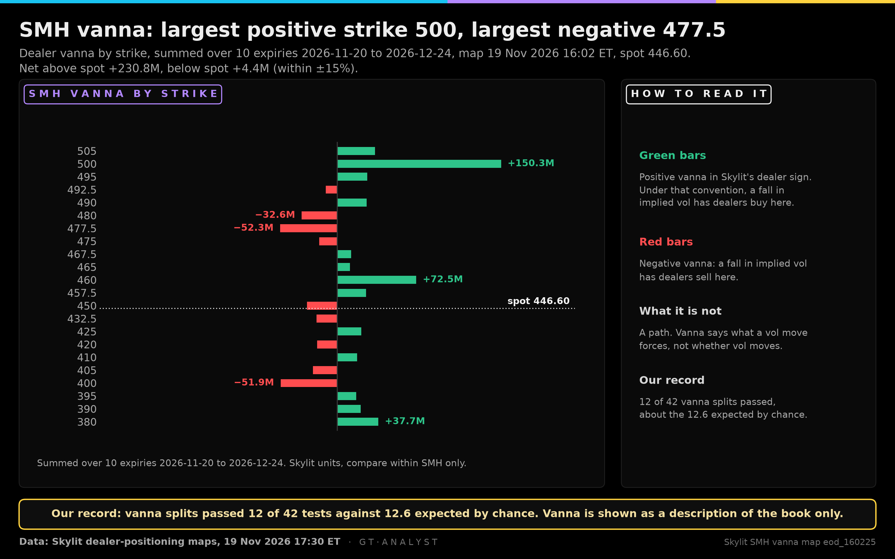

*SMH vanna by strike (19 Nov 2026 16:02 ET): largest positive 500, largest negative 477.5; net above spot +230.8M, below +4.4M.*

NVDA's eod map (19 Nov 2026 15:59 ET, spot 145.71): the largest cell is 150 on Fri 20 Nov (−11.4M), and net gamma within 2% of spot over the 8 expiries shown is +12.4M, so dealers are net long gamma around the price.

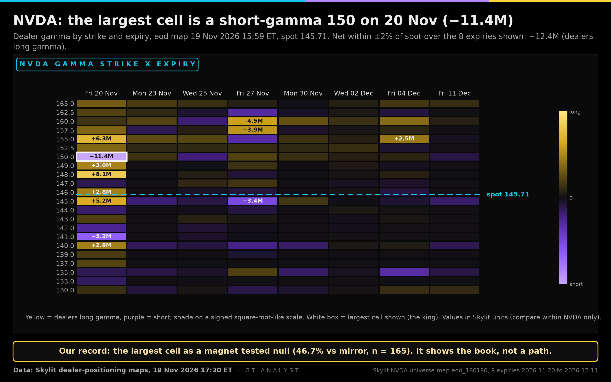

*NVDA dealer gamma across 8 expiries (19 Nov 2026 15:59 ET). Largest cell 150 on 2026-11-20, −11.4M.*

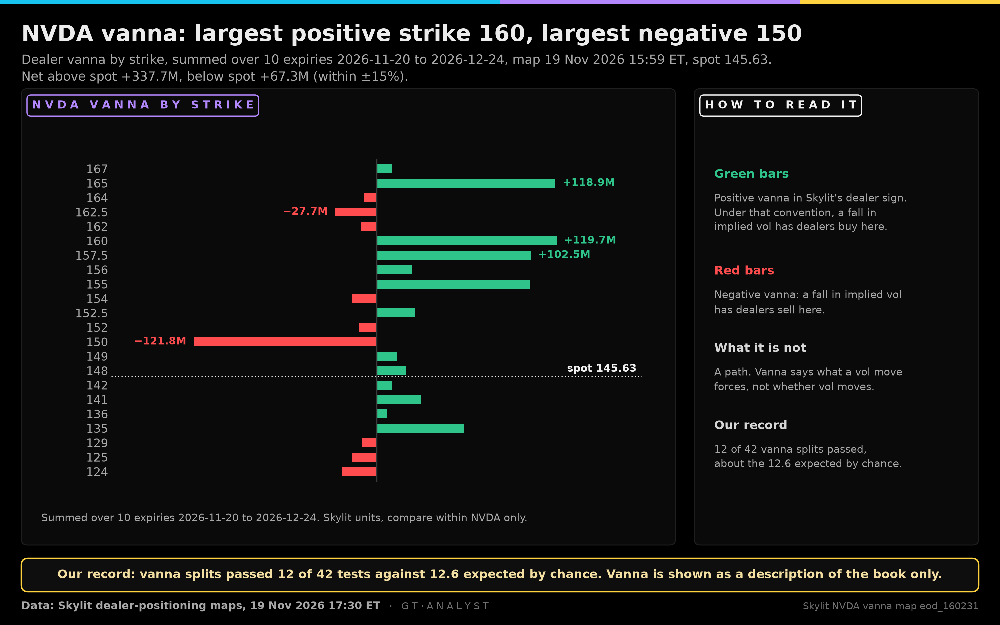

*NVDA vanna by strike (19 Nov 2026 15:59 ET): largest positive 160, largest negative 150; net above spot +337.7M, below +67.3M.*

AMD's eod map (19 Nov 2026 15:59 ET, spot 487.60): the largest cell is 520 on Fri 20 Nov (+1.8M), and net gamma within 2% of spot over the 8 expiries shown is +3.7M, so dealers are net long gamma around the price.

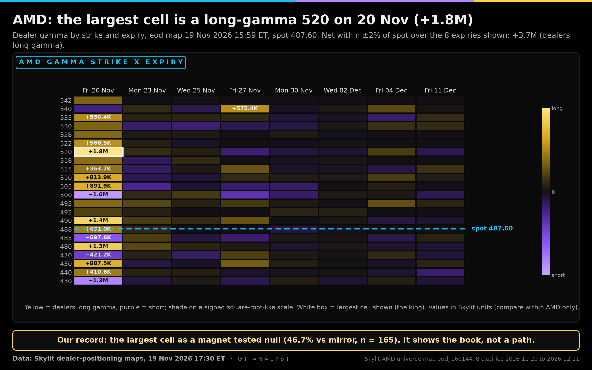

*AMD dealer gamma across 8 expiries (19 Nov 2026 15:59 ET). Largest cell 520 on 2026-11-20, +1.8M.*

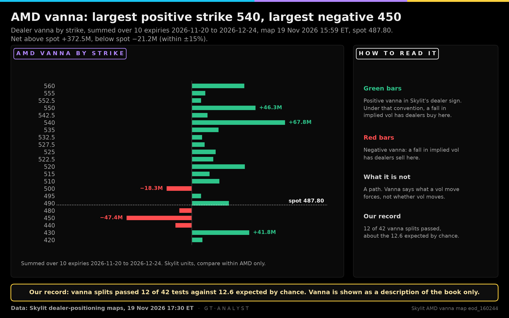

*AMD vanna by strike (19 Nov 2026 15:59 ET): largest positive 540, largest negative 450; net above spot +372.5M, below −21.2M.*

MSFT's eod map (19 Nov 2026 15:59 ET, spot 498.09): the largest cell is 500 on Fri 20 Nov (+8.2M), and net gamma within 2% of spot over the 8 expiries shown is +12.1M, so dealers are net long gamma around the price.

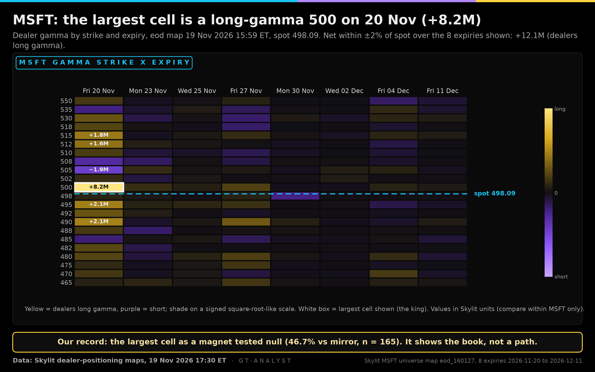

*MSFT dealer gamma across 8 expiries (19 Nov 2026 15:59 ET). Largest cell 500 on 2026-11-20, +8.2M.*

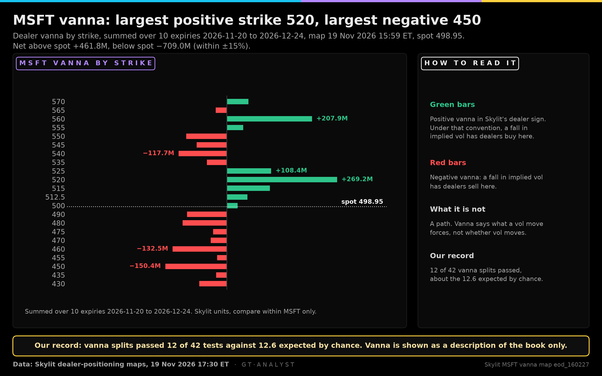

*MSFT vanna by strike (19 Nov 2026 15:59 ET): largest positive 520, largest negative 450; net above spot +461.8M, below −709.0M.*

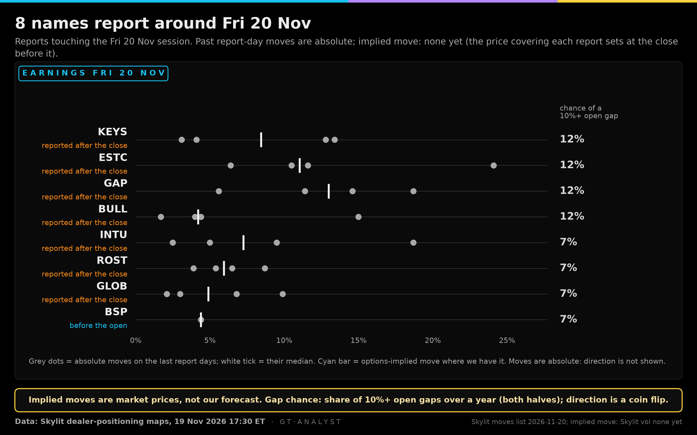

*8 names report around Fri 20 Nov.*

## Routes into Friday

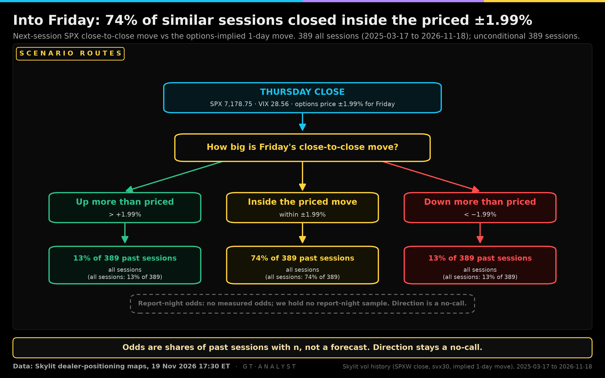

*Routes for Friday's session. Inside the priced move: 74% of 389 all sessions; beyond it up 13%, down 13%.*

In 389 past all sessions the next close landed inside the priced ±1.99% 74% of the time; beyond it up 13%, down 13%. Shares of past sessions, not a forecast.

## Dated watch-list

- Thu 19 Nov 16:05 ET: Keysight, Elastic, Gap and Webull report after Thursday's close; their reaction session is Friday.
- Fri 20 Nov 09:30 ET: Friday 20 Nov is the monthly options expiry: the S&P monthly settles at the 06:30 PT open; the rest expires at 13:00 PT.
- Thu 26 Nov 09:30 ET: Thanksgiving week: US markets are closed Thursday 26 Nov and close early Friday 27 Nov.

## Our record

> **Morning band held the close on 52% of 262 sessions vs 44% for its mirror (in-sample, Oct 2025 to 19 Nov 2026). Logged editions so far: 0 of 2 morning bands held the close.**

Bootstrap 95% interval for the band-minus-mirror gap: +1.9 to +14.9 points; in-sample, not pre-registered, so a lead only. The overnight node rule was null on ~370 unseen nights.

## Data and staleness

- Snapshot: 19 Nov 2026 17:30 ET (overnight), fresh (same day).
- Index maps: Skylit per-minute gamma maps (5 expiries per symbol); spot is a 1-minute sample, so highs and lows are sampled, not exchange OHLC.
- Gamma values are Skylit's per-strike units; compare within one symbol only.
- Charm by strike: GAP (not in our Skylit maps). Index vanna (SPX/SPY/QQQ): GAP. Dealer net contracts: GAP.
- Overnight futures: ES/NQ bars cover 06:00-16:14 ET and end 2026-11-19; the night-turn clock needs years of full overnight bars (GAP).
- Macro calendar consensus and prior values: GAP. DXY, yields, metals panels: GAP.
- Never used: Unusual Whales data or cached option chains of unclear source.

---
GT-Analyst · data: Skylit maps 19 Nov 2026 17:30 ET · not investment advice. Levels describe dealer positioning, not targets; no trade, hedge or size is implied.
